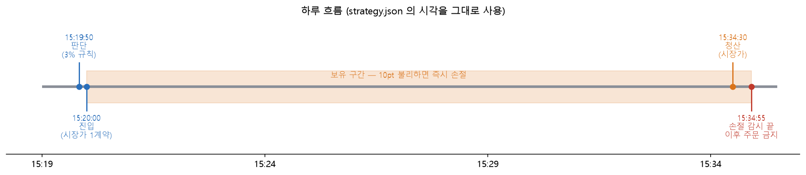
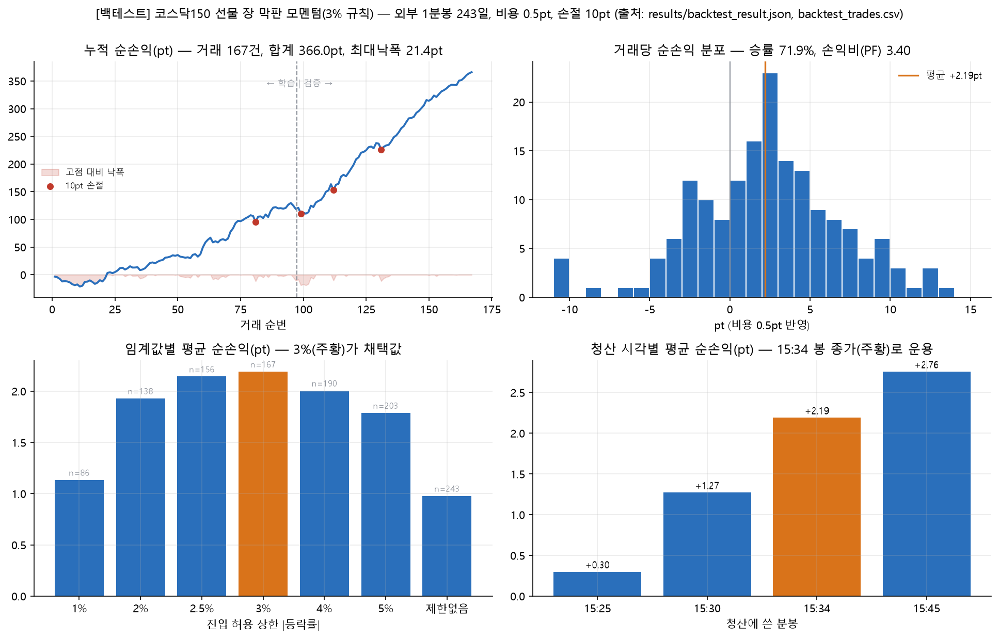
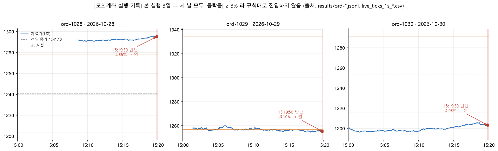

# 2주차 · 국내상품 전략 구현 — 코스닥150 선물 장 막판 모멘텀 추종

**제출일: 2026/10/30(금) 23:59**

> **[백테스트]** 는 과거 데이터 1분봉 위의 계산이고, **[모의계좌 주문]** 은 NH선물 모의 서버에 실제로 낸 주문이며, **[참고용 사후 계산]** 은 거래가 아니라 장 마감 뒤에 한 계산입니다. 자체 시뮬레이션은 수치에 표기하지 않았습니다.
> 모의계좌 본 실행은 10/28·10/29·10/30 세 번 했고, 세 날 모두 15:19:50 등락률이 ±3% 이상이라 규칙대로 쉬었습니다.

| 항목       | 내용                                                                       |
| -------- | ------------------------------------------------------------------------ |
| 대상 종목    | 코스닥150 선물 2026년 12월물 (`A066C000`)                                        |
| 전략       | 15:19:50 등락률이 ±3% 미만이면 그 방향으로 15:20 시장가 진입, 15:34:30 시장가 청산 (재난 손절 10pt) |
| 전략 버전 id | `late-session-momentum` v1                                               |
| 백테스트     | 코스닥150 선물 최근월물 1분봉 1년치 (2025-10-16 ~ 2026-10-26, 243거래일)                 |
| 실행 환경    | [백테스트] + [모의계좌 주문]                                                       |
| 담당       | 이승윤 (전략 설계·검증), 민승기 (전략 보완·구현)                                           |
| 작성일      | 2026/10/30                                                               |

## 과제 요약과 폴더 구성

| 경로                                        | 내용                                                                    |
| ----------------------------------------- | --------------------------------------------------------------------- |
| `README.md`                               | 이 보고서                                                                 |
| `strategy.json`                           | 전략 설정 (모든 파라미터)                                                       |
| `strategy_core.py`                        | 신호·손절·손익 순수 함수, 설정 검증                                                 |
| `runner.py`                               | 하루 한 번 매매 상태머신 (`Trader`)                                             |
| `live.py`                                 | 실시간 체결 수신, 전일 종가 조회, 모의계좌 주문·주문내역 체결 확인                               |
| `paper_fill.py`                           | 자체 시뮬레이션 브로커 (이번 보고서 수치에는 쓰지 않음)                                      |
| `backtest.py`                             | [백테스트] 재구현 (표준 라이브러리만)                                                |
| `run.py`                                  | 실행 진입점 `--env paper --mode backtest\|paper-sim\|paper-order --run-id` |
| `order_smoke.py`                          | 모의 주문 스모크 (지정가 접수·정정·취소, 시장가 왕복, 단일가 프로브)                             |
| `summarize_journal.py`                    | 기록(JSONL) 요약 (읽기 전용)                                                  |
| `skipday_review.py`                       | 쉬는 날 사후 점검 (읽기 전용, 주문 없음)                                             |
| `charts.py`                               | 보고서용 차트 생성 (읽기 전용, matplotlib)                                        |
| `nhapi/`                                  | NH선물 API 클라이언트 (2주차 시점의 사본)                                           |
| `tests/`                                  | 단위 테스트 60개                                                            |
| `requirements.txt`, `config.example.yaml` | 설치·설정                                                                 |
| `results/`                                | 실행 근거 원본·요약·차트(`charts/`), 백테스트 분석(`backtest/`)                       |

## 1. 전략과 매매 계획

### 1-1. 대상 상품

코스닥150 선물 최근월물입니다. 1계약 승수는 1pt = 1만 원이고, 백테스트 기간 평균 진입가 1,660pt 기준 명목금액은 약 1,660만 원입니다. 정규장은 08:45\~15:45 이고 15:35\~15:45 가 종가 단일가입니다. 현물(코스닥 시장)은 15:20\~15:30 이 종가 단일가라 선물이 현물보다 15분 늦게 끝납니다.

실행 월물은 12월물 `A066C000` 입니다(최종거래일 2026-12-10, 틱 0.1pt = 1,000원). 2027년 3월물은 전일 거래량 4계약으로 사실상 거래가 없었고, 12월물은 전일 거래량 189,336, 미결제 415,971 이었습니다(2026-10-27 품목별세부정보·현재가 조회에서 옮긴 값이며, 원문은 작업 폴더에만 두고 제출하지 않았습니다).

### 1-2. 전략을 고른 까닭

레버리지·인버스 ETF 는 매일 장 마감 기준으로 노출 비율을 맞춰야 합니다. 2배 레버리지와 1배 인버스 모두 지수가 오른 날은 사고 내린 날은 팔아야 하고, 그 양은 대략 다음과 같습니다.

$$RD \approx L(L-1)\cdot r \cdot AUM$$

이 물량이 장 마감 직전에 몰리면 가격이 같은 방향으로 한 번 더 밀립니다. 근거로 삼은 논문은 두 편입니다.

- **Baltussen et al. (2021), 「Hedging demand and market intraday momentum」** — 1974\~2020년 주요국 주식·채권·원자재·통화 선물 60여 종에서 장 마감 30분 수익률이 그날 나머지 시간의 수익률과 같은 방향으로 움직이고, 그 원인이 옵션 딜러와 레버리지 ETF 의 감마 헤지 수요라는 것을 보였습니다.
- **성태균·정형찬 (2019), 「레버리지/인버스 ETF가 주가지수 선물시장에 미치는 영향에 관한 연구」** — 국내 레버리지·인버스 ETF 의 재조정 수요가 코스피200·코스닥150 선물의 장 마감 수익률에 영향을 주고, 코스닥150 에서는 다음 날 오전에 반전된다는 것을 보였습니다.

코스닥150 선물은 코스피200 보다 시장이 작고 레버리지·인버스 ETF 의 선물 비중이 커서 효과가 더 뚜렷할 것으로 봤습니다.

이동평균 교차처럼 가격 모양만 보는 신호 대신, **누가 왜 그 시각에 같은 방향으로 거래해야 하는지**가 설명되는 신호를 고르고 싶었습니다.

### 1-3. 매매 규칙 (실행 프로그램 기준, `strategy.json`)

| 단계 | 시각 | 규칙 |
| --- | --- | --- |
| 신호 | 15:19:50 | 현재가(실시간 체결)와 전일 종가로 등락률 r 계산 |
| 판정 | 15:19:50 | r ≠ 0 이고 \|r\| < 3% 이면 진입. r > 0 매수, r < 0 매도. \|r\| ≥ 3% 면 쉼 |
| 진입 | 15:20:00 | 시장가 1계약 |
| 재난 손절 | 15:20 ~ 15:34:55 | 진입가에서 10pt 불리해지면 즉시 시장가 청산 |
| 청산 | 15:34:30 | 반대 방향 시장가 1계약 (연속매매 마지막 구간). 15:34:55 이후에는 주문을 내지 않음 |
| 제외 | — | 최종거래일 (최근월물이 15:20 에 끝남) |
| 한도 | — | 최대 보유 1계약, 일일 손실 한도 300,000원 |

처음 설계의 청산은 15:36 반대 시장가로 내서 15:45 종가 단일가에 체결되는 방식이었습니다. 실행 프로그램은 이를 15:34:30 연속매매 청산으로 바꿨고, 이유는 1-4절과 10절에 적었습니다. 아래 2절의 백테스트(①~⑥)는 **원래 설계(15:45 종가 단일가 청산, 손절 없음)** 의 결과이고, 실행 규칙과 같은 조건의 백테스트는 2-2절 ⑦에 따로 적었습니다.

### 1-4. 규칙마다 그렇게 정한 까닭

- **15:20 진입:** 15:20 부터 현물 시장은 종가 단일가(15:20\~15:30)에 들어가 접속매매가 멈추고, 선물은 15:45 까지 계속 거래됩니다. 이 시점이면 그날 지수 등락이 거의 정해져 레버리지·인버스 ETF 가 맞춰야 할 노출도 대부분 확정됩니다. 그래서 현물로 바로 사고팔 수 없는 15:20 이후의 리밸런싱·헤지 물량은 선물 쪽으로 몰릴 것이라고 봤습니다. 실제로 백테스트에서 막판 수익은 15:20\~15:29 에 +1.22pt, 현물이 마감된 15:30\~15:45 에 +2.07pt 로 나타났습니다.
- **청산 시각을 15:34:30 으로 변경:** 원래는 종가 단일가 체결가가 청산가라 청산 쪽 슬리피지가 없다는 점이 장점이었습니다(백테스트 평균 +2.76pt, 비용 0.5pt 기준). 그러나 10/28 15:36 프로브에서 단일가 구간(15:35\~15:45)에 낸 주문이 주문번호는 받았지만 주문내역에 '미접수'로 남고 취소가 `5039` 로 거부됐습니다. 청산 주문이 접수되지 않으면 포지션이 밤새 남을 수 있어, 체결이 확실한 15:34:30 연속매매 청산으로 바꿨습니다. 대가는 백테스트 평균 약 0.57pt 감소입니다(2-2절 ⑦). 15:45 이후 관찰은 모의 운영시간(09:00\~15:45) 이후라 참고로만 쓰며, 단일가 청산이 체결되는지는 확인하지 못했습니다.
- **재난 손절 10pt:** 백테스트에서는 손절 없이도 최악 1회 손실이 −15.4pt 였습니다. 손실 한도(일일 300,000원)가 있는 실행에서 최악 1회 손실을 100,000원으로 제한하기 위한 안전장치이며, 백테스트에서 4번 발동했고 평균은 거의 바뀌지 않았습니다(2-2절 ⑦).
- **3% 기준:** 학습 구간(~2026-04)에서 정했습니다. 학습 구간에서 3% 이상 움직인 33일은 같은 방향으로 들어가면 평균 약 −4.5pt 로 크게 깨졌고(②의 13건·12건·8건 구간 합 −149pt ÷ 33일), 그중에서도 6% 넘게 움직인 8일(평균 −14pt)에 손실이 몰려 있었습니다.
- **당일 청산:** 막판에 밀린 가격은 다음 날 아침에 되돌려집니다(2-2절 ⑤). 오버나이트로 들고 가면 번 것을 돌려줍니다.
- **1계약:** 이번 주는 규칙대로 돌아가는지 확인하는 것이 목적이라 크기를 늘리지 않았습니다.

### 1-5. 전략의 한계와 약점

- 데이터가 1년치이고, 그 1년이 코스닥150 이 2,100 과 1,060 사이를 오간 변동성 큰 장이었습니다.
- 3% 기준이 왜 생기는지는 가격 데이터만으로 설명하지 못했습니다. 리밸런싱 물량은 r 에 비례하므로 큰 날일수록 효과가 커야 하는데 오히려 사라집니다. 3-2절에 확인한 것과 못 한 것을 나눠 적었습니다.
- ETF 순자산 규모가 클수록 효과가 커지는지는 이 데이터로 확인하지 못했습니다.
- 3% 임계값과 10pt 손절폭은 같은 자료를 본 뒤 정한 값이라 선택 편향이 있습니다.

## 2. 백테스트 결과

### 2-1. 결과 파일

백테스트 원본 데이터는 팀 저장소 [`week02/results/backtest/`](https://github.com/baseball2000212-coder/NH_pioneer_VolSkew/tree/main/week02/results/backtest) 에 있습니다.

| 파일 | 내용 |
| --- | --- |
| [trades.csv](results/backtest/trades.csv) | 243거래일 매매기록 (신호, 진입가, 청산가, 수수료, 손익) |
| [summary.json](results/backtest/summary.json) | 전체·학습·검증 요약, 단순 보유 비교 |
| [range_breakdown.csv](results/backtest/range_breakdown.csv) | 등락률 구간별 성과 (학습·검증·전체) |
| [intraday_placebo.csv](results/backtest/intraday_placebo.csv) | 같은 규칙을 다른 시각에 적용한 결과 |
| [late_split.csv](results/backtest/late_split.csv) | 막판 25분을 현물 마감 전·후로 나눈 결과 |
| [next_day_reversal.csv](results/backtest/next_day_reversal.csv) | 다음 날 아침 반전 회귀 |
| [vs_buy_and_hold_daily.csv](results/backtest/vs_buy_and_hold_daily.csv) | 단순 보유와 일별 비교 |

실행 프로그램으로 다시 계산한 ⑦의 근거 파일은 `results/backtest_result.json`, `results/backtest_trades.csv`, `results/backtest_input_daily.csv` 입니다.

### 2-2. 성과와 검증

2025-10-15 \~ 2026-10-26 의 252거래일입니다. 첫날은 전일 종가로만 쓰고, 최종거래일 4일과 롤오버 다음 날 4일을 빼서 243거래일이 남았습니다. 학습 구간(\~2026-04-30)에서 규칙을 정하고 검증 구간(2026-05-01\~)에는 그대로 적용했습니다. 수수료는 편도 0.0098%(명목금액 기준, 왕복 평균 약 0.33pt)를 뺐습니다. 데이터는 한국투자증권 Open API 로 받은 코스닥150 선물 최근월물 1분봉입니다. **①~⑥은 15:45 종가 단일가 청산, 손절 없음 기준 [백테스트] 입니다.**

**① 성과**

| 구간 | 거래 | 평균 | 승률 | 누적 | 최대낙폭 | t |
| --- | --- | --- | --- | --- | --- | --- |
| 전체 | 167 | +2.96pt | 73% | +495pt | −24.2pt | 7.58 |
| 학습 | 97 | +2.01pt | 66% | +195pt | −15.2pt | 4.12 |
| 검증 | 70 | +4.28pt | 83% | +299pt | −17.0pt | 7.00 |
| 전체 (최악가 진입) | 167 | +1.61pt | 69% | +269pt | −30.7pt | 4.52 |

최악가 진입은 매수면 15:20 봉 고가, 매도면 저가에 샀다고 가정한 값입니다. 진입가 대비로 보면 거래당 평균 +0.181% (학습 +0.112%, 검증 +0.276%) 입니다. 매수 85건 평균 +2.22pt, 매도 82건 평균 +3.74pt 로 양쪽 모두 플러스입니다.


**② 등락률 구간별 성과**

15:19 등락률을 구간으로 나눠, 각 구간의 날에 같은 규칙(15:20 같은 방향 진입, 15:45 청산, 수수료 차감)을 적용한 결과입니다. 3% 기준은 학습 구간에서 정했습니다.

| 15:19 등락률 | 학습 구간 | 검증 구간 | 전체 |
| --- | --- | --- | --- |
| 0\~1% | 54건 · +0.93pt · 승률 57% | 32건 · +3.18pt · 승률 75% | 86건 · +1.77pt (t = 3.05) |
| 1\~2% | 29건 · +3.44pt · 승률 76% | 23건 · +5.21pt · 승률 87% | 52건 · +4.22pt (t = 6.67) |
| 2\~3% | 14건 · +3.24pt · 승률 79% | 15건 · +5.19pt · 승률 93% | 29건 · +4.25pt (t = 5.66) |
| 3\~4% | 13건 · +0.17pt · 승률 54% | 10건 · +3.66pt · 승률 100% | 23건 · +1.69pt (t = 2.33) |
| 4\~6% | 12건 · −2.95pt · 승률 25% | 14건 · −0.48pt · 승률 57% | 26건 · −1.62pt (t = −1.37) |
| 6% 이상 | 8건 · −14.44pt · 승률 25% | 19건 · +1.65pt · 승률 79% | 27건 · −3.12pt (t = −0.90) |

1\~3% 구간이 학습·검증 모두 가장 강하고, 3% 를 넘으면 학습 구간에서 수익이 사라지거나 크게 깨집니다(3\~6% 25건 누적 −33pt, 6% 이상 8건 누적 −116pt). 검증 구간에서는 3\~4% 가 아직 플러스였지만 4\~6% 는 마이너스이고 6% 이상은 유의하지 않습니다. 3% 이상인 날을 모두 합치면 학습 −149pt, 검증 +61pt, 전체 −87pt 로, 3% 미만(전체 +495pt)과 달리 수익이 나지 않았습니다.

**③ 효과는 장 막판에만 있습니다**

같은 규칙(그 시각까지 등락률 3% 미만이면 같은 방향, 25분 보유)을 시각만 바꿔 적용했습니다.

| 진입 | 10:00 | 11:00 | 13:00 | 14:00 | 14:30 | 15:00 | **15:20** |
| --- | --- | --- | --- | --- | --- | --- | --- |
| 평균 (pt, 수수료 전) | −0.23 | −0.44 | +0.88 | −0.20 | −0.44 | +0.61 | **+3.29** |
| t | −0.21 | −0.66 | 2.07 | −0.35 | −0.78 | 1.00 | **8.41** |


**④ 막판 수익의 2/3 는 현물 마감 뒤에 나옵니다**

| 구간 | 평균 (pt, 수수료 전) | t |
| --- | --- | --- |
| 15:20~15:29 (현물 종가 단일가 중) | +1.22 | 4.66 |
| 15:30~15:45 (현물 마감 뒤, 선물만 거래) | +2.07 | 6.87 |

현물 종가가 정해지면 ETF 가 그날 맞춰야 할 노출도 정해지고, 그 뒤 선물로 물량을 맞춘다는 설명과 맞습니다.

**⑤ 막판에 밀린 가격은 다음 날 아침에 되돌려집니다**

막판 25분 수익률을 다음 날 아침 수익률에 회귀했습니다. 15:19 까지 등락률을 함께 넣었고 표준오차는 White 방식입니다.

| 종속변수 | 전체 240일 β (t) | 3% 미만 166일 β (t) |
| --- | --- | --- |
| 다음 날 시가 갭 | −0.56 (−2.40) | −0.33 (−1.09) |
| 종가 → 다음 날 09:30 | −1.03 (−2.73) | −0.40 (−0.82) |
| 종가 → 다음 날 10:00 | −1.26 (−3.13) | −0.42 (−0.75) |

전체 기준으로 β 가 −1 근처라, 막판에 밀린 만큼이 다음 날 10:00 까지 거의 다 되돌려집니다. 성태균·정형찬(2019)이 코스닥150 에서 본 과잉반응 뒤 반전과 같은 방향이고, 당일 청산 규칙의 근거입니다. 3% 미만인 날만 보면 부호는 같지만 막판 움직임이 작아(평균 약 20bp) 유의하지 않습니다.

**⑥ 최근월물 단순 보유와 비교**

같은 기간(2025-10-15 종가 ~ 2026-10-26 종가, 251거래일)에 최근월물 1계약을 계속 들고 있었을 때와 비교했습니다. 롤오버는 최종거래일 마지막 가격에 팔고 다음 거래일 09:00 시가에 새 월물을 사는 것으로 가정했고(4회), 수수료는 똑같이 편도 0.0098% 를 뺐습니다. 수익률은 매일 그날 명목금액 대비(증거금 대비가 아님)로 계산해 복리로 이었고, 변동성과 샤프는 일별 수익률을 연환산(√252)했습니다(무위험수익률 0).

| | 3% 미만 룰 | 최근월물 단순 보유 |
| --- | --- | --- |
| 누적 손익 (1계약) | **+495pt (+495만 원)** | −227pt (−227만 원) |
| 누적 수익률 (명목, 복리) | **+35.2%** | −15.2% |
| 연환산 수익률 | +35.3% | −15.2% |
| 연환산 변동성 | **4.1%** | 58.3% |
| 샤프 비율 | **7.46** | 0.01 |
| 최대낙폭 (pt) | −24.2pt | −1,130.5pt |
| 최대낙폭 (명목) | −1.2% | −52.0% |
| 칼마 비율 (연환산 수익률 ÷ 최대낙폭) | 29.9 | −0.29 |
| 기간 중 최고 누적 수익률 | +35.2% | +49.3% |
| 보유 기간 | 167일 × 25분 | 251일 내내 |
| 일별 수익률 상관 | −0.03 | |

같은 증거금으로 단순 보유는 고점에서 +49% 까지 갔다가 −52% 낙폭을 맞고 −15% 로 끝났습니다. 3% 미만 룰은 하루 25분만 들고 변동성 4.1% 로 +35% 를 냈습니다. 다만 이 1년은 코스닥150 이 1,423 에서 1,213 으로 내린 기간이라 누적 손익 비교는 단순 보유에 불리합니다. 상승장이면 단순 보유의 누적 손익이 더 클 수 있으므로 **비교의 핵심은 위험 대비 수익(샤프, 최대낙폭)** 입니다. 전략은 노출 시간이 짧아 명목 기준 변동성이 낮게 나오는 점도 감안해야 합니다. 롤오버한 4번의 밤사이 움직임은 새 월물의 최종거래일 종가가 데이터에 없어 빠져 있습니다.


**⑦ 실행 프로그램과 같은 규칙으로 다시 계산한 결과 [백테스트]**

실행 프로그램(`run.py --mode backtest`)이 같은 1분봉으로 실행 규칙(15:34 봉 종가 청산, 손절 10pt, 왕복 비용 0.5pt)을 그대로 계산했습니다. 팀원 기록 167건과 날짜별 손익이 모두 일치합니다(`results/backtest_result.json` 의 `team_reference_check`: 167/167).

| 설정 | 거래 | 승률 | 평균(pt) | 합(pt) | PF | 최대 낙폭(pt) |
| --- | --- | --- | --- | --- | --- | --- |
| 실행 규칙: 손절 10pt, 비용 0.5pt, 15:34 청산 | 167 | 71.9% | 2.19 | 366.0 | 3.40 | 21.4 |
| ㄴ 학습(~2026-04-30) | 97 | 63.9% | 1.22 | 118.6 | 2.13 | 21.4 |
| ㄴ 검증(2026-05-01~) | 70 | 82.9% | 3.53 | 247.4 | 6.26 | 11.5 |
| 손절 없음, 비용 0.5pt, 15:34 청산 | 167 | 71.9% | 2.24 | 374.0 | 3.59 | 24.1 |

청산 시각별 평균(pt, 비용 0.5pt): 15:25 → 0.30, 15:30 → 1.27, 15:34 → 2.19, 15:45 → 2.76. 비용 0.0/0.2/0.5/1.0pt → 2.69 / 2.49 / 2.19 / 1.69. 손절은 4번 발동했고 합계에 거의 영향이 없었습니다(366.0pt 대 374.0pt). 15:45 청산에서 비용을 팀원 가정(약 0.33pt)으로 맞추면 평균이 약 2.9pt 로 ①의 +2.96pt 와 같은 수준입니다(비용 가정 차이 0.5pt 대 약 0.33pt 를 감안). 손절은 같은 봉 안의 경로를 몰라 손절선 가격에 체결된다고 본 낙관적 가정입니다.

## 3. 결과 해석과 한계

### 3-1. 백테스트 해석

이번 연구는 레버리지·인버스 ETF 의 리밸런싱 물량 자체를 예측하기보다, 리밸런싱이 장 막판 모멘텀을 강화한다는 가설을 세우고 가격 데이터로 그 흔적을 확인하는 방식으로 진행했습니다. 그 결과 장 막판 모멘텀은 중간 정도로 움직인 날에 가장 뚜렷했습니다. 15:19 등락률이 1\~3% 인 날은 학습·검증 구간 모두 거래당 +3pt 이상으로 가장 강했고(전체 81건, 평균 약 +4.2pt), 0\~1% 인 날은 플러스지만 약했습니다. 등락률이 3% 를 넘어서면 모멘텀이 크게 악화되어, 3% 이상인 날을 모두 합치면 전체 −87pt 로 수익이 나지 않았습니다.(2-2절 ②)

수익은 장 막판 25분에만 나오고(③), 그중 2/3 가 현물 마감 뒤에 나오며(④), 다음 날 아침 되돌림이 있습니다(⑤). 시장 방향과의 상관은 거의 0 이고 매수·매도 양쪽이 모두 플러스입니다(①, ⑥). 넷 다 「마감 직전 같은 방향의 일시적 물량」이라는 설명과 맞습니다.

### 3-2. 3% 기준을 통해 확인한 것

리밸런싱 물량이 r 에 비례한다면 크게 움직인 날 효과가 더 커야 하는데, 3% 이상인 날은 막판 효과가 사라집니다. 큰 날 운용사가 장중에 미리 리밸런싱해서 막판에 남는 물량이 적은지 확인하려고, 3% 이상 움직인 76일에 대해 장중 1분 수익률 순서만 무작위로 섞은 기준선(500회)과 비교했습니다. 10:30 \~ 14:30 은 기준선과 차이가 없었고(p = 0.31 \~ 0.60), 09:30 만 기준선을 넘었습니다(p = 0.002). 장 초반 추세는 리밸런싱보다 갭이나 뉴스로 보는 편이 자연스러워서, **장중 리밸런싱의 증거는 찾지 못했습니다.** 즉 변동성이 커지면 커질수록 장 막판 모멘텀이 약해지고 장 중 수익률과는 반대되는 되돌림이 장 막판에 나타났습니다. 이는 저희가 처음에 세웠던 가설을 약화시키기 때문에, 큰 날에 막판 물량을 상쇄하는 다른 흐름이 있을 가능성을 생각했습니다. 국내 개인투자자는 지수가 크게 빠진 날 레버리지 ETF 를, 크게 오른 날 인버스 ETF 를 사는 역추세 매수 경향이 있습니다. 레버리지 ETF 에 자금이 들어오면 운용사와 LP 는 그만큼 선물을 사야 하므로, 하락한 날의 리밸런싱 매도와 반대 방향의 매수가 생깁니다. 장 마감 무렵 ETF 가 실제로 내야 하는 선물 주문은 대략 다음과 같고,

$$\text{순주문} \approx \underbrace{L(L-1)\cdot r \cdot AUM}_{\text{리밸런싱}} + \underbrace{L \cdot \text{순유입}}_{\text{설정·환매}}$$

큰 날일수록 역추세 순유입도 커진다면 두 번째 항이 첫 번째 항을 상쇄해 막판 모멘텀이 약해질 수 있습니다. 이번 데이터는 가격뿐이라 이 설명을 검증하지는 못했습니다. ETF 별 일별 설정·환매(순유입) 자료를 붙여, 큰 날의 순유입이 리밸런싱 물량을 얼마나 상쇄하는지 확인할 계획입니다.

### 3-3. 백테스트 가정과 한계

- **체결:** 15:20 봉 시가에 진입했다고 봤고, 보수적인 경우로 봉의 가장 불리한 가격도 함께 계산했습니다. ①~⑥의 청산은 종가 단일가 체결가를 쓴 것이라 별도 가정이 필요 없지만, **모의 서버에서 단일가 구간 주문이 처리되는지는 확인하지 못했습니다**(1-4절). 실행 규칙(15:34:30 시장가)의 청산가는 15:34 봉 종가로 가정했습니다(⑦).
- **기간:** 1년, 변동성이 큰 장 하나뿐입니다. 하락장이어서 단순 보유와의 누적 손익 비교(⑥)는 기간에 따라 달라질 수 있어, 위험 대비 수익으로 보는 것이 맞습니다.
- **수익률 기준:** 이 보고서의 수익률은 모두 선물 명목금액(가격 × 1만 원) 대비입니다. 선물은 명목금액의 일부만 증거금으로 내고 거래하므로, 실제 투입 자금인 증거금 대비로 보면 수익률은 명목 수익률 ÷ 증거금률만큼 커집니다. 다만 증거금률은 거래소가 시장 변동성에 따라 조정하고 증권사마다 위탁증거금 수준도 달라, 한 값으로 고정해 계산하면 오해를 줄 수 있어 증거금 대비 수익률은 따로 적지 않았습니다.
- **데이터 공백:** 1분봉 252일 중 8일에 공백이 있습니다. 7일은 개장 지연(수능일 2025-11-13, 새해 첫 거래일 2026-01-02, 09:00\~09:44)과 서킷브레이커로 보이는 29분 정지(2026-03-04, 06-08, 07-28, 07-29, 10-15)이고, 1일(2026-08-03 10:43)은 체결이 없던 1분으로 보입니다. 전략에 쓰는 15:19·15:20·15:45 가격은 243거래일 모두 있습니다. 데이터는 09:00 부터라 08:45\~08:59 는 없습니다.
- **롤오버:** 최종거래일과 롤오버 다음 날을 빼서 월물 사이 가격 차이가 신호에 섞이지 않게 했습니다.
- **출처:** 백테스트 자료는 한국투자증권 1분봉이며 NH 모의 서버 시세가 아닙니다. 전일 종가는 NH 서버 분봉 값이 현재가 조회 `ref_pric` 와 같았지만, 백테스트 자료가 NH 시세와 같은지는 일부(10/26 종가 1213.40)만 확인했습니다.

## 4. 개선할 것

- 모의계좌 실제 체결가와 15:20 봉 시가의 차이를 매일 기록해 백테스트의 슬리피지 가정을 실측값으로 바꿔야 할 필요가 있습니다. 이번 주에 잰 것은 10/28 스모크 1회뿐입니다(시장가 매수 1279.4 체결, 당시 매도 1호가 1279.7, 왕복 +0.1pt). 전략 주문이 없어 15:20 진입 체결가는 아직 실측하지 못했습니다.
- 백테스트 데이터를 NH 차트 API(`chart-minute`)로 다시 받아 모의계좌와 같은 출처로 맞춥니다.
- 종가 단일가 구간 주문이 모의 서버에서 어떻게 처리되는지 확인합니다(장 시간 안에서, 운영진에 규칙 문의).
- 전략 규칙 자체가 3% 미만 날에만 거래하므로 변동성이 큰 주에는 거래가 0건이 될 수 있습니다. 쉬는 날 비율(백테스트 31%)을 모니터링합니다.

## 5. 향후 계획

- 모의계좌로 매일 돌려 거래를 쌓습니다.
- 레버리지·인버스 ETF 순자산과 투자자별 선물 순매수 데이터를 붙여, 리밸런싱 물량 추정치로 막판 수익률을 직접 설명해 봅니다 (5주차 데이터 기반 전략).
- 3주차 해외상품에서는 같은 API 클라이언트(`nhapi`)에 해외 주문을 추가하고, 이번 주 경험(단일가 구간 주문, 체결 확인 방식)을 주문 상태기계 설계에 반영합니다.

## 6. 실행 방법

이 폴더(`week02/`)에서 실행합니다(Python 3.11 이상).

```bash
python -m venv .venv
.venv\Scripts\python -m pip install -r requirements.txt
```

모의 키는 이 폴더 바깥의 `_secrets/config.yaml`(또는 환경변수 `NHFUTURES_CONFIG` 가 가리키는 경로)에 `config.example.yaml` 형식으로 채웁니다. 인증정보는 이 폴더에 두지 않습니다.

```bash
# [백테스트] 네트워크·키 불필요 (results/backtest_input_daily.csv 사용; results/backtest_result.json 을 덮어씀)
python run.py --env paper --mode backtest --run-id bt1

# [모의계좌 주문] 15:00~15:08 에 시작, 판단 15:19:50, 청산 15:34:30
python run.py --env paper --mode paper-order --run-id ord-1030 --confirm-orders

# 기록 요약, 테스트, 차트
python summarize_journal.py results/ord-1030.jsonl --run ord-1030
python -m pytest -q tests
python charts.py plot
```

멈추려면 Ctrl+C 또는 이 폴더에 `STOP` 파일을 만듭니다(미체결 취소 → 보유 청산 → 기록 마감). 전략 파라미터는 모두 `strategy.json` 에 있습니다. 주요 파일: `strategy_core.py`(신호·손절·손익 순수 함수), `runner.py`(하루 한 번 매매 상태머신), `live.py`(실시간 체결 수신·모의 주문·체결 확인), `backtest.py`, `nhapi/`(NH선물 API 클라이언트).

## 7. 사용 API

| 용도 | API | 방식 | 어디에 썼나 |
| --- | --- | --- | --- |
| 토큰 발급 | `POST /auth-service/v1/token` | REST | 실행 시작 시 (캐시, 만료 전 재발급) |
| 전일 종가(분봉 15:45 봉), 오늘 기준 봉 | `domestic_chart-minute` | REST | 판단용 전일 종가 |
| 현재가 보조, 전일 종가 대조(`ref_pric`) | `domestic_price` | REST | 전일 종가 이중 확인 |
| 호가 | `domestic_price-bid` | REST | 스모크(슬리피지 기준) |
| 판단용 최근가·호가 | `KA` 체결(야간 짝 `KC`) | WebSocket | 15:19:50 최근 체결가 |
| 주문 / 정정 / 취소 | `domestic_order` / `domestic_modify` / `domestic_cancel` | REST | 스모크(지정가 접수·정정·취소, 시장가 왕복), 전략 진입·청산 경로 |
| 체결 확인 | `domestic_order-history` | REST | 주문 접수와 체결을 구분해 확인 |
| 보유 대사 | `domestic_open-interest` | REST | 시작·종료 시 보유 확인 |
| 예수금·수수료 | `domestic_deposit` | REST | 가상 자금, 수수료 실측 |

오류 처리: 성공 판정은 HTTP 200 만 보지 않고 본문의 `msg_cd`·`errorCode` 로 하고, 조회 API 만 재시도하며 **주문은 자동 재시도하지 않습니다**(응답이 없으면 주문내역으로 대사). 체결은 주문내역의 체결 수량·가격으로만 인정합니다(접수 ≠ 체결). 모든 사건은 한 줄 = 한 사건 JSONL 로 기록하고 인증정보는 기록 전에 마스킹합니다.

## 8. 실행 환경

- **환경:** [모의계좌 주문] NH선물 모의 서버. 실전 환경 미사용. 가상 자금 1억 원, 1계약. 프로그램 안 시뮬레이션(종이 체결)은 이번 보고서의 수치에 쓰지 않았습니다.
- **종목:** 코스닥150 선물 2026년 12월물 `A066C000`.
- **수수료:** 서버가 부과한 실측값을 씁니다. 스모크 왕복(매수 1279.4, 매도 1279.5)에서 예수금 `fee` 가 2,508원이었고, 이는 명목금액(체결가 × 1만 원)의 0.0098% × 2 와 같은 값(1,253.8 + 1,253.9 ≈ 2,508원)이라 2-2절 백테스트의 수수료 가정(편도 0.0098%)과 일치합니다(`results/smoke-1028-am_summary.json`).

| run_id | 구분 | 일시(KST) | 비고 |
| --- | --- | --- | --- |
| `smoke-1028-am` | [모의계좌 주문] 스모크 | 2026-10-28 09:05경 | 지정가 접수·정정·취소, 시장가 왕복 |
| `smoke-1028-probe` | [모의계좌 주문] 프로브 | 2026-10-28 15:36경 | 종가 단일가 구간 지정가 접수·취소 |
| `ord-1028` | [모의계좌 주문] 본 실행 | 2026-10-28 15:08~15:19 | 쉼 |
| `ord-1029` | [모의계좌 주문] 본 실행 | 2026-10-29 15:01~15:19 | 쉼 |
| `ord-1030` | [모의계좌 주문] 본 실행 | 2026-10-30 14:59~15:19 | 쉼 |
| `skipreview-*` | [참고용 사후 계산] | 2026-10-30 15:45 이후 | 9절, 주문 없음 |
| `backtest-20261028b` | [백테스트] | 2026-10-28 | 2-2절 ⑦ |

본 실행 3개의 기록은 줄 수가 모두 28줄이고(`results/ord-1028.jsonl`, `ord-1029.jsonl`, `ord-1030.jsonl`), 오류·`api_issue` 가 0건, 웹소켓 재접속 없음(connecting → live → stopped), 시작 대사 보유 0·미체결 0, 종료 시 보유 0 이었습니다.

## 9. 실행 결과

### 9-1. 왜 전략 거래가 0건인가

모의계좌 본 실행은 세 번 했지만 세 날 모두 15:19:50 등락률이 3% 이상이라 규칙대로 진입하지 않았습니다 [모의계좌 주문, 출처 `results/ord-*.jsonl`].

| run_id | 전일 종가 | 15:19:50 최근가 | 등락률 | 판정 |
| --- | --- | --- | --- | --- |
| `ord-1028` | 1241.10 | 1295.10 | +4.35% | 쉼 (≥3%) |
| `ord-1029` | 1295.60 | 1255.50 | −3.095% | 쉼 (≥3%) |
| `ord-1030` | 1253.80 | 1203.30 | −4.03% | 쉼 (≥3%) |

백테스트의 10/20 종가 1328.00 에서 10/30 최근가 1203.30 까지 약 −9.4% 내린 고변동 국면이라, 백테스트에서 31% 였던 쉬는 날이 이번 주는 3일 모두였습니다(`results/backtest_input_daily.csv`). 10/29 는 기준(−3.0%)을 0.095%p 넘겨 쉬었고, 규칙을 바꾸지 않았습니다. 세 날 모두 시작 대사, 전일 종가 이중 확인(분봉과 현재가 `ref_pric` 일치), 실시간 체결 수신(10/28 4,769건, 10/29 6,871건, 10/30 11,255건; 건수는 작업 폴더의 원본 틱 로그 줄 수이며 용량 때문에 제출하지 않았습니다)이 정상이었습니다.

### 9-2. 만일 진입했다면 손익은 [참고용 사후 계산]

규칙을 무시하고 거래했다면 어땠는지를 장 마감 뒤 NH 모의 서버 분봉으로 계산했습니다(판단 15:19 봉 종가, 진입 15:20 봉 시가, 청산 15:34 봉 종가, 비용 0.5pt; `results/skipday_review.json`, 주문 없음).

| 날짜 | 등락률(15:19 봉) | 규칙 판정 | 추종했다면 순손익(pt) | 반대로 했다면(pt) |
| --- | --- | --- | --- | --- |
| 10/28 | +4.34% | 쉼 | −0.30 | −0.70 |
| 10/29 | −3.11% | 쉼 | +1.20 | −2.20 |
| 10/30 | −4.04% | 쉼 | −0.90 | −0.10 |

세 날 합계 0.0pt 로 의미 있는 손익이 없었고, 표본이 3개라 규칙의 타당성을 말해 주지는 못합니다. 15:45 종가 단일가 청산으로 계산한 값은 만들지 않았습니다. 이 값은 모의계좌 체결이 아닙니다.

### 9-3. 모의 주문 경로 검증 [모의계좌 주문] (`results/smoke-1028-am_summary.json`)

전략 주문이 없어, 10/28 09:05 스모크로 주문 경로를 따로 확인했습니다.

| 확인 | 결과 |
| --- | --- |
| 지정가 매수 접수 (최우선 매수호가 아래 2.0pt) | 접수됨, 주문내역 '미체결' |
| 정정 (0.5pt 아래로) | 지원됨. 새 주문번호 발급, 원주문 '정정완료' |
| 취소 | 지원됨. 취소 주문 '취소완료', 취소 뒤 미체결 0건 |
| 시장가 매수 1계약 | 체결 1279.4 (주문내역으로 확인) |
| 시장가 매도 1계약 | 체결 1279.5, 종료 시 보유 0 |
| 왕복 | +0.1pt (스프레드·슬리피지 포함, 수수료 별도) |
| 수수료 (예수금 `fee`) | 2,508원 (약 0.25pt, 편도 약 1,254원) |
| 지연 | 주문 63~781ms, 정정 641ms, 취소 78ms |

15:20 진입부터 15:34:30 청산까지의 전체 흐름은 모의계좌로 실제 실행해 보지 못했고, 가짜 브로커를 쓴 단위 테스트로만 검증했습니다(`tests/test_trader.py`, 테스트 60개 통과). 킬 스위치와 일일 손실 한도도 이번 본 실행에서는 걸린 적이 없어 단위 테스트로만 확인했습니다.

### 9-4. 차트

차트는 `charts.py` 가 `results/` 의 기록만 읽어 그린 그림입니다.





| 파일 | 환경 | 보여 주는 것 |
| --- | --- | --- |
| `results/charts/rule_timeline.png` | (규칙 설명) | 판단 15:19:50 → 진입 15:20:00 → 청산 15:34:30 → 손절 감시 종료 15:34:55 하루 흐름 |
| `results/charts/backtest_overview.png` | [백테스트] ⑦ | 실행 규칙의 누적 순손익·낙폭, 거래당 손익 분포, 임계값별·청산 시각별 평균 손익 |
| `results/charts/live_skipdays.png` | [모의계좌 실행 기록] | 10/28·10/29·10/30 15:00~15:20 체결가와 전일 종가·±3% 선, 15:19:50 판단 시점 (세 날 모두 쉼, 주문 없음) |

## 10. 실행 중 오류

본 실행 3회(`ord-1028`~`ord-1030`)에서는 오류·`api_issue` 기록이 0건이었습니다. 다만 준비·검증 중에 아래 문제를 만났고, 실제로 발생한 것만 적습니다.

| 시점 | 문제 | 처리 |
| --- | --- | --- |
| 10/28 15:36 프로브 | 종가 단일가 구간(15:35\~15:45)에 낸 지정가가 주문번호(0000001182)와 함께 접수 응답을 받았지만 주문내역은 '미접수'로 남고, 취소는 두 번 모두 `5039 처리불가 [원주문 접수확인 전이거나 잔량이 없는 경우]` 로 거부됨. 다음 날 14:33 조회에서는 주문이 사라져 있었음 | 청산을 15:34:30 연속매매 시장가로 변경(1-4절). 15:47 이후 상태는 모의 운영시간(09:00~15:45) 밖이라 참고로만 쓰며, 단일가 체결 여부는 확인하지 못함. 오류 제보 후보로 정리 |
| 10/27 API 조사 | 차트(분) `nxt_key` 로 다음 쪽을 요청해도 같은 2,000봉 반복 | 끝 날짜·시각을 뒤로 밀어 이전 구간을 받는 방식으로 우회, 제보 후보 |
| 10/27 API 조사 | 차트(분) `req_qty` 와 무관하게 최대 2,000봉 반환 | 제보 후보로 기록 |
| 10/27 야간 | 예수금조회가 달력상 오늘 `biz_dt` 에 대해 오류 없이 모든 값 0 (영업일이 다음 날로 넘어간 야간 시간대) | `biz_dt` 를 다음 영업일(10/28)로 바꿔 재조회하자 정상 값(1억 원)이 와서 영업일 기준 문제로 원인을 좁힘. 문서 보강 제보 후보 |
| 구현 점검 중 | 시작 전부터 남아 있던 보유가 종료 단계에서 자동 청산되던 설계 결함 | 이 실행이 연 포지션만 청산하도록 수정, 테스트로 확인 |


## 참고문헌

- Baltussen, G., Da, Z., Lammers, S., & Martens, M. (2021). Hedging demand and market intraday momentum. *Journal of Financial Economics*, 142(1), 377–403.
- 성태균·정형찬 (2019). 레버리지/인버스 ETF가 주가지수 선물시장에 미치는 영향에 관한 연구. 『금융공학연구』 18(2), 85–117.
