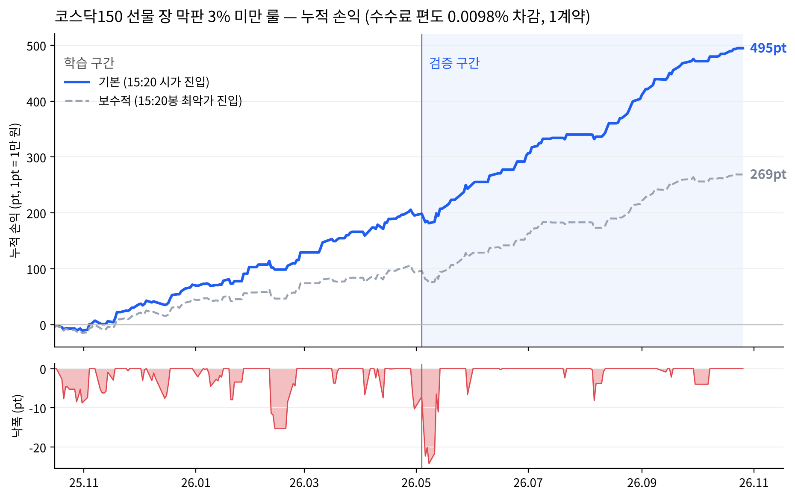
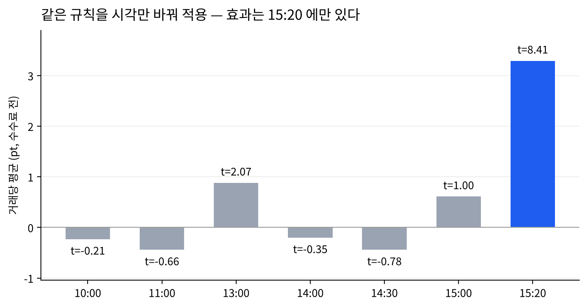
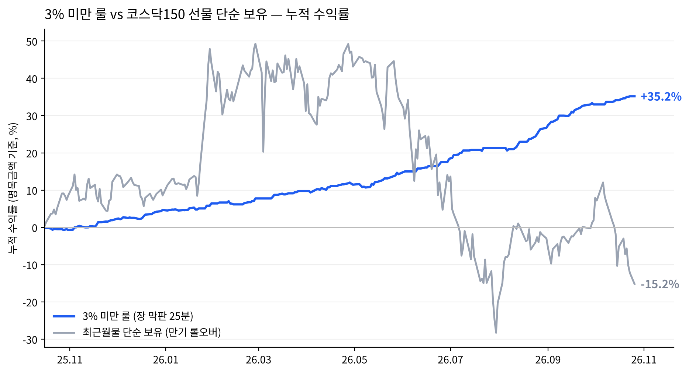

# 2주차 · 국내상품 전략 구현 — 코스닥150 선물 장 막판 모멘텀

**제출일: 2026/10/30(금) 23:59**

| 항목 | 내용 |
| --- | --- |
| 대상 종목 | 코스닥150 선물 2026년 12월물 (`A066C000`) |
| 전략 | 15:19 등락률이 ±3% 미만이면 그 방향으로 15:20 진입, 15:45 종가 단일가 청산 |
| 백테스트 | 코스닥150 선물 최근월물 1분봉 1년치 (2025-10-16 ~ 2026-10-26, 243거래일) |
| 담당 | 이승윤 (전략 설계·검증), 민승기 (구현·체결실행) |

## 1. 전략과 매매 계획

### 1-1. 대상 상품

코스닥150 선물 최근월물입니다. 1계약 승수는 1pt = 1만 원이고, 백테스트 기간 평균 진입가 1,660pt 기준 명목금액은 약 1,660만 원입니다. 정규장은 08:45\~15:45 이고 15:35\~15:45 가 종가 단일가입니다. 현물(코스닥 시장)은 15:20\~15:30 이 현물(코스닥 시장)은 15:20~15:30 이 종가 단일가라 선물이 현물보다 15분 늦게 끝납니다.

### 1-2. 전략을 고른 까닭

레버리지·인버스 ETF 는 매일 장 마감 기준으로 노출 비율을 맞춰야 합니다. 2배 레버리지와 1배 인버스 모두 지수가 오른 날은 사고 내린 날은 팔아야 하고, 그 양은 대략 다음과 같습니다.

$$RD \approx L(L-1)\cdot r \cdot AUM$$

이 물량이 장 마감 직전에 몰리면 가격이 같은 방향으로 한 번 더 밀립니다. 근거로 삼은 논문은 두 편입니다.

- **Baltussen et al. (2021), 「Hedging demand and market intraday momentum」** — 1974\~2020년 주요국 주식·채권·원자재·통화 선물 60여 종에서 장 마감 30분 수익률이 그날 나머지 시간의 수익률과 같은 방향으로 움직이고, 그 원인이 옵션 딜러와 레버리지 ETF 의 감마 헤지 수요라는 것을 보였습니다.
- **성태균·정형찬 (2019), 「레버리지/인버스 ETF가 주가지수 선물시장에 미치는 영향에 관한 연구」** — 국내 레버리지·인버스 ETF 의 재조정 수요가 코스피200·코스닥150 선물의 장 마감 수익률에 영향을 주고, 코스닥150 에서는 다음 날 오전에 반전된다는 것을 보였습니다.

코스닥150 선물은 코스피200 보다 시장이 작고 레버리지·인버스 ETF 의 선물 비중이 커서 효과가 더 뚜렷할 것으로 봤습니다.

이동평균 교차처럼 가격 모양만 보는 신호 대신, **누가 왜 그 시각에 같은 방향으로 거래해야 하는지**가 설명되는 신호를 고르고 싶었습니다.

### 1-3. 매매 규칙

| 단계 | 시각 | 규칙 |
| --- | --- | --- |
| 신호 | 15:19:55 | 현재가와 전일 종가로 등락률 r 계산 |
| 판정 | 15:19:55 | r ≠ 0 이고 \|r\| < 3% 이면 진입. r > 0 매수, r < 0 매도. \|r\| ≥ 3% 면 쉼 |
| 진입 | 15:20:00 | 시장가 1계약 |
| 청산 | 15:36:00 | 반대 방향 시장가 1계약 → 15:45 종가 단일가로 체결 |
| 제외 | — | 최종거래일 (최근월물이 15:20 에 끝남) |

### 1-4. 규칙마다 그렇게 정한 까닭

- **15:20 진입:** 현물이 종가 단일가에 들어가는 시각입니다. 이때부터 ETF 가 맞춰야 할 노출이 거의 정해집니다.
- **종가 단일가 청산:** 백테스트의 청산 가격이 15:45 종가 단일가 체결가 그 자체라 청산 쪽 슬리피지가 없습니다. 실행 위험은 15:20 진입에만 남습니다.
- **3% 기준:** 학습 구간(~2026-04)에서 정했습니다. 학습 구간에서 3% 이상 움직인 33일은 같은 방향으로 들어가면 평균 −4.14pt 로 크게 깨졌고, 그중에서도 6% 넘게 움직인 8일(평균 −14pt)에 손실이 몰려 있었습니다.
- **당일 청산:** 막판에 밀린 가격은 다음 날 아침에 되돌려집니다(2-2절 ⑤). 오버나이트로 들고 가면 번 것을 돌려줍니다.
- **1계약:** 이번 주는 규칙대로 돌아가는지 확인하는 것이 목적이라 크기를 늘리지 않았습니다.

### 1-5. 미리 알고 있던 약점

- 데이터가 1년치이고, 그 1년이 코스닥150 이 2,100 과 1,060 사이를 오간 변동성 큰 장이었습니다.
- 3% 기준이 왜 생기는지는 가격 데이터만으로 설명하지 못했습니다. 리밸런싱 물량은 r 에 비례하므로 큰 날일수록 효과가 커야 하는데 오히려 사라집니다. 3-2절에 확인한 것과 못 한 것을 나눠 적었습니다.
- ETF 순자산 규모가 클수록 효과가 커지는지는 이 데이터로 확인하지 못했습니다.

## 2. 백테스트 결과

### 2-1. 결과 파일

| 파일 | 내용 |
| --- | --- |
| [trades.csv](results/backtest/trades.csv) | 243거래일 매매기록 (신호, 진입가, 청산가, 수수료, 손익) |
| [summary.json](results/backtest/summary.json) | 전체·학습·검증 요약, 단순 보유 비교 |
| [threshold_sensitivity.csv](results/backtest/threshold_sensitivity.csv) | 등락률 기준별 성과 |
| [move_buckets.csv](results/backtest/move_buckets.csv) | 등락률 구간별 막판 수익 |
| [intraday_placebo.csv](results/backtest/intraday_placebo.csv) | 같은 규칙을 다른 시각에 적용한 결과 |
| [late_split.csv](results/backtest/late_split.csv) | 막판 25분을 현물 마감 전·후로 나눈 결과 |
| [next_day_reversal.csv](results/backtest/next_day_reversal.csv) | 다음 날 아침 반전 회귀 |
| [vs_buy_and_hold_daily.csv](results/backtest/vs_buy_and_hold_daily.csv) | 단순 보유와 일별 비교 |

### 2-2. 성과와 검증

데이터는 2025-10-15 ~ 2026-10-26 의 252거래일입니다. 첫날은 전일 종가로만 쓰고, 최종거래일 4일과 롤오버 다음 날 4일을 빼서 243거래일이 남았습니다. 학습 구간(~2026-04-30)에서 규칙을 정하고 검증 구간(2026-05-01~)에는 그대로 적용했습니다. 수수료는 편도 0.0098%(명목금액 기준, 왕복 평균 약 0.33pt)를 뺐습니다. 데이터는 한국투자증권 Open API 로 받은 코스닥150 선물 최근월물 1분봉입니다.

**① 성과**

| 구간 | 거래 | 평균 | 승률 | 누적 | 최대낙폭 | t |
| --- | --- | --- | --- | --- | --- | --- |
| 전체 | 167 | +2.96pt | 73% | +495pt | −24.2pt | 7.58 |
| 학습 | 97 | +2.01pt | 66% | +195pt | −15.2pt | 4.12 |
| 검증 | 70 | +4.28pt | 83% | +299pt | −17.0pt | 7.00 |
| 전체 (최악가 진입) | 167 | +1.61pt | 69% | +269pt | −30.7pt | 4.52 |

최악가 진입은 매수면 15:20 봉 고가, 매도면 저가에 샀다고 가정한 값입니다. 진입가 대비로 보면 거래당 평균 +0.181% (학습 +0.112%, 검증 +0.276%) 입니다. 매수 85건 평균 +2.22pt, 매도 82건 평균 +3.74pt 로 양쪽 모두 플러스입니다.

**② 3% 기준은 학습 구간에서 정했고, 검증 구간에서는 3~4% 사이에서 결과가 거의 같습니다**

| 기준 | 학습 평균 (t) | 검증 평균 (t) |
| --- | --- | --- |
| 1% | +0.93pt (1.39) | +3.18pt (3.06) |
| 2% | +1.81pt (3.42) | +4.03pt (5.40) |
| **3%** | **+2.01pt (4.12)** | **+4.28pt (7.00)** |
| 3.5% | +1.88pt (4.17) | +4.22pt (7.25) |
| 4% | +1.80pt (4.03) | +4.20pt (7.70) |
| 5% | +1.61pt (3.50) | +3.90pt (7.33) |
| 제한 없음 | +0.36pt (0.47) | +3.19pt (5.23) |

검증 구간에서 3% 이상 움직인 43일은 평균 +1.71pt(수수료 전)로 학습 구간처럼 깨지지는 않았습니다. 기준을 결과에 맞춰 고른 것이 아니라는 근거로 이 표를 둡니다.

**③ 효과는 장 막판에만 있습니다**

같은 규칙(그 시각까지 등락률 3% 미만이면 같은 방향, 25분 보유)을 시각만 바꿔 적용했습니다.

| 진입 | 10:00 | 11:00 | 13:00 | 14:00 | 14:30 | 15:00 | **15:20** |
| --- | --- | --- | --- | --- | --- | --- | --- |
| 평균 (pt, 수수료 전) | −0.23 | −0.44 | +0.88 | −0.20 | −0.44 | +0.61 | **+3.29** |
| t | −0.21 | −0.66 | 2.07 | −0.35 | −0.78 | 1.00 | **8.41** |

**④ 막판 수익의 2/3 는 현물 마감 뒤에 나옵니다**

| 구간 | 평균 (pt, 수수료 전) | t |
| --- | --- | --- |
| 15:20~15:29 (현물 종가 단일가 중) | +1.22 | 4.66 |
| 15:30~15:45 (현물 마감 뒤, 선물만 거래) | +2.07 | 6.87 |

현물 종가가 정해지면 ETF 가 그날 맞춰야 할 노출도 정해지고, 그 뒤 선물로 물량을 맞춘다는 설명과 맞습니다.

**⑤ 막판에 밀린 가격은 다음 날 아침에 되돌려집니다**

막판 25분 수익률을 다음 날 아침 수익률에 회귀했습니다. 15:19 까지 등락률을 함께 넣었고 표준오차는 White 방식입니다.

| 종속변수 | 전체 240일 β (t) | 3% 미만 166일 β (t) |
| --- | --- | --- |
| 다음 날 시가 갭 | −0.56 (−2.40) | −0.33 (−1.09) |
| 종가 → 다음 날 09:30 | −1.03 (−2.73) | −0.40 (−0.82) |
| 종가 → 다음 날 10:00 | −1.26 (−3.13) | −0.42 (−0.75) |

전체 기준으로 β 가 −1 근처라, 막판에 밀린 만큼이 다음 날 10:00 까지 거의 다 되돌려집니다. 성태균·정형찬(2019)이 코스닥150 에서 본 과잉반응 뒤 반전과 같은 방향이고, 당일 청산 규칙의 근거입니다. 3% 미만인 날만 보면 부호는 같지만 막판 움직임이 작아(평균 약 20bp) 유의하지 않습니다.

**⑥ 최근월물 단순 보유와 비교**

같은 기간(2025-10-15 종가 ~ 2026-10-26 종가, 251거래일)에 최근월물 1계약을 계속 들고 있었을 때와 비교했습니다. 롤오버는 최종거래일 마지막 가격에 팔고 다음 거래일 09:00 시가에 새 월물을 사는 것으로 가정했고(4회), 수수료는 똑같이 편도 0.0098% 를 뺐습니다. 수익률은 매일 그날 명목금액 대비로 계산해 복리로 이었고, 변동성과 샤프는 일별 수익률을 연환산(√252)했습니다(무위험수익률 0).

| | 3% 미만 룰 | 최근월물 단순 보유 |
| --- | --- | --- |
| 누적 손익 (1계약) | **+495pt (+495만 원)** | −227pt (−227만 원) |
| 누적 수익률 (명목, 복리) | **+35.2%** | −15.2% |
| 연환산 수익률 | +35.3% | −15.2% |
| 연환산 변동성 | **4.1%** | 58.3% |
| 샤프 비율 | **7.46** | 0.01 |
| 최대낙폭 (pt) | −24.2pt | −1,130.5pt |
| 최대낙폭 (명목) | −1.2% | −52.0% |
| 칼마 비율 (연환산 수익률 ÷ 최대낙폭) | 29.9 | −0.29 |
| 기간 중 최고 누적 수익률 | +35.2% | +49.3% |
| 시장에 들고 있던 시간 | 167일 × 25분 | 251일 내내 |
| 일별 수익률 상관 | −0.03 | |

같은 증거금으로 단순 보유는 고점에서 +49% 까지 갔다가 −52% 낙폭을 맞고 −15% 로 끝났습니다. 3% 미만 룰은 하루 25분만 들고 변동성 4.1% 로 +35% 를 냈습니다. 다만 이 1년은 코스닥150 이 1,423 에서 1,213 으로 내린 기간이라 누적 손익 비교는 단순 보유에 불리합니다. 상승장이면 단순 보유의 누적 손익이 더 클 수 있으므로 **비교의 핵심은 위험 대비 수익(샤프, 최대낙폭)** 입니다. 전략은 노출 시간이 짧아 명목 기준 변동성이 낮게 나오는 점도 감안해야 합니다. 롤오버한 4번의 밤사이 움직임은 새 월물의 최종거래일 종가가 데이터에 없어 빠져 있습니다.

## 3. 결과 해석과 한계

### 3-1. 백테스트 해석

수익은 장 막판 25분에만 나오고(③), 그중 2/3 가 현물 마감 뒤에 나오며(④), 다음 날 아침 되돌려집니다(⑤). 시장 방향과의 상관은 거의 0 이고 매수·매도 양쪽이 모두 플러스입니다(①, ⑥). 넷 다 「마감 직전 같은 방향의 일시적 물량」이라는 설명과 맞습니다. 그래도 이 데이터는 가격뿐이라 **물량을 직접 본 것은 아닙니다.**

### 3-2. 3% 기준에 대해 확인한 것과 못 한 것

리밸런싱 물량이 r 에 비례한다면 크게 움직인 날 효과가 더 커야 하는데, 3% 이상인 날은 막판 효과가 사라집니다. 큰 날 운용사가 장중에 미리 리밸런싱해서 막판에 남는 물량이 적은지 확인하려고, 3% 이상 움직인 76일에 대해 장중 1분 수익률 순서만 무작위로 섞은 기준선(500회)과 비교했습니다. 10:30 ~ 14:30 은 기준선과 차이가 없었고(p = 0.31 ~ 0.60), 09:30 만 기준선을 넘었습니다(p = 0.002). 장 초반 추세는 리밸런싱보다 갭이나 뉴스로 보는 편이 자연스러워서, **장중 리밸런싱의 증거는 찾지 못했습니다.** 큰 날은 하루 선물 거래량이 2~3배라 막판 물량이 묻히고 손익 변동이 커진다는 점만 확인해서, 3% 는 위험 필터로 둡니다. 투자자별 시간대별 선물 순매수 데이터로 다시 확인할 계획입니다.

### 3-3. 백테스트 가정과 한계

- **체결:** 15:20 봉 시가에 진입했다고 봤고, 보수적인 경우로 봉의 가장 불리한 가격도 함께 계산했습니다. 청산은 종가 단일가 체결가라 가정이 필요 없습니다.
- **기간:** 1년, 변동성이 큰 장 하나뿐입니다. 하락장이어서 단순 보유와의 누적 손익 비교(⑥)는 기간에 따라 달라질 수 있어, 위험 대비 수익으로 보는 것이 맞습니다.
- **수익률 기준:** 명목금액 기준입니다. 증거금 기준으로 보면 레버리지만큼 커집니다.
- **데이터 공백:** 1분봉 252일 중 8일에 공백이 있습니다. 7일은 개장 지연(수능일 2025-11-13, 새해 첫 거래일 2026-01-02, 09:00~09:44)과 서킷브레이커로 보이는 29분 정지(2026-03-04, 06-08, 07-28, 07-29, 10-15)이고, 1일(2026-08-03 10:43)은 체결이 없던 1분으로 보입니다. 전략에 쓰는 15:19·15:20·15:45 가격은 243거래일 모두 있습니다. 데이터는 09:00 부터라 08:45~08:59 는 없습니다.
- **롤오버:** 최종거래일과 롤오버 다음 날을 빼서 월물 사이 가격 차이가 신호에 섞이지 않게 했습니다.

## 4. 개선할 것

- 모의계좌 실제 체결가와 15:20 봉 시가의 차이를 매일 기록해 백테스트의 슬리피지 가정을 실측값으로 바꿉니다. 30~50번이 쌓이면 다시 봅니다.
- 백테스트 데이터를 NH 차트 API(`chart-minute`)로 다시 받아 모의계좌와 같은 출처로 맞춥니다.

## 5. 향후 계획

- 모의계좌로 매일 돌려 거래를 쌓습니다.
- 레버리지·인버스 ETF 순자산과 투자자별 선물 순매수 데이터를 붙여, 리밸런싱 물량 추정치로 막판 수익률을 직접 설명해 봅니다 (5주차 데이터 기반 전략).

## 참고문헌

- Baltussen, G., Da, Z., Lammers, S., & Martens, M. (2021). Hedging demand and market intraday momentum. *Journal of Financial Economics*, 142(1), 377–403.
- 성태균·정형찬 (2019). 레버리지/인버스 ETF가 주가지수 선물시장에 미치는 영향에 관한 연구. 『금융공학연구』 18(2), 85–117.
