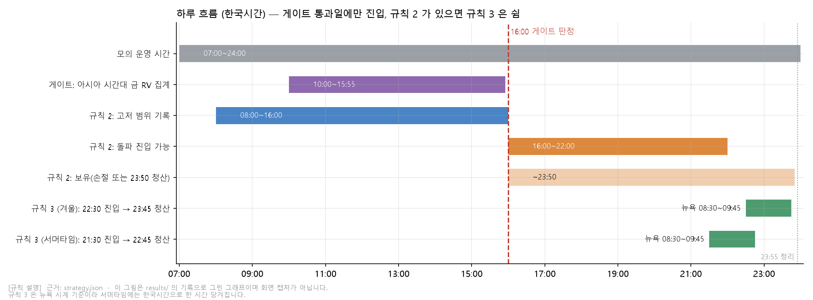
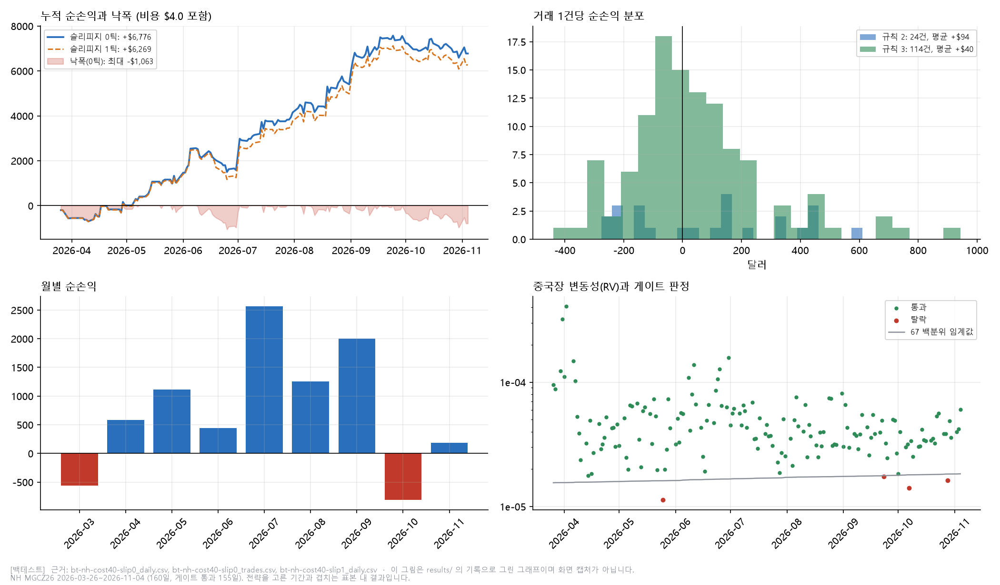
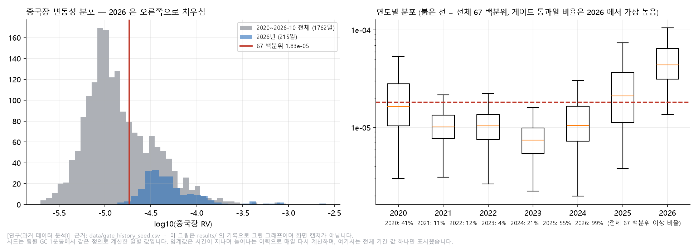
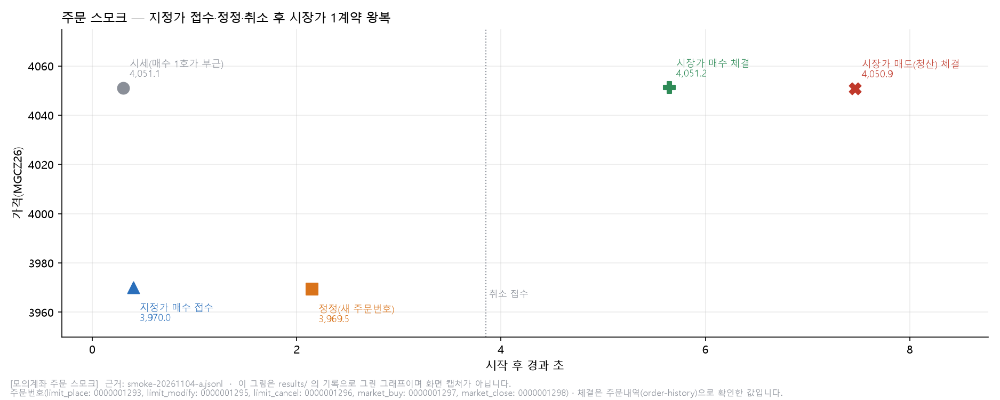
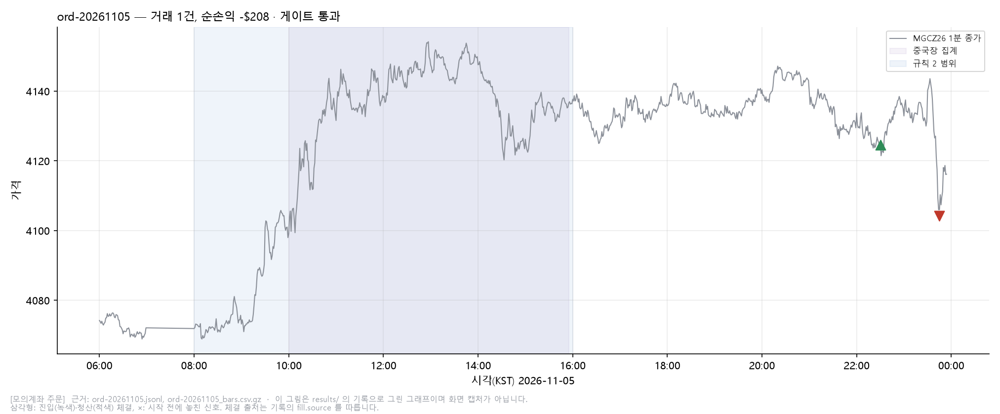
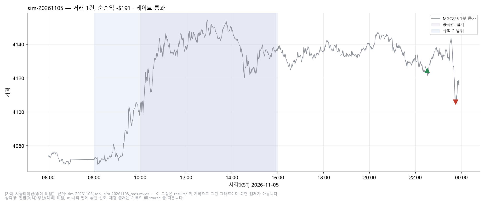

# 3주차 · 해외상품(원자재) 전략: 아시아 시간대 금 변동성 게이트와 시계열 분석 (CME MGC)

> 본 실행은 2026-11-05(목) 16:21부터 23:55까지 했고, run_id는 `ord-20261105`([모의계좌 주문])와 `sim-20261105`([자체 시뮬레이션])입니다. 결과는 6-4절에 있습니다.

| 항목 | 내용 |
| --- | --- |
| 전략 이름 | 아시아 시간대 금 변동성 + 시계열 분석 |
| 전략 버전 id | `cn-vol-gate-filter-v3` |
| 대상 종목 | CME 마이크로 금 12월물 `MGCZ26` (거래소 `FCME`, 틱 0.1, 승수 10oz, 1틱 1달러). 확인용으로 2년물 선물 `ZTZ26` 분봉을 조회 |
| 실행 환경 | [백테스트], 11/04 [모의계좌 주문] 스모크, 11/05 본 실행([모의계좌 주문]·[자체 시뮬레이션(종이 체결)]) |
| 작성일 | 2026-11-06 |

## 폴더 구성

| 경로 | 내용 |
| --- | --- |
| `README.md` | 이 보고서 |
| `strategy.json` | 전략 파라미터, 비용, 위험 한도, 실행 설정 (코드에 숫자를 박지 않았습니다) |
| `run.py` | 진입점. `--env paper --mode backtest\|paper-sim\|paper-order --run-id` |
| `strategy_core.py`, `sessions.py` | 전략 핵심(게이트, 규칙 2, 규칙 3, 위험 점검)과 시각 도우미 |
| `backtest.py`, `live.py`, `executors.py` | 백테스트 루프, 실시간 루프(종이 체결과 모의계좌 공통), 실행기 |
| `feeds.py`, `gate_store.py` | 분봉 입출력과 ZT 변화량, 게이트 이력 |
| `charts.py`, `chartkit.py` | 보고서용 그래프 생성 (스크린샷 대신, `results/`의 기록만 읽음) |
| `summarize_journal.py`, `order_smoke.py` | 실행 기록(JSONL) 요약(읽기 전용), 모의계좌 주문 스모크 |
| `nhapi/` | NH선물 API 클라이언트 (3주차 시점 사본, 해외 주문용 `overseas.py` 추가) |
| `data/` | 게이트 이력 시드 `gate_history_seed.csv`, NH 분봉 `MGCZ26_1m.csv.gz`, `ZTZ26_1m.csv.gz` |
| `tests/` | 전략·실행·요약·그래프 테스트 (API 없이 동작) |
| `research/`, `results/research/` | 전략을 고르기까지의 검증 스크립트와 출력 (재현하려면 팀원 데이터가 필요, 5절) |
| `results/` | 백테스트 산출물, 11/05 본 실행 기록과 요약, 스모크 기록 |
| `results/charts/` | 그래프 원본(PNG) |
| `screenshots/` | `results/charts/`와 같은 그림을 `NN-이름.png`로 둔 폴더. 이 README의 그림은 여기 경로를 씁니다 |

## 1. 과제 요약

| 필수 기능 | 구현 위치 | 근거 파일 |
| --- | --- | --- |
| 해외 상품·거래소 전략 구현 | `strategy_core.py`의 `DayEngine` | `results/bt-nh-slip0_summary.json` |
| 해외 시세·분봉 조회 | `live.py`의 `LiveFeed`(`overseas_chart-minute`), 현재가는 `order_smoke.py`(`overseas_price`) | `results/ord-20261105.jsonl`(분봉 조회 10,229회, 오류 52건은 재시도), `results/smoke-20261104-a.jsonl` |
| 해외 주문·잔고·주문내역 | `nhapi/overseas.py`의 `OverseasGateway` | 작업 루트 `_lib/tests/test_overseas.py` 18건(제출 폴더 밖), 스모크·본 실행 기록 |
| 거래소 시간·서머타임 | `sessions.py`(뉴욕 시계), `strategy.json` | `tests/test_strategy_core.py`의 서머타임 테스트(규칙 3은 21:30) |
| 위험관리·킬 스위치·대사 | `nhapi/risk.py`, `live.py`의 `_finish`, `run.py` | `tests/test_runtime.py` |
| 실행 기록·요약 | `nhapi/journal.py`, `summarize_journal.py` | `results/ord-20261105.jsonl`, `results/*_journal_summary.json` |

| 제출물 | 이 폴더의 위치 |
| --- | --- |
| 소스코드와 실행 방법 | 위 파일들, 2절 |
| 보고서 | 이 README |
| 실행 근거 | `results/` |
| 그래프(스크린샷 대신) | `screenshots/`, 생성 코드는 `charts.py` |

선택 기능으로, 주문 응답이 불명확하면 주문내역으로 대사하는 `resolve_unknown`과, 체결 확인에 실패하면 신규 주문을 멈추는 동작을 넣었습니다.

테스트 원칙은 이렇습니다. 실전 주문은 하지 않습니다(`--env`는 `paper`만 받습니다). 시뮬레이션 체결을 모의계좌 체결로 쓰지 않습니다. 주문 접수만 있고 주문내역에서 확인되지 않으면 체결로 적지 않습니다. 실제로 난 오류만 적습니다.

## 2. 실행 방법

설치 (Python 3.11 이상):

```bash
pip install -r requirements.txt
```

설정은 `config.example.yaml`을 작업 루트의 `_secrets/config.yaml`로 복사해 모의 APP Key와 Secret을 채웁니다(환경변수 `NHFUTURES_CONFIG`로 경로를 바꿀 수 있습니다). 이 폴더에는 키가 없습니다.

재현 명령:

```bash
# [백테스트] NH MGCZ26 분봉(2026-03-26부터 11-04까지). 키 없이 동작. 비용은 기본 4.0달러, 3.5달러는 --round-trip-usd 3.5
python run.py --env paper --mode backtest --run-id bt-001 --bars data/MGCZ26_1m.csv.gz --zt data/ZTZ26_1m.csv.gz --start 2026-03-26 --end 2026-11-04
# [자체 시뮬레이션(종이 체결)] 실시간 분봉 조회만 하고 주문은 내지 않음
python run.py --env paper --mode paper-sim --run-id sim-001
# [모의계좌 주문] 모의계좌에 시장가 주문 (시작 전에 확인 질문이 나옴)
python run.py --env paper --mode paper-order --run-id ord-001
```

멈추려면 작업 폴더에 `STOP` 파일을 만들거나 Ctrl+C를 누릅니다. 미체결 취소, 포지션 정리, 기록 마감 순서로 끝납니다.

요약은 `python summarize_journal.py results/ord-20261105.jsonl --run ord-20261105`처럼 돌립니다.

그래프는 `python charts.py plot`으로 만듭니다. `results/`의 기록만 읽어서 `results/charts/*.png`를 그리고 `screenshots/NN-이름.png`로도 복사하며, 키나 API가 필요 없습니다.

테스트는 `python -m pytest tests -q`로 돌립니다(47건, API 없이 동작).

## 3. 전략과 매매 계획

### 3-1. 대상 상품

MGC는 마이크로 금 선물로 10oz, 틱 0.1(1달러)입니다. 증거금은 주문가능수량 100,000달러가 46계약이라는 조회 결과에서 계약당 2,100–2,200달러쯤으로 추정했습니다. 거래시간은 CME 기준 08:00부터 다음 날 07:00(KST, 겨울)이고, 인수도 품목이라 12월물 최초통보일이 2026-11-30입니다. 2년물 선물 ZT는 매크로 확인용으로 분봉만 조회하고 주문은 내지 않습니다. 출처는 11/02에 NH 조회로 확인한 작업 노트입니다.

모의 운영 시간은 07:00부터 24:00 KST이고 이월이 안 됩니다. 그래서 아시아 시간대(10:00–16:00 KST, 상하이 거래시간과 겹치는 구간)와 런던·미국 시간대를 하루 안에 한 번씩 보는 구조로 잡았습니다. 어느 시간대든 보는 것은 금(MGC) 가격뿐입니다.

### 3-2. 후보 비교와 채택 이유

처음에는 팀원이 만든 「MGC 매크로 3규칙」을 그대로 구현하려 했습니다. 그런데 2020–2025년 데이터로 다시 돌려 보니 효과가 없고 2026년에만 성과가 있어서, 그 규칙을 바탕으로 두되 통계로 다시 걸러 바꿨습니다.

| 후보 | 결과 | 채택 |
| --- | --- | --- |
| 곡선 상대가치(기울기·곡률) | 정산가 기반 기준선의 예측력이 거의 없음(하루가 만든 회귀) | 보류 |
| 팀원 「MGC 매크로 3규칙」 | 재현됨. 2020–2025년에는 효과 없음, 2026년에만 성과 | 근거가 약해 변형 |
| 아시아·런던 시간대 금 가격 정보로 방향 예측 | 60개 검정에서 Holm 보정 후 0개, 워크포워드 표본 밖 R²가 모두 음수 | 쓰지 않음 |
| 아시아 시간대 금 변동성 게이트 + 규칙 2·3 필터형 | 거래일과 낙폭이 줄었고 수익은 통계적으로 유의하지 않음 | 채택 |

연구에서 확인한 것은 다음과 같습니다(수치 출처는 `results/research/`).

- 아시아·런던 시간대의 금 거래량·변동성 정보(휴장일 효과 포함)는 활동을 잘 설명하지만 방향은 설명하지 못했습니다(`long_history_out.txt`, `v3_research_out.txt`).
- 규칙 2(아시아 범위 돌파와 ZT 확인)는 2020–2023년에 손실이었고, 2024년에서 2026년으로 갈수록 좋아지며 변동성 수준과 함께 커졌습니다(`v3_rule2_out.txt`, `v3_regime_out.txt`, `v3_cnvol_out.txt`).
- 규칙 2와 3은 같은 방향에 거는 날이 대부분이라 한 포지션으로 합쳤습니다(`v3_unified_out.txt`).
- 아시아 시간대 금 변동성 67백분위 게이트가 검토한 4종 가운데 과거 성과가 가장 좋았습니다(`v3_cngate_out.txt`).

### 3-3. 매매 규칙 (`strategy.json`)

| 단계 | 시각(KST) | 내용 |
| --- | --- | --- |
| 게이트 | 16:00에 판정 | 아시아 시간대 금 RV(10:00–15:55 KST 금 1분 로그수익률 제곱합)가 오늘 이전 모든 날의 67백분위 이상일 때만 거래. 이력이 120일 미만이면 거래하지 않음. RV는 금 분봉(모의 MGC, 과거 이력 GC)으로만 계산하고 중국 지수·A50 데이터는 쓰지 않음 |
| 규칙 2 | 범위 08:00–16:00, 진입 16:00–22:00, 청산 23:50 | 범위 고가보다 1틱 위나 저가보다 1틱 아래를 먼저 뚫는 쪽으로 진입. 직전 30분(1분 지연) ZT 변화 부호가 돌파 방향과 같을 때만 진입. 손절은 범위 중간값. 양방향을 같은 날 돌파했거나 범위 봉이 200개 미만이면 건너뜀 |
| 규칙 3 | 뉴욕 08:30 진입, 09:45 청산 (겨울 22:30/23:45, 서머타임 21:30/22:45) | 규칙 2로 오늘 진입한 적이 없을 때만. 뉴욕 08:29 종가가 세션 시가(뉴욕 18:00)보다 높으면 매수, 낮으면 매도. 비상 손절 300달러 |
| 위험 | 상시 | 하루 최대 1계약, 일일 손실 한도 800달러(남은 한도가 1회 손절 금액보다 작으면 신규 진입 금지), 킬 스위치, 시작 시 보유·미체결 대사, 23:55 정리 |

비용은 계약당 왕복 4.0달러로 잡았습니다. 모의 스모크에서 관찰한 수수료이고, 연구와 팀원 규칙서는 3.5달러를 썼습니다. 슬리피지는 설정값(`costs.slippage_ticks`, 기본 0)입니다.

### 3-4. 미리 알던 약점

- 수익이 통계적으로 유의하지 않습니다. 필터형에 게이트를 건 2020–2025년은 하루 평균 +16.6달러, t 1.65, 최대 낙폭 −1,592달러입니다(`results/research/v3_cngate_out.txt`). 2020–2023년은 +1.3달러(t 0.13), 2024–2025년은 +23.5달러(t 1.69)라서 효과가 2024년 이후에 몰려 있습니다.
- 게이트 4종 중 가장 좋은 것을 골랐기 때문에 다중비교 편향이 있습니다. 규칙 2와 3은 단독으로는 2020–2025년에 효과가 없고 2026년에만 성과가 있었고, 이 전략도 같은 의존성을 가집니다.
- 2026년에는 변동성이 높아서 게이트가 거의 매일 열립니다(NH 백테스트에서 160일 중 155일). 지금 시장에서는 사실상 매일 거래하는 전략입니다.
- 규칙 3은 08:30 정각 체결에 크게 기대고 있습니다. 진입이 1분 늦으면 수익이 절반으로 줄었습니다(연구 기록).
- 규칙 2는 한국시간에 고정돼 있어서, 서머타임에 CME·런던·미국 시각이 한 시간 당겨지는 영향은 검증하지 못했습니다.
- 진짜 표본 밖 검증은 이번 주 모의 운영뿐입니다.

## 4. 사용 API와 프로그램 구조

```
run.py ─ backtest ─────────► backtest.run_backtest ─► DayEngine(strategy_core) ─► SimExecutor
      └ paper-sim/-order ─► live.LiveRunner ──┬ LiveFeed(분봉 조회) ─► DayEngine ─► Intent
                                              └ executors: SimExecutor | OrderExecutor ─► OverseasGateway ─► Client ─► NH API
```

| 용도 | API | 경로 | 방식 |
| --- | --- | --- | --- |
| 접근토큰 | `token` | `/auth-service/v1/token` | REST |
| 현재가 (스모크에서 확인) | `overseas_price` | `/trade/v1/overseas/price` | REST |
| 분봉 (MGCZ26, ZTZ26) | `overseas_chart-minute` | `/trade/v1/overseas/chart-minute` | REST (연속조회 `nxt_key`) |
| 주문·정정·취소 | `overseas_order` | `/trade/v1/overseas/order` | REST (`qt_div_cd` 1/2/3) |
| 주문내역·잔고 | `overseas_order-history`, `overseas_open-interest` | `/trade/v1/overseas/…` | REST |
| 주문가능수량·예수금 | `overseas_orderable-quantity`, `overseas_deposit` | `/trade/v1/overseas/…` | REST |

오류 처리는 이렇게 했습니다. HTTP 200을 성공으로 보지 않고 `errorCode`, `msg_cd`, 해외 주문의 `err_cd`를 확인합니다. 주문은 자동으로 재시도하지 않고, 응답이 없으면 `unknown`으로 두고 주문내역으로 접수 여부를 확인합니다. 체결은 주문내역에서 수량과 가격이 확인될 때만 인정하고, 확인이 안 되면 신규 주문을 멈춥니다. 조회는 일시 오류일 때만 재시도합니다. 401이나 토큰 만료는 토큰을 다시 받아 한 번만 다시 보냅니다. 환경·시장별 토큰과 호출 제한 간격은 `nhapi/client.py`와 `ratelimit.py`가 처리합니다.

기록은 한 줄이 한 사건인 JSONL입니다. 갈래는 `run`, `event`, `signal`, `order`, `fill`, `trade`, `error`, `api_issue`이고 모든 줄에 `run_id`, `ts`, `env`, `mode`, `sym`이 들어갑니다. 체결(`fill.source`)은 `backtest-model`, `paper-sim`, `mock-account`로 나누며 서로 합산하지 않습니다.

## 5. 실행 환경

| 구분 | 설명 |
| --- | --- |
| [백테스트] | `bt-nh-cost40-slip0/1`(비용 4.0달러, 슬리피지 0/1틱)과 `bt-nh-slip0/1`(비용 3.5달러). NH `MGCZ26` 1분봉 2026-03-26부터 11-04까지. 게이트 이력은 팀원 GC 1분봉(2020년부터 2026-10까지)에서 같은 정의로 계산한 시드와 이 실행의 분봉을 합쳤습니다 |
| [자체 시뮬레이션(종이 체결)] | `sim-20261105`, 2026-11-05 16:22:06부터 23:55:02 KST, MGCZ26. 실시간 분봉만 조회하고 주문은 내지 않았습니다. 체결가는 신호 기준가입니다 |
| [모의계좌 주문] | `ord-20261105`, 2026-11-05 16:21:24부터 23:55:02 KST, MGCZ26 시장가 1계약. 체결은 주문내역 조회로 확인했습니다. 스모크는 `smoke-20261104-a`(11/04 19:43) |
| 가상 자금·비용 | 계약당 왕복 4.0달러(3.5달러 병기), 슬리피지 0틱(민감도 1틱). 가정은 `results/*_assumptions.json`에 실행마다 저장했습니다 |

연구 단계의 검증은 팀원이 공유한 GC 1분봉(2020년부터 2026-10까지)과 일봉으로 했고, 이 데이터는 제출물에 넣지 않았습니다. `research/` 스크립트는 `./team_data/`에 팀원 데이터를 두면 다시 돌아갑니다. 엔진이 연구 코드와 같은 결과를 내는지 맞춰 본 결과는 `results/research/v3_engine_validate_out.txt`에 있습니다.

## 6. 실행 결과

### 6-1. [백테스트] NH MGCZ26, 2026-03-26부터 11-04까지 (160일, 표본 내)

근거: `results/bt-nh-slip0_summary.json`, `results/bt-nh-slip1_summary.json`, `results/bt-nh-cost40-slip0_summary.json`, `results/bt-nh-cost40-slip1_summary.json`와 각 실행의 `_trades.csv`, `_daily.csv`.

비용은 두 가지를 같이 적습니다. 3.5달러는 팀원 규칙서와 연구에서 쓴 가정이고, 4.0달러는 모의 스모크에서 관찰한 왕복 수수료(6-3)로 `strategy.json`의 현재 값입니다. 금액 단위는 모두 달러입니다.

| 비용(계약당 왕복) | 슬리피지 | run_id | 거래일 | 하루 평균 | t | 합계 | 최대 낙폭 | 최악의 하루 |
| --- | --- | --- | --- | --- | --- | --- | --- | --- |
| 3.5 | 0틱 | `bt-nh-slip0` | 138 | +49.6 | 2.44 | +6,845 | −1,056 | −438 |
| 3.5 | 1틱 | `bt-nh-slip1` | 138 | +45.9 | 2.25 | +6,338 | −1,318 | −440 |
| 4.0 | 0틱 | `bt-nh-cost40-slip0` | 138 | +49.1 | 2.42 | +6,776 | −1,063 | −439 |
| 4.0 | 1틱 | `bt-nh-cost40-slip1` | 138 | +45.4 | 2.22 | +6,269 | −1,324 | −441 |

비용이 0.5달러 다르면 거래 138건 기준으로 합계가 69달러 줄어듭니다. 전략 결과 자체는 바뀌지 않습니다. 3.5달러 실행은 `--round-trip-usd 3.5`로 재현합니다.

규칙별로는 규칙 2가 24건(건당 +94.5달러, 승률 58%), 규칙 3이 114건(건당 +40.1달러, 승률 51%)입니다(슬리피지 0틱, 비용 3.5달러 기준). 게이트를 통과한 날은 155일이고 판정할 수 없던 날이 1일입니다. 이 기간은 전략을 고를 때 본 구간과 겹치기 때문에 검증 결과로 읽으면 안 됩니다.

### 6-2. 연구 단계 요약 (GC 1분봉, 비용 3.5달러 포함, `results/research/`)

| 구성 | 2020–2025 하루 평균, 달러 (t) | 최대 낙폭, 달러 | 2026 하루 평균, 달러 (t) |
| --- | --- | --- | --- |
| 규칙 2·3 독립 운영, 게이트 없음 | −0.1 (−0.02) | −10,464 | +107 (3.65) |
| 필터형 + 아시아 시간대 금 RV 67백분위 게이트 | +16.6 (1.65) | −1,592 | +83.9 (3.85) |

### 6-3. [모의계좌 주문] 스모크 (2026-11-04 19:43 KST, `order_smoke.py`, run_id `smoke-20261104-a`)

근거: `results/smoke-20261104-a.jsonl`(응답 원문 포함, 인증·계좌 식별정보는 가림)과 `results/smoke-20261104-a_summary.json`. 전략 신호가 아니라 주문 경로를 점검한 것이고 1계약입니다.

| 단계 | 결과 |
| --- | --- |
| 시작 대사 | 보유 0건, 미체결 0건 |
| 지정가 매수 3970.0 접수 | 접수(주문번호 0000001293), 미체결 조회에서 상태 `confirmed` |
| 3969.5로 정정 | 새 주문번호 0000001295로 접수(원주문 줄은 사라지고 새 줄의 원주문번호가 원래 번호) |
| 취소 | 새 주문번호 0000001296으로 접수, 이후 미체결 0건 |
| 시장가 매수 1계약 | 접수 후 주문내역에서 체결 확인 4051.20 (`ord_sts` 6) |
| 잔고 | 1건(평균 4051.20, 평가손익 −3.00달러) |
| 시장가 매도(청산) | 체결 4050.90, 잔고 0건, 미체결 0건 |

- 주문 API 5회가 모두 오류 없이 처리됐고 지연은 p50 94ms, p95 125ms였습니다. 접수 응답은 체결이 아니고, 체결은 주문내역으로만 확인했습니다.
- 모의 수수료는 왕복 1계약에 `fut_fee` 5,365원으로, 환율 1341.2에서 약 4.00달러입니다. 팀원 가정 3.5달러보다 0.5달러 큽니다(6-1에 4.0달러 실행을 같이 적었습니다). 예수금은 134,120,000원에서 134,110,611원으로 줄었고, 청산손익 −4,024원과 수수료 −5,365원이 반영된 값입니다.

### 6-3a. 그래프 (스크린샷 대신)

그래프는 `charts.py`가 `results/`의 기록만 읽어서 그린 것이고 화면 캡처가 아닙니다. 모든 그림 아래에 실행 환경과 근거 파일을 적었습니다.








| 파일 | 환경 | 보여 주는 것 |
| --- | --- | --- |
| `screenshots/01-rule_timeline.png` | [규칙 설명] | 한국시간 하루 흐름. 아시아 시간대 금 RV 집계, 16:00 게이트, 규칙 2 범위·진입·보유, 규칙 3(겨울 22:30, 서머타임 21:30), 23:55 정리 |
| `screenshots/02-backtest_overview.png` | [백테스트] 비용 4.0달러 | 누적 순손익과 낙폭(슬리피지 0·1틱), 규칙별 거래 손익 분포, 월별 손익, 아시아 시간대 금 RV와 게이트 판정 |
| `screenshots/03-gate_distribution.png` | [연구] | 아시아 시간대 금 RV 분포와 67백분위, 연도별 분포(2026년은 99%가 임계값 이상) |
| `screenshots/04-smoke_orders.png` | [모의계좌 주문 스모크] | 지정가 접수·정정(새 번호)·취소 뒤 시장가 왕복의 체결 가격과 주문번호 |
| `screenshots/10-live_ord-20261105.png` | [모의계좌 주문] 11/05 본 실행 | 하루 1분 종가, 아시아 시간대 금 RV 집계와 규칙 2 범위 구간, 규칙 3 진입(22:30, 녹색)과 청산(23:45, 적색) 체결(`fill.source=mock-account`) |
| `screenshots/11-live_sim-20261105.png` | [자체 시뮬레이션(종이 체결)] 11/05 본 실행 | 같은 신호의 종이 체결(`fill.source=paper-sim`). 위 그림과 체결 출처를 섞지 않았습니다 |

### 6-4. 11/05 본 실행: [모의계좌 주문] `ord-20261105`, [자체 시뮬레이션(종이 체결)] `sim-20261105`

근거: `results/ord-20261105.jsonl`, `results/sim-20261105.jsonl`(그 실행의 줄 전체, 마스킹됨), `results/*_journal_summary.json`(`summarize_journal.py`), 분봉 `results/*_bars.csv.gz`. 대상은 MGCZ26 1계약이고 전략은 v3(아시아 시간대 금 RV 67백분위 게이트와 필터형 규칙 2·3), 비용은 왕복 4.0달러입니다.

| 항목 | 모의계좌 주문 (A) | 종이 체결 (B) |
| --- | --- | --- |
| 실행 시간 | 16:21:24 – 23:55:02 | 16:22:06 – 23:55:02 |
| 시작 대사 | 보유 0건, 미체결 0건 | (주문 없음) |
| 시작 전 놓친 신호 | 0건 | 0건 |
| 게이트(16:00 기준으로 복원) | 통과: 아시아 시간대 금 RV 8.551e-05, 67백분위 1.834e-05 이상 | 동일 |
| 규칙 2 | 진입 없음(아래 설명) | 진입 없음 |
| 규칙 3 | 22:30 매수, 23:45 청산 | 같은 신호 |
| 진입 체결 | 4124.6 (신호 기준가 4124.6) | 4124.6 |
| 청산 체결 | 4104.2 (신호 기준가 4105.9) | 4105.9 |
| 거래 손익(비용 4.0달러 포함) | −208.0달러 | −191.0달러 |
| 마감 | 취소와 청산 단계 통과, 마감 잔고 0건 | 동일 |

- 규칙 2가 진입하지 않은 이유: 08시부터 16시까지의 범위는 4067.1에서 4156.0이었고, 16시부터 22시까지 가격은 4124.6에서 4147.8 사이라서 범위를 벗어나지 않았습니다(`results/ord-20261105_bars.csv.gz`로 계산). 돌파가 없었으니 정상입니다.
- 규칙 3 신호: 뉴욕 08:29 종가 4124.3이 세션 시가 4075.0보다 높아서 매수했습니다(`signal` 줄의 `reason`). 청산은 뉴욕 09:45(23:45)입니다. 비상 손절 300달러에 해당하는 가격 4094.6은 보유 중 최저가 4101.5였기 때문에 닿지 않았습니다.
- 주문 경로: 주문 API 2회(진입, 청산)가 모두 오류 없이 처리됐고, 접수 뒤 주문내역 조회로 체결을 확인했습니다(주문번호 0000001703, 0000001725). 접수 지연은 94ms, 125ms였습니다.
- API 호출: 분봉 조회 `overseas_chart-minute`가 A에서 10,229회, B에서 10,213회였고 지연은 p50 125ms, p95 234ms입니다. 오류는 52건으로, 17:05:45부터 17:07:33 사이에 `EGW033`(HTTP 502, 백엔드 연결 실패) 10건과 `EGW020`(HTTP 429, 호출 제한) 42건이 났습니다. 모두 다음 조회 주기에 재시도했고 이후 오류는 없었습니다. 이 시간에는 주문이 없었습니다.


## 7. 해석과 한계

하루, 한 건의 결과라서 승률이나 손익비는 계산하지 않았습니다.

규칙 3 매수가 23:45까지 20.4포인트(−204달러) 내려가서 비용 4.0달러를 더해 −208달러였습니다(A). 방향이 맞지 않은 것이 손실의 거의 전부이고, 슬리피지와 수수료는 작았습니다.

종이 체결(B)과 모의계좌(A)의 차이는 17달러입니다. 진입 체결가는 같았고(4124.6), 청산에서 모의계좌가 신호 기준가보다 1.7포인트 불리하게 체결됐습니다. 비용은 둘 다 4.0달러로 같게 넣었으니 이 차이는 전부 청산 슬리피지입니다. 청산 시장가를 23:45:00에 냈는데 그림 오른쪽 끝처럼 그 무렵 가격이 급하게 떨어지고 있어서 영향이 있었을 것으로 보지만, 호가와 체결 큐 기록이 없어서 원인을 단정하지는 못합니다.

백테스트와 비교하면, 이날 규칙 2는 돌파가 없었고 규칙 3만 움직였습니다. 백테스트에서 규칙 3은 114건에 승률 51%(6-1)였으니 한 번 진 것이 백테스트와 어긋나지는 않습니다. 한 건으로는 맞는지 틀린지 말할 수 없습니다.

한도와 마감 처리는 설계대로 움직였습니다. 일일 손실 한도 800달러에는 닿지 않았고, 23:45 시간 청산과 23:55 정리(`cancel_all`, `flatten`, 마감 잔고 0건)가 실제로 실행됐습니다.

시작 시점의 한계도 있습니다. 16:21에 시작해서 16:00부터 16:21까지의 규칙 2 신호는 복원 계산으로만 확인했고(놓친 신호 0건), 그 사이에 돌파가 있었다면 주문하지 못했을 것입니다.

모형과 가정의 한계는 다음과 같습니다. 게이트와 규칙은 과거 통계로 골랐고 효과가 2024년 이후에 몰려 있습니다. 백테스트의 체결은 기준가에 슬리피지를 더한 모델이고 호가나 체결 큐가 없습니다. 표본 크기는 모의 운영 1거래일, 1건이라 통계 검정이 불가능하고, 이번 실행은 동작을 확인하고 백테스트와 차이를 보는 데 의미가 있습니다.

## 8. 오류 제보 · 개선 · 향후 계획

- 스모크에서 찾은 문제: 해외 주문내역 응답의 `occurs1_user_id`(로그인 ID)가 마스킹 목록에 없어서 로그에 그대로 남았습니다. 마스킹 규칙과 테스트를 추가하고 기존 로그를 다시 가렸습니다.
- 구현 중에 찾은 문제: 실행 기록 도우미에 `kind` 필드를 넘기다 기록 갈래(`signal`, `fill`)를 덮어쓰는 실수가 있었는데 테스트가 잡아서 `action`으로 바꿨습니다. 또 연구 코드에서 서머타임 구간의 규칙 3을 판단할 때 미래 정보(규칙 2의 뒤늦은 진입)를 쓰고 있었고, 엔진으로 옮기면서 발견해 없앴습니다.
- 본 실행에서 난 오류: 11/05 17:05:45부터 17:07:33까지 해외 분봉 조회가 `EGW033`(HTTP 502, 백엔드 연결 실패) 10건에 이어 `EGW020`(HTTP 429, 호출 제한) 42건으로 거절됐습니다(A와 B 모두). 프로그램은 조회 실패를 `error`(`poll`, `retry-next-poll`)로 기록하고 다음 주기에 다시 시도했고 이후 정상으로 돌아왔습니다. 이 시간에 주문 요청은 없었습니다. 서버 쪽 연결 실패 직후에 호출 제한이 이어진 것으로 보이며, 우리 쪽 평균 호출 빈도(프로세스당 약 0.4회/초, 두 프로세스)는 시세 호출 제한(초당 10)보다 한참 낮습니다. 근거는 `results/ord-20261105.jsonl`입니다.
- API 이상 동작 제보: 팀 작업 노트(제출 폴더 밖 `_notes/api_issues.md`)에 ISSUE-004(품목별세부정보·장운영정보의 `prd_cd` 필터 무시), ISSUE-005(만기·미상장 종목 응답 불일치), ISSUE-006(분봉 조회 `EGW033` 502 뒤 `EGW020` 429)을 정리해 두었습니다.
- 앞으로 할 일: 모의 운영을 더 쌓아 게이트와 규칙을 다시 검증하고, 서머타임이 규칙 2에 주는 영향과 규칙 3 체결 지연에 대한 민감도를 확인합니다.ㅍ
