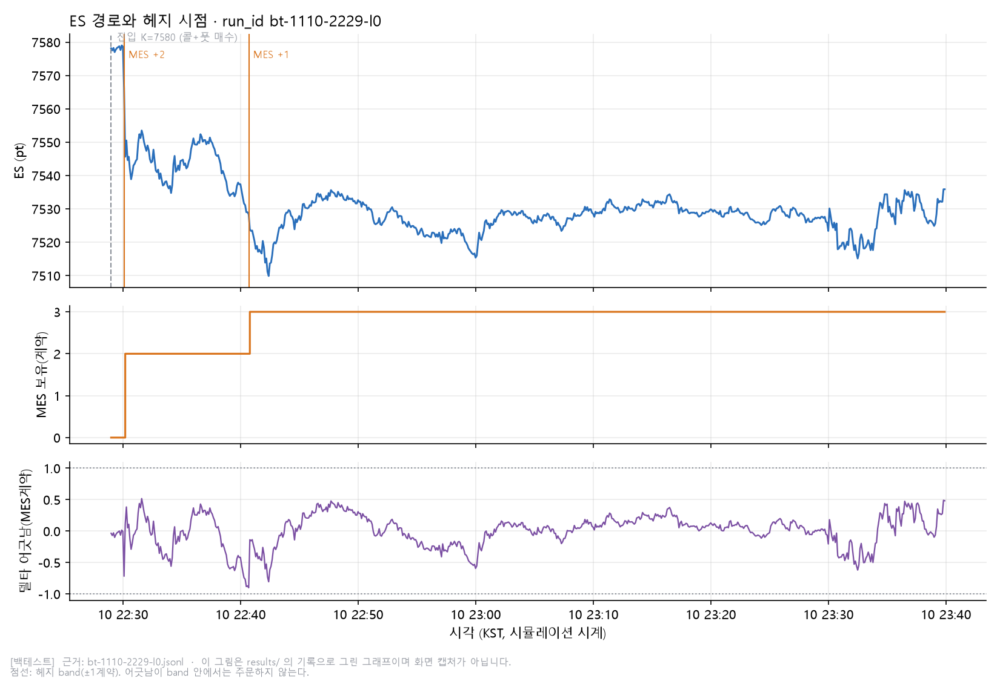
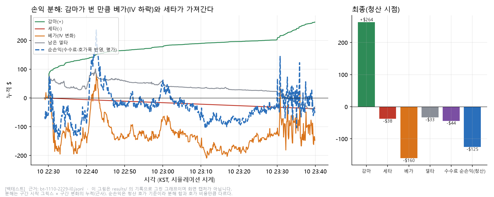
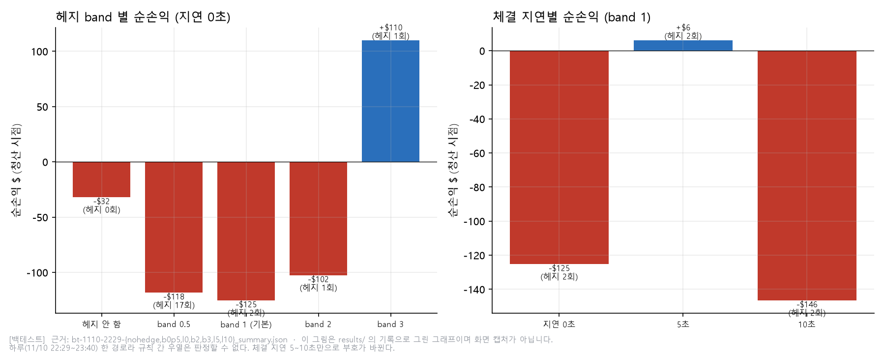
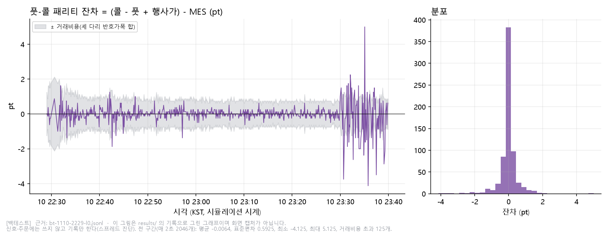
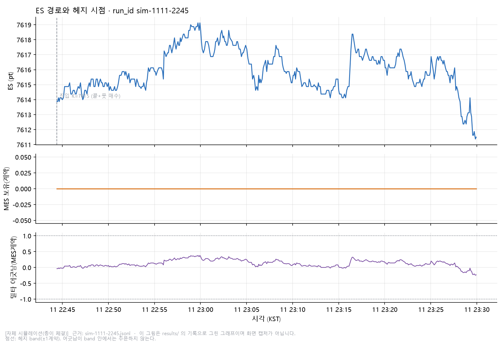
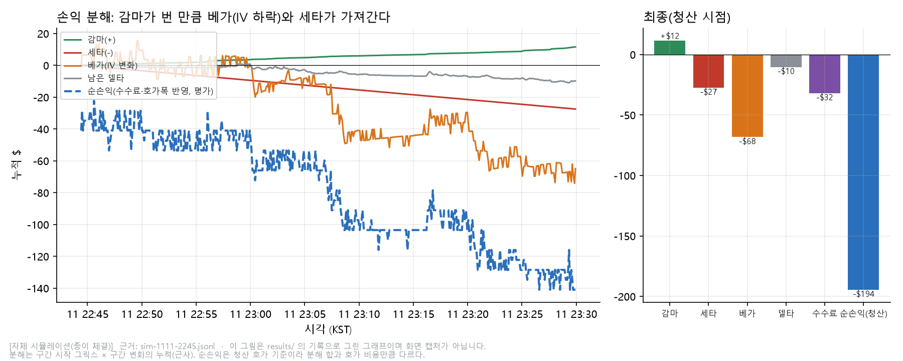

# 4주차 · 복수상품·스프레드 - 미장 개장 전 스트래들 구축 + MES 델타헤지 (개장 후 감마)

| 항목 | 내용 |
| --- | --- |
| 전략 이름 | **미장 개장 전 ES 주간옵션 ATM 롱 스트래들 구축 + MES 델타헤지로 개장 후 감마 수익 추구** |
| 전략 버전 id | `es-weekly-straddle-mes-hedge` v1 (`strategy.json`) |
| 대상 종목 | CME ES 주간옵션 `O_EW2X26`(2026-11-13 만기 = 11/14 06:00 KST, 거래소 코드 `OCME`) 콜·풋 / CME 마이크로 E-mini `MESZ26`(2026-12 월물, `FCME`) / 시세 기준 `ESZ26` |
| 실행 환경 | [백테스트] + [자체 시뮬레이션(종이 체결)] + 모의계좌 주문 스모크(해외 모의 서버 `apidemo.futures.co.kr`, 실전 미사용). 전략 엔진의 모의계좌 주문 실행은 하지 않음(5절) |
| 작성일 | 2026-11-13 |

## 폴더 구성

| 경로 | 내용 |
| --- | --- |
| `README.md` | 이 보고서 |
| `run.py` | 진입점 (`--env paper --mode backtest\|paper-sim\|paper-order --run-id`) |
| `strategy.json` | 전략·위험 한도·상품 상수·백테스트 가정 (코드에 매직 넘버 없음) |
| `strategy_core.py` · `bs.py` | 순수 로직: 호가·다리·헤지 판단·손익 분해·위험 한도·패리티 잔차 / Black-76 가격·그릭스·IV |
| `engine.py` | 진입 → 헤지 루프 → 청산 상태기계, 잔고 대사 |
| `brokers.py` | `NHBroker`(모의계좌 실제 주문) · `SimBroker`(가상 체결) |
| `replay.py` | [백테스트] 시장: 기록된 호가 재생 |
| `journal_adapter.py` | 엔진 사건 → 실행 기록(JSONL) 형식, 오늘 실현손익 집계 |
| `order_smoke.py` | 모의계좌 주문 스모크(MES·옵션 각 1계약: 지정가 접수·정정·취소, 시장가 왕복, 7093 점검) |
| `summarize_journal.py` | 기록에서 한 실행의 줄만 걸러 사본·요약 JSON 생성 |
| `charts.py` · `chartkit.py` | 보고서용 그래프(스크린샷 대신, `results/` 기록만 읽음) |
| `nhapi/` | NH선물 API 클라이언트 (4주차 시점의 사본) |
| `tests/` | 단위 테스트 48개 (NH 호출 없음) |
| `data/` | 11/10 22:17~23:45 호가 기록(옵션 체인 5초 간격, ES·MES) — 백테스트 입력 |
| `results/` | 실행 근거: 기록 사본(`*.jsonl`), 요약(`*_summary.json`), 백테스트 결과·가정(`*_result.json`), 그래프(`charts/`) |
| `screenshots/` | 스크린샷 자리의 그래프 사본 `NN-이름.png` |

## 1. 과제 요약

| 공지의 필수 기능 | 구현 위치 | 근거 |
| --- | --- | --- |
| 두 개 이상의 종목·월물을 함께 보는 전략 | ES 옵션 콜·풋 + MES 선물, 시세는 ES 호가 — `engine.py` `Engine._cycle` | `results/bt-1110-2229-l0.jsonl` |
| 「가격 차이(스프레드)」를 대상으로 삼기 | 스트래들(콜+풋)과 선물 델타의 어긋남을 헤지 대상으로 삼고, 같은 행사가 콜·풋·MES 의 **풋-콜 패리티 잔차**(콜−풋+행사가−MES)를 매 2초 기록 — `strategy_core.py` `hedge_order`, `parity_residual` | 3·6절, `results/charts/parity_spread.png` |
| 두 다리(레그) 주문을 함께 다루기 | 콜→풋 순서 진입, 풋만 거부되면 콜+MES 구조로 계속, 콜 거부면 진입 포기, 헤지 거부 시 간격 벌리기, 청산은 옵션(보유분만)→MES→잔고 0 확인 — `engine.py` `_enter`, `_execute`, `_exit` | `tests/test_engine.py` |
| 신호·주문·체결·손익 기록을 스스로 남김 | 한 줄=한 사건 JSONL — `journal_adapter.py` | `results/*.jsonl` |
| 모의계좌 우선, 어느 쪽인지 명시 | 모드를 `--mode` 로 명시, 체결 `source` 칸으로 구분 | 5절 |

| 제출물 | 이 폴더의 위치 |
| --- | --- |
| 소스코드·실행 방법 | 위 폴더 구성, 2절 |
| 보고서 | 이 README |
| 실행 근거 | `results/` |
| 스크린샷 | `screenshots/` (그래프 사본, 화면 캡처 아님) |

선택 기능: 풋-콜 패리티 잔차 기록, 헤지 band·체결 지연 비교 백테스트.

테스트 원칙: 실전 주문은 하지 않습니다. 시뮬레이션 체결을 모의계좌 체결로 표현하지 않습니다. 주문 접수만 있으면 체결 성공으로 적지 않습니다(체결은 주문내역·잔고로 확인한 것만). 실제로 발생한 오류만 적습니다.

## 2. 실행 방법

이 폴더에서 실행합니다.

설치:

```bash
pip install -r requirements.txt
```

설정(모의 주문·실시간 시세에만 필요): `config.example.yaml` 을 `_secrets/config.yaml` 로 복사해 해외 모의 APP Key·Secret 을 채우고, 환경변수 `NHFUTURES_CONFIG` 로 그 경로를 가리킵니다. 키는 이 폴더에 두지 않습니다.

재현 명령:

```bash
# [백테스트] 11/10 22:29 진입 → 23:40 청산 (키·네트워크 필요 없음)
python run.py --env paper --mode backtest --run-id bt-1110-2229-l0 --day 20261110 --start 22:29:00 --exit 23:40:00 --latency 0 --band 1 --out-dir results
# [자체 시뮬레이션] NH 실시간 시세 + 가상 체결 (주문 없음)
python run.py --env paper --mode paper-sim --run-id sim-EXAMPLE --enter-at auto --exit 23:40
# [모의계좌 주문] 모의계좌에 실제 주문 (1쌍). --enter-at auto = 미장 개장(23:30) 20분 전(23:10)까지 포지션 없이 기다렸다가 진입
python run.py --env paper --mode paper-order --run-id ord-EXAMPLE --enter-at auto --exit 23:40 --yes   # 이 명령은 구현·테스트했지만 이번 제출에서는 실행하지 않았다(5절)
```

백테스트 변형(6절 표): `--band 0.5|2|3|999`(999=헤지 안 함), `--latency 5|10`, `--start 23:05:00`.
중단: 작업 폴더에 `STOP` 파일을 만들거나 Ctrl+C → 미체결 취소 → 옵션 매도(보유분만) → MES 정리 → 잔고 0 확인 → 기록 마감.

요약·그래프·테스트:

```bash
python summarize_journal.py --log logs/<run_id>.jsonl --run <run_id> --out results
python charts.py plot                    # 백테스트 그래프 4장 → results/charts/, screenshots/
python charts.py plot --run <run_id>     # 본 실행 그래프 → screenshots/10-*, 11-*
python -m pytest tests -q
```

기본 기록 폴더는 `logs/` 입니다(첫 실행 때 생성). 이 폴더의 `results/` 에는 그 실행의 줄만 거른 사본이 들어 있습니다.

## 3. 전략과 매매 계획

### 3-1. 대상 상품

| | ES 주간옵션 `O_EW2X26` | `MESZ26` | `ESZ26` |
| --- | --- | --- | --- |
| 만기 | 2026-11-13 장 마감(= 11/14 06:00 KST) | 2026-12-18 (잔존 37일) | 2026-12-18 |
| 승수 | $50/pt (CME 규격) | $5/pt | $50/pt |
| 호가 단위 | 관측 호가 0.25 단위 | 0.25 pt = $1.25 | 0.25 pt = $12.50 |
| 수수료(1계약 편도) | $8 (팀 확인값, 2026-11-10) | $2 (팀 확인값) | — |
| 유동성 (11/11 19:00 모의 호가, `results/phase1_probe/chain_O_EW2X26.json`·`book_*.json`) | ATM 7600 콜 41.75/42.25 (잔량 44·15), 풋 41.75/42.25 (36·1) | 7599.75/7600.00 (17·15) | 7599.75/7600.00 (15·9) |

- 승수·호가 단위는 API(`product-detail`)가 0건을 돌려줘 **CME 규격을 근거로** 썼습니다(8절). 증거금은 모의 잔고 확인 전이라 적지 않습니다.
- 차월물(ESH27/MESH27)은 호가가 1~3계약뿐이라 월물 간 전략 후보에서 뺐습니다(근거 `results/phase1_probe/book_ESH27.json`, `book_MESH27.json`: 2026-11-11 19:00 KST 조회 1회).
- 옵션 시리즈 만기는 `product-expiry` 가 0건이라 **코드(`strategy.json` `expiry_kst`)에 직접 적었습니다.**

### 3-2. 전략 논리와 후보 비교

**전략 논리(팀 전략):** 미국 정규장이 열리기 **전에** ES 주간옵션 ATM 스트래들(콜 1 + 풋 1)을 구축하고, 개장(09:30 ET = 23:30 KST, 미국 서머타임 종료 2026-11-01 이후) 뒤 **실현변동성이 커지는 구간에서 감마 수익**을 얻는다. 움직임으로 델타가 틀어질 때마다 MES 로 중립을 되돌려, 방향이 아니라 움직임의 크기에서 이익을 거둔다. 모의 운영이 24:00 이고 엔진 마감이 23:45 라 **개장 후 약 10~13분**이 이 논리를 쓰는 구간이다(세션 설정: `strategy.json` `session`).


| | A. ES 주간옵션 ATM 롱 스트래들 + MES 델타헤지 (채택) | B. ES 월물 간 캘린더 스프레드 | C. ES–MES 가격 차 차익 |
| --- | --- | --- | --- |
| 근거 | 롱 감마가 ½Γ(ΔS)² 를 벌고 세타·IV 하락을 낸다 | 월물 베이시스 평균회귀 | 같은 지수를 따르는 두 상품 |
| 두 다리 주문 | 옵션 콜·풋 + MES (3다리) | 선물 2다리 | 선물 2다리 |
| 약점 | IV 하락(베가)·시간가치 손실, 쌍당 고정 비용 | 차월물 호가가 얇음 | 호가가 같아 1틱 괴리 < 왕복 비용 |
| 판단 | 채택 | 제외 | 제외 |

A 를 고른 이유는 팀 결정(개장 후 변동성 확대를 감마로 거두는 논리)이며, 코드·기록(11/10)이 있고 **약점(베가 손실)을 손익 분해로 설명**할 수 있기 때문입니다.

### 3-3. 지표·파라미터 근거 (`strategy.json`)

| 파라미터 | 값 | 근거 |
| --- | --- | --- |
| `band` | 1 (MES 계약) | 어긋남 ≥ 1계약일 때만 주문. 1쌍이면 MES 1계약 ≈ ES 13pt(추정: 11/11 19:00 호가의 IV 16.9%, 잔존 59시간 → 감마 0.0076/pt) |
| `min_gap`, `max_hedges_per_hour` | 10초, 12회 | 같은 가격대에서 오르내릴 때 주문 폭주를 막음. 넘으면 band 2배 |
| `iv_max_spread` / `entry_max_spread` | 2 pt | 11/10 CPI 전후 옵션 호가폭이 7~12 pt 까지 벌어졌다는 기록(팀 메모)에서, 넓을 때 IV 갱신·진입을 건너뜀 |
| `stop_per_pair` / `stop_hold` | $400 / 30초 | 스트래들 가치 약 $4,200 의 10% 미만. **베가 약 $249/변동성 1pt 라 IV 1.6pt 하락이면 닿는 크기**(추정) |
| `max_mes_per_pair` | 12 | 쌍당 옵션 델타 최대 ±1.0 → MES ±10, 여유 2 |
| `daily_loss_limit` | $1,200 | 남은 한도 < 1회 손절 금액이면 신규 진입 금지(같은 날 이전 실행 요약에서 읽음) |
| `deadline` | 23:45 | 모의 운영 24:00 전 잔고 0. 마감 2분 전부터 시장가로 정리 |

### 3-4. 매매 규칙

| 항목 | 규칙 |
| --- | --- |
| 진입 시각 | **미장 개장 20분 전**(`--enter-at auto` = 23:10, `strategy.json` `session.enter_before_open_min`)까지 포지션 없이 기다림(대기 중에도 STOP·마감 감시). `--enter-at` 를 안 주면 실행한 순간 진입 |
| 진입 | 진입 시각의 ES 호가 가운데 값에 가장 가까운 5pt 행사가. 콜 → 풋 순서로 매수, 매도호가 지정가 → 10초 미체결이면 취소 후 시장가. 옵션 호가폭 2pt 초과면 최대 120초 기다림 |
| 헤지 | 어긋남 = 옵션 델타×10 + MES 보유. \|어긋남\| ≥ band 이면 가장 가까운 정수로 MES 시장가. 주문 간격 ≥ 10초, 시간당 12회 초과면 band 2배, ES 호가가 60초 넘게 멈추면 안 함, MES 보유 상한 |
| 델타·IV | ES 호가로 매 2초 델타. IV 는 옵션 호가 가운데 값에서(호가폭 2pt 초과면 건너뜀, 최근 5개 중앙값) — 체결가·현재가 조회는 쓰지 않음 |
| 손절 | 수수료 포함 평가손익 ≤ −$400/쌍 이 30초 이어지면 청산 |
| 청산 | `--exit` 시각(개장 뒤, 권장 23:40) / 마감 2분 전 / STOP 파일 / Ctrl+C. 옵션은 잔고 조회 수량 이하만 매도, MES 정리, 잔고 0 확인 |
| 수량 | 1쌍(콜 1 + 풋 1) |
| 재시도 | 주문은 자동 재시도 안 함. 응답이 없으면 주문내역(10회, 1초 간격) → 잔고 차이로 판정 |

### 3-5. 규칙별 이유와 결과에서 확인된 것

| 규칙 | 이유 | 백테스트에서 확인된 것 |
| --- | --- | --- |
| band 안에서는 가만히 | 수수료($2)·호가폭 때문에 자주 맞추면 비용이 감마 이익을 초과 | band 0.5 는 헤지 17회·수수료 $72, band 1 은 2회·$44 (6절) |
| 옵션은 보유분만 매도 | 모의 서버가 옵션 신규 매도를 7093 으로 거부(팀 메모) | 테스트로 초과 매도 0건 확인, 모의계좌에서는 신규 매도가 7093 으로 거부됨을 스모크로 확인(6-5절), 보유분 매도는 체결됨 |
| 개장 전 진입, 개장 후 헤지 | 개장 뒤 실현변동성이 커지는 구간에 감마를 이미 들고 있기 위해 | 11/10 기록: 개장 전후 ES 1분 변동폭 평균 2.0pt → 5.4pt(7절). 23:05 진입 변형은 개장 뒤 10분에 감마가 +$17 → +$78 로 쌓임 |
| 호가폭 넓으면 IV 갱신·진입 보류 | 지표 직후 호가가 벌어져 IV 가 튐 | 11/10 22:30 직후 베가 곡선이 크게 흔들림(`pnl_attribution.png`) |

### 3-6. 한계

이 전략은 **만기까지 들고 갈 수 없습니다.** 모의 운영 시간이 24:00 이고 옵션 만기는 다음 날 06:00(KST)이라 당일 청산해야 하고, 스트래들은 지표(예: 11/10 22:30 CPI) 전에 높게 형성된 내재변동성이 발표 뒤 내려가는 **베가 손실**을 그대로 맞습니다. 따라서 **손실이 날 수 있다는 것을 알고 시작합니다.** 목표는 수익이 아니라 실행·API 처리·손익 분해입니다. 11/10 재현에서 이미 감마 +$264, 세타 −$38, 베가 −$160, 순손익 −$125 였습니다.

## 4. 사용 API와 프로그램 구조

```
run.py ─ strategy.json ─▶ Engine(상태기계: STARTUP → ENTER[진입 시각까지 WAIT] → HEDGE ⟲ → EXIT)
                             │  매 2초: ES·옵션 호가 → IV → 그릭스 → 어긋남 → (band 이상이면) MES 주문
                             ├─ Broker: NHBroker(모의계좌) | SimBroker(가상 체결)
                             │     └ nhapi: Client(토큰·호출 제한·재시도) · OverseasGateway(주문·대사)
                             └─ EngineJournal ─▶ logs/<run_id>.jsonl (run·event·signal·order·fill·error·api_issue)
```

| 용도 | API | 구분 | 빈도 |
| --- | --- | --- | --- |
| 토큰 | 인증(해외 키) | REST | 시작 1회 + 만료 전 |
| ES·MES·옵션 호가 | `overseas_bid-price` | REST | 2초마다 4회 (제한 시세 10/초 이하) |
| 옵션 체인 | `overseas_price-all-option` | REST | **전략 실행에서는 쓰지 않음** — ATM 은 ES 호가로 직접 계산하고 옵션 호가는 `overseas_bid-price` 로 읽는다. 상품 탐색(`work/phase1_probe.py`)에서만 1회 조회(8절 ATM 플래그 관찰) |
| 주문·정정·취소 | `overseas_order` | REST | 진입·헤지·청산 때만 (제한 5/초) |
| 주문내역·체결 확인 | `overseas_order-history` | REST | 주문당 1~10회 |
| 잔고 대사 | `overseas_open-interest` | REST | 30초마다 + 주문 직후 |

실시간(WS) 시세는 쓰지 않았습니다. 델타 어긋남 band 가 ES 13pt 에 해당해 2초 폴링으로 충분하고, 호출량이 제한의 20% 이하입니다.

오류 처리:
- **성공 판정:** HTTP 200 이 아니라 본문의 `err_cd`/`msg_cd`. 접수(주문번호)≠체결 — 체결은 주문내역·잔고 차이로 확인.
- **호출 제한:** `EGW020/036/037`·HTTP 429 는 10 → 20 → 40초 쉬고 다시(조회만), 호출 사이 최소 0.15초.
- **재시도:** 주문 요청은 재시도하지 않음. 응답이 없으면 주문내역을 10회 재조회, 그래도 모호하면 잔고로 판정.
- **재접속·재시작:** 포지션의 진실은 계좌 잔고. `--resume` 로 잔고에서 이어받고 30초마다 대사.
- **청산은 킬 스위치에 막히지 않음:** `reduce_only` 주문은 진입 점검을 건너뜀.
- **기록:** 한 줄 = 한 사건. 모든 줄에 `run_id·ts·env·mode·sym`, 체결에는 `source`(backtest-model / paper-sim / mock-account), 호출에는 `api_id·http_status·msg_cd·latency_ms`.

## 5. 실행 환경

| 구분 | 상태 |
| --- | --- |
| [백테스트] | 완료(2026-11-11 20:07). 입력: 11/10 22:17~23:45 NH 모의 서버 호가 기록(옵션 체인 5초 간격, ES·MES — `data/`, 해시는 `*_result.json`). **수집 주체·방식의 상세는 기록하지 못했다**(팀 전략 초안과 함께 전달된 압축 파일에 담긴 기록을 사용). 가상 체결 |
| [자체 시뮬레이션(종이 체결)] | **완료 1회**: 2026-11-11 22:44:23~23:30:00 KST, run_id `sim-1111-2245`, NH 모의 서버 실시간 호가 + 가상 체결(주문 없음), 1쌍 |
| [모의계좌 주문] | **스모크 완료**(2026-11-11 20:37~20:38, run_id `smoke-w04-20261111-b`, MES·옵션 각 1계약). **전략 엔진(`run.py --mode paper-order`)의 모의계좌 주문 실행은 하지 않았다.** 경위: 개장 전 진입 규칙(`--enter-at`)은 11/12 밤에 완성했고, 개장 후 구간(23:30~23:45)을 쓰는 본 실행은 제출 시점까지 이뤄지지 않았다. 주문 경로 자체는 스모크로 모의계좌에서 확인했다(6-5절) |

[백테스트] 가정 (`results/*_result.json` 의 `assumptions` 에도 저장): 시장가·건너는 지정가는 **맞은편 호가에 전량 체결**(호가폭 전부가 슬리피지), 체결 지연은 `latency_sec` 초 뒤 호가, 스냅숏(5초) 사이는 직전 호가 유지(봉 내부 경로 가정 없음), 금리 0, 수수료 옵션 $8·MES $2(편도), 가상 자금 한도 없음.

## 6. 실행 결과

### 6-1. 근거 파일

| 실행 | 파일 |
| --- | --- |
| 기본 (22:29 진입, band 1, 지연 0) | `results/bt-1110-2229-l0.jsonl`, `_summary.json`, `_result.json` |
| 변형 | `bt-1110-2229-{l5,l10,b0p5,b2,b3,nohedge}`, `bt-1110-2305-l0` 동일 3종 |
| 자체 시뮬레이션 | `results/sim-1111-2245.jsonl`, `sim-1111-2245_summary.json` |
| 입력 데이터 해시 | `*_result.json` 의 `inputs_sha256` |
| 상품 조회(읽기 전용, 주문 없음, 마스킹) | `results/phase1_probe/` (호가·만기·품목상세·옵션 체인 응답). 3-1절 ATM 호가와 3-3절 추정치의 근거는 `chain_O_EW2X26.json`(2026-11-11 19:00 KST, 행사가 410개) |

### 6-2. [백테스트] 결과 (11/10, 22:29 진입 → 23:40 청산, K=7580)

| 실행 | 헤지 횟수 | 수수료 | 수수료 전 손익 | **순손익** |
| --- | --- | --- | --- | --- |
| 헤지 안 함 | 0 | $32 | $0.00 | **-$32.00** |
| band 0.5 | 17 | $72 | -$46.25 | **-$118.25** |
| **band 1 (기본), 지연 0** | 2 | $44 | -$81.25 | **-$125.25** |
| band 2 | 1 | $40 | -$62.50 | **-$102.50** |
| band 3 | 1 | $44 | +$153.75 | **+$109.75** |
| band 1, 지연 5초 | 2 | $44 | +$50.00 | **+$6.00** |
| band 1, 지연 10초 | 2 | $44 | -$102.50 | **-$146.50** |
| (참고) 23:05 진입(개장 25분 전), band 1 | 0 | $32 | -$125.00 | **-$157.00** |

기본 실행의 체결: 22:29:00 콜·풋 각 1계약 매수(54.75, 56.75), 22:30:08 MES 2계약 매수(7548.25), 22:40:44 MES 1계약 매수(7524.75), 23:40:00 콜·풋 매도(33.75, 77.75), MES 3계약 매도(7535.00). 잔고 0 확인.

### 6-3. 손익 분해 (기본 실행)

| 감마 | 세타 | 베가 | 남은 델타 | 호가 비용 | 수수료 | 순손익 |
| --- | --- | --- | --- | --- | --- | --- |
| +$263.50 | -$37.51 | -$160.13 | -$33.13 | -$113.98 | -$44.00 | -$125.25 |

(분해는 구간 시작 그릭스 × 구간 변화의 근사, 호가 비용 = 분해 합 +$32.73 − 수수료 전 손익 −$81.25 로 역산한 값.)

### 6-4. 풋-콜 패리티 잔차 (기본 실행, 매 2초 2,046개)

평균 −0.006pt, 표준편차 0.59pt, 최소 −4.125, 최대 +5.125. 세 다리 반호가폭 합(거래비용)을 넘은 표본은 125개(6.1%). 신호·주문에는 쓰지 않았습니다.

### 6-5. [모의계좌 주문] 스모크 결과 (2026-11-11 20:37~20:38 KST, `order_smoke.py`, run_id `smoke-w04-20261111-b`)

근거: `results/smoke-w04-20261111-b.jsonl`(마스킹된 응답 원문 포함), `results/smoke-w04-20261111-b_summary.json`. 시작 대사(보유·미체결 0) → … → 최종 잔고 0·미체결 0. 모든 체결은 **주문내역 조회로 확인한 것**입니다(접수 응답만으로 체결로 적지 않음).

| 단계 | 결과 |
| --- | --- |
| MES 지정가 매수 @7584.50(시세에서 멀리) | 접수 0000000690 → 미결 조회 1건(`confirmed`) → 정정 @7583.25 → **새 주문번호 0000000691** → 취소 → **새 주문번호 0000000692**(대상 691) → 미결 0건 |
| 옵션(`O_EW2X26-C7610.0`) 지정가 매수 @20.50 | 접수 0693 → 정정 @19.25(0694) → 취소(0695) → 미결 0건 |
| 옵션 신규 매도 점검(보유 없이 @81.50 지정가) | **거부 `7093` "옵션신규매도 거래가 불가능합니다"**. 같은 시각 주문가능수량 조회는 매도 3계약 가능이라 답함 (8절) |
| MES 시장가 매수 1 → 매도 1 | 접수 0696 → 체결 7609.50 → 잔고 확인 → 접수 0697 → 체결 7609.25 → 잔고 0 |
| 옵션 콜 시장가 매수 1 → 매도 1(`reduce_only`) | 접수 0698 → 체결 41.25 → 잔고 확인 → 접수 0699 → 체결 40.75 → 잔고 0 |

체결 가격 차 손익: MES −$1.25(0.25pt × $5), 옵션 −$25.00(0.50pt × $50), 수수료 별도. 이 스모크에서 확인된 것: 지정가 정정·취소는 주문번호가 바뀐다(코드가 따라감), 주문가능수량과 실제 주문 가능 여부가 다르다, 옵션 시장가·보유분 매도가 모의에서 체결된다. 이 한 번의 체결가는 백테스트의 "맞은편 호가 전량 체결" 가정과 비교할 호가를 주문 직전에 따로 기록하지 않아 **슬리피지 모형 검증에는 쓰지 않았습니다.** 전략 엔진(`run.py --mode paper-order`)의 실행 결과는 없습니다.

### 6-6. [자체 시뮬레이션(페이퍼 포지션)] 결과 — 2026-11-11 22:44:23~23:30:00 KST, run_id `sim-1111-2245`

NH 모의 서버의 **실시간 호가**를 읽고 체결은 **우리 시뮬레이터(맞은편 호가 전량)** 로 처리했습니다. 주문은 서버로 나가지 않았고 모든 체결 `source` 는 `paper-sim` 입니다. 모의계좌 체결이 아닙니다. 근거: `results/sim-1111-2245.jsonl`, `_summary.json`.

| 항목 | 값 |
| --- | --- |
| 진입 | 22:44:24 ES 7613.875 → 행사가 7615, 콜 39.75·풋 41.00 매수(가상 체결) |
| 청산 | 23:30:00 `--exit` 시각, 콜 37.75·풋 39.75 매도, 잔고 0 (`flat: true`) |
| ES 경로 | 7611.375 ~ 7619.125 (범위 7.75pt), 마지막 7611.5 |
| IV (콜·풋 평균) | 16.6% → 16.4% (−0.25 변동성 pt) |
| 헤지 | **0회** — 델타 어긋남 최대 0.38 MES 계약으로 band(1계약) 안 |
| 손익 분해 | 감마 +$11.55, 세타 −$27.48, 베가 −$68.29, 남은 델타 −$10.32, 호가 비용 약 −$68, 수수료 −$32 |
| 수수료 전 / **순손익** | −$162.50 / **−$194.50** |
| 패리티 잔차 (1,088개) | 평균 −0.009pt, 표준편차 0.17pt, 최소 −1.125, 최대 +0.875, 거래비용 초과 6개 |
| API 호출 | `overseas_bid-price` 4,364회(약 1.6회/초, 제한 10/초의 약 16%), 지연 중앙값 32ms·95% 78ms, HTTP 200 4,363회, 타임아웃 1회(22:45:32, 10초 — 다음 호출에서 회복, 오류·주문 영향 없음) |

체결 4건(진입 2·청산 2) 외 주문·오류·`api_issue` 는 없었습니다.

이 실행은 `--exit 23:30` 이라 **미장 개장(23:30) 구간을 포함하지 않았습니다**(개장 전 진입 규칙을 넣기 전의 실행). 개장 후 감마 논리의 검증은 `--enter-at auto --exit 23:40` 실행에서 합니다.

### 6-7. 그래프 (스크린샷 대신 — 모두 `results/` 기록으로 그린 그래프이며 화면 캡처가 아님)

| 파일 | 환경 | 보여 주는 것 |
| --- | --- | --- |
| `screenshots/01-hedge_timeline.png` | [백테스트] | ES 경로, MES 보유, 델타 어긋남, 헤지 시점 |
| `screenshots/02-pnl_attribution.png` | [백테스트] | 손익을 감마·세타·베가·델타로 분해한 누적 곡선과 최종 막대 |
| `screenshots/03-hedge_rule_compare.png` | [백테스트] | 헤지 band 별·체결 지연별 순손익 |
| `screenshots/04-parity_spread.png` | [백테스트] | 풋-콜 패리티 잔차 시계열·분포와 거래비용 폭 |
| `screenshots/10-run_sim-1111-2245_timeline.png` | [자체 시뮬레이션(종이 체결)] | 11/11 밤 ES 경로, MES 보유(0), 델타 어긋남(band 안) |
| `screenshots/11-run_sim-1111-2245_attribution.png` | [자체 시뮬레이션(종이 체결)] | 손익 분해 누적 곡선과 최종 막대(베가·세타·호가 비용) |








모의계좌 주문 실행 뒤 `screenshots/12-*`, `13-*`(해당 run 의 타임라인·손익 분해, 환경 표기 포함)을 추가합니다(`charts.py plot --run <run_id> --number 12`).

## 7. 해석과 한계

- **왜 손실인가:** 감마(+$264)는 ES 가 22:30→22:31 사이 7578.6 → 7543.5(약 −35pt)로 움직이며 벌었지만, 발표 뒤 5분 사이 내재변동성이 19.2% → 약 18.8% 로 내려 베가(−$160)가 이를 상당 부분 상쇄하고, 세타(−$38)와 호가 비용(약 −$114)·수수료($44)가 더해져 순손익이 −$125 가 되었습니다. 전략 특성상 만기까지 들고 갈 수 없어 IV 하락이 그대로 손실로 확정됩니다.
- **헤지 규칙 간 우열은 잡음입니다.** band 3 은 +$110, band 1 은 −$125 이지만 같은 하루 한 경로이고, 체결 지연만 0 → 5 → 10초로 바꿔도 −$125 → +$6 → −$147 로 부호가 바뀝니다. 헤지를 한 번도 안 한 경우(−$32)가 가장 손실이 작은 것은 하루 ES 하락 방향과 델타 어긋남이 우연히 맞은 결과로 읽어야 합니다.
- **고정 비용:** 헤지를 거의 안 해도 옵션 왕복 호가 비용과 수수료($32)가 있어 움직임이 작으면 반드시 손실입니다(23:05 진입 −$157: 발표 뒤 잔잔한 구간).
- **개장 효과 확인(11/10 기록, 하루 한 경로·근사):** ES 1분 간격 표본의 평균 절대 변동폭은 23:00~23:30 에 2.03pt(29개), 개장 뒤 23:30~23:45 에 5.38pt(14개)로 약 2.7배였습니다. 개장 25분 전 23:05 에 진입한 변형(`bt-1110-2305-l0`)에서 개장 전(23:05~23:30)은 감마 +$17·세타 −$15·베가 −$3 이었고, 개장 뒤 10분은 감마 +$61(누적 +$78)로 감마가 개장 뒤에 몰려 쌓였습니다. 하지만 같은 10분에 IV 가 20.4% → 20.0% 로 내려 베가가 −$114 로 감마 이익을 넘었고 순손익은 −$157 이었습니다. **개장 뒤 변동성 확대는 관측되지만 이 하루는 IV 하락이 감마를 능가해 전략이 수익을 내지 못했습니다.** 개장 전 진입과 모의계좌 실행 결과는 5·6절의 실행 후 갱신에서 같은 방식으로 분해합니다.
- **조용한 밤(11/11 자체 시뮬레이션):** ES 가 45분 동안 7.75pt 만 움직여 어긋남이 최대 0.38계약에 그쳤고 헤지는 한 번도 나가지 않았습니다(1쌍의 MES 1계약 ≈ ES 13pt). 감마 이익은 +$12 에 그친 반면 세타 −$27, IV 16.6→16.4%(−0.25pt)에 따른 베가 −$68, 호가 비용 약 −$68, 수수료 −$32 가 고정 비용처럼 작용해 −$194.50 이었습니다. 11/10 CPI 밤(감마 +$264)과 대비해 **이 전략의 손익은 실현 변동폭에 달려 있고, 움직임이 작으면 고정 비용만 남는다**는 것을 두 경로가 보여 줍니다. 두 경로만으로 일반화하지는 않습니다.
- **패리티 잔차:** 평균은 0 근처이고 11/10 CPI 밤은 표준편차 0.6pt·거래비용 초과 6%, 11/11 조용한 밤은 표준편차 0.17pt·초과 0.6%(6/1,088)로 변동이 클수록 괴리가 커집니다. 어느 쪽이든 이 괴리로 별도 차익 거래를 하기엔 비용 대비 기회가 적습니다.
- **한계:** 표본이 하루 한 번의 경로, 5초 스냅숏 기반이라 헤지 직전의 가격 이동을 못 봄, 체결을 맞은편 호가 전량으로 가정(실제 모의 체결과 다를 수 있음), 금리 0, IV 는 호가 가운데 값 기반이라 지표 직후 잡음이 큼. 전략 엔진의 모의계좌 체결 결과는 없음.
