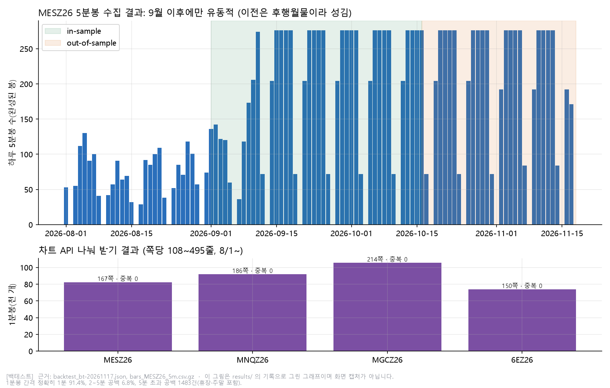
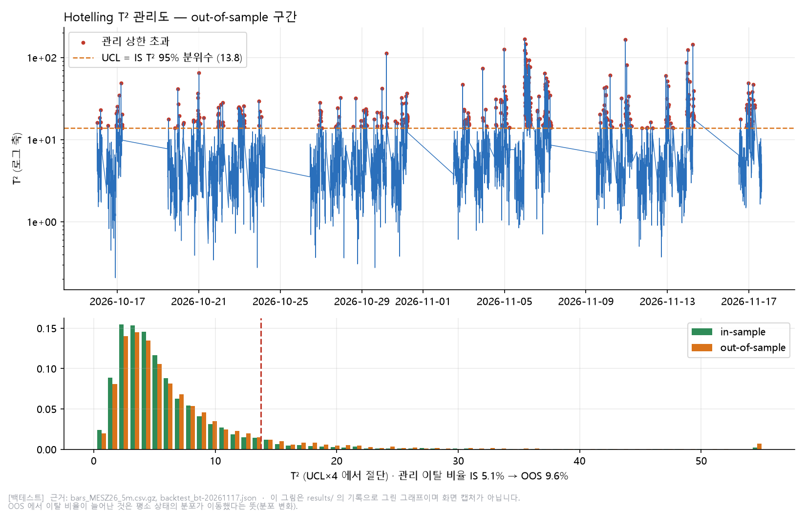
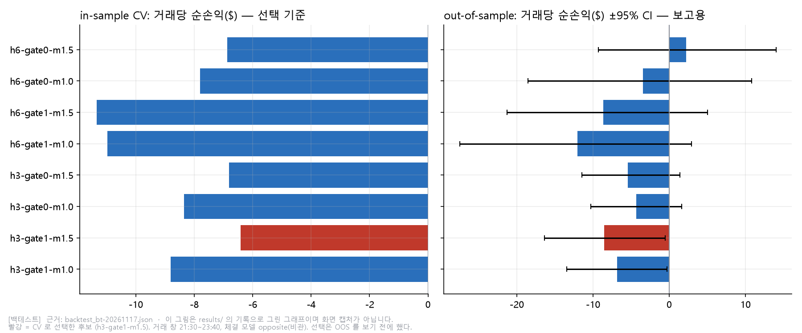
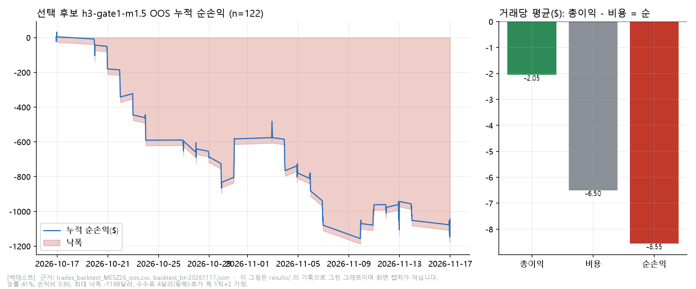
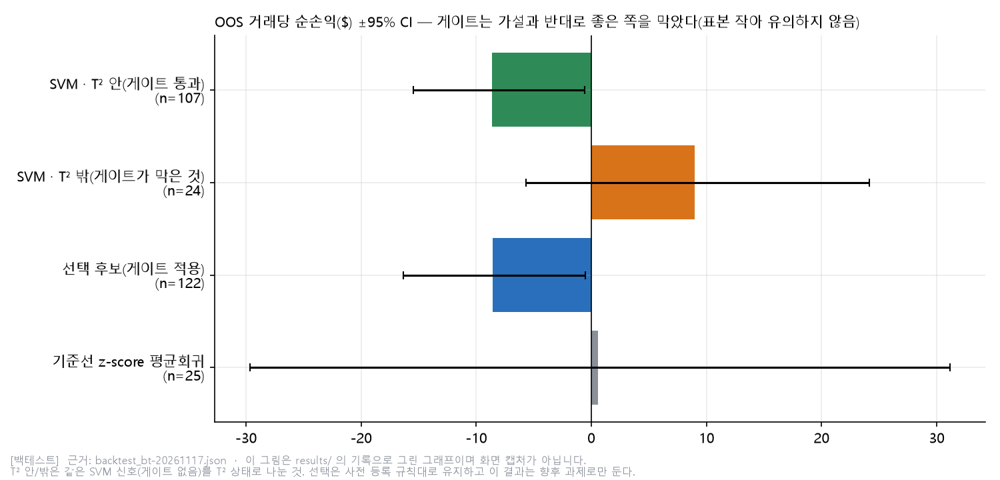
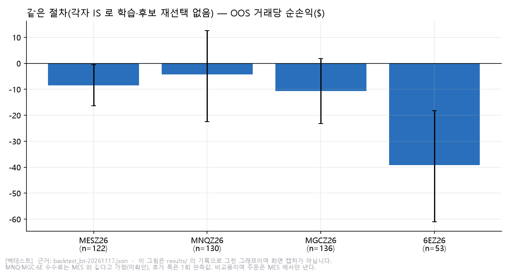
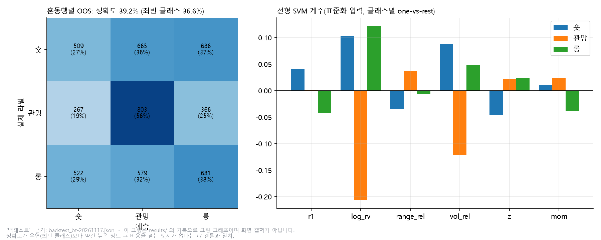
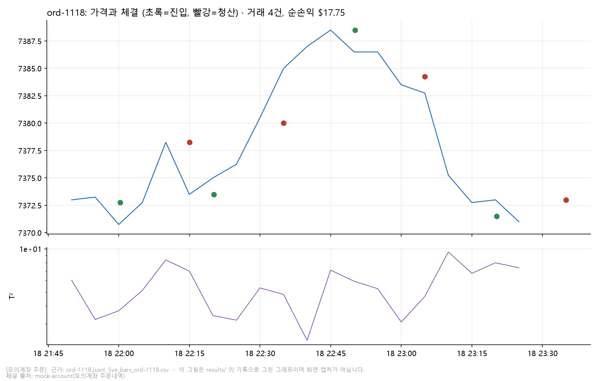

# 5주차 — 데이터 기반 전략: T² 관리도 국면 게이트 + 선형 SVM 롱/숏 분류 (MES)


> **실행 환경 한눈에**
> - 시세 데이터 수집: **NH 모의 서버**(해외 APP Key)의 차트(분) API. 주문 없음.
> - 6절 A (검증): **[백테스트]** — 과거 1분봉으로 우리 코드가 체결을 가정한 값. 모의계좌 체결이 아님.
> - 6절 B-1 (주문 스모크): **[모의계좌 주문 스모크]** — 2026-11-17, MES 1계약, 모의계좌 주문내역으로 확인.
> - 6절 B-2 (전략 모의 실행): **[모의계좌 주문]** `ord-1118`(2026-11-18 21:57~23:35, MES 1계약, 체결은 모의계좌 주문내역 기준) + 리허설 **[자체 시뮬레이션]** `sim-1118b`(체결을 섞지 않고 따로 적음).


| 항목 | 내용 |
| --- | --- |
| 전략 이름 / 버전 | `t2-svm-v1` / 선택 후보 `h3-gate1-m1.5` (`model_MESZ26.json`) |
| 대상 종목 | CME 마이크로 E-mini S&P 500 `MESZ26` (2026-12-18 만기, 현금결제) |
| 데이터 | 1분봉 2026-08-01 ~ 2026-11-17 15:12 → 5분봉 16,190개 (유동 구간은 9월 이후) |
| 실행 환경 | 검증 [백테스트] / 모의 실행은 6절 B 참조 |


## 폴더 구성

| 경로 | 내용 |
| --- | --- |
| `run.py` | 진입점 (`--env paper --mode backtest\|paper-sim\|paper-order --run-id`) |
| `collect_chart.py` | 차트 API 나눠 받기 → 이어 붙이기·중복 제거 → CSV.gz + 요약 JSON |
| `bars.py` | 1분봉 → 5분봉 합성, 데이터 품질 점검 |
| `signals.py` | 특징 계산, Hotelling T² 관리도, 선형 SVM, 거래 창·이벤트 제외 (백테스트·라이브 공용) |
| `backtest.py` · `research.py` | 체결 시뮬레이터·지표 / 후보 8개 선택·OOS·교차상품 검증 파이프라인 |
| `engine.py` · `brokers.py` | 실시간 실행 엔진(상태기계·리스크·킬 스위치) / 모의계좌·가상 체결 브로커 |
| `order_smoke.py` | 모의계좌 주문 점검(지정가 접수·정정·취소, 엔진 방식 진입, 시장가 왕복, 잔고 0 확인) |
| `replay_check.py` · `summarize_journal.py` | 라이브-리플레이 신호 일치 검사 / 실행 기록 요약 |
| `charts.py` · `chartkit.py` | 보고서 그래프 (스크린샷 대신) |
| `strategy.json` · `model_MESZ26.json` | 전략 설정 / 학습된 모형(표준화·SVM 계수·T² 평균·정밀도·UCL) |
| `nhapi/` | 우리 팀 API 클라이언트(이 주차 시점의 사본). 이번 주 추가: `history.py` |
| `tests/` | 단위 테스트 (API 없이 동작) |
| `results/` | 데이터(`data/`), 검증 결과 JSON, 5분봉·거래 CSV, 모형, 차트(`charts/`), 스모크 기록, 모의 실행 `ord-1118`(원본 줄 사본·요약·`live_bars_*.csv`·리플레이 검사), 리허설 `sim-1118b`, 사후 재수집 1분봉(`data_recheck/`) |
| `screenshots/` | 그래프 사본 `NN-이름.png` (화면 캡처 아님) |

## 1. 과제 요약

| 공지 요구 | 구현 위치 | 근거 파일 |
| --- | --- | --- |
| 시세 데이터를 **나눠 받아 이어 붙이고 중복 제거** | `collect_chart.py`, `nhapi/history.py` (`collect_overseas_minute`: `nxt_key` 이어받기, `(날짜,시각)` 중복 제거, 멈춤 조건) | `results/data/collect_summary_collect-20261117.json` (쪽 수·중복·쪽당 줄 수) |
| **가공·분석** | `bars.py` (5분봉 합성, 공백·거래량 칸 점검), `signals.py` (특징 6개) | `results/backtest_bt-20261117.json` 의 `data`, `screenshots/01-data_quality.png` |
| **통계 기반 시그널** (변동성 국면 구분) | `signals.py` `T2Chart` — 다변량 Hotelling T² 관리도 | `screenshots/02-t2_chart.png` |
| **보조지표 조합** | 6개 지표(수익률·변동성·고저폭·거래량·z-score·모멘텀)를 한 벡터로 결합 | `signals.py` `compute_features` |
| **AI·ML 예측** (선택) | `signals.py` `SignalModel` — 선형 SVM 3분류(롱/숏/관망) | `model_MESZ26.json`, `screenshots/07-svm_confusion.png` |
| **신호가 쓸 만한지 검증** | `research.py` — 후보 8개 사전 등록, in-sample CV 로 선택, out-of-sample 1회, 교차상품, 기준선 | `results/backtest_bt-20261117.json`, `screenshots/03~06` |
| 모의계좌 주문·기록 | `engine.py`, `brokers.py`, `run.py` (JSONL 기록), `order_smoke.py` | 스모크: `results/smoke_summary.json`, `results/smoke-w05-20261117.jsonl`. 전략 실행: `results/ord-1118_summary.json`, `results/ord-1118.jsonl`, `results/replay_check_ord-1118.json` (6절 B-2) |
| 데이터 파일을 `results/` 에 | 1분봉 4종목 CSV.gz(5.7MB), 5분봉+특징+T²+신호 CSV.gz | `results/data/`, `results/bars_MESZ26_5m.csv.gz` |

| 제출물 | 위치 |
| --- | --- |
| 보고서 | 이 `README.md` |
| 코드 | 이 폴더 |
| 실행·검증 근거 | `results/` |
| 그림 | `screenshots/` (백테스트 그래프 7장 + 모의 실행 `10-run_ord-1118.png`), `results/charts/` |

**선택 기능**: ML 비교(SVM)를 포함했다. 오류 제보 3건(8절). **테스트 원칙**: 신호·백테스트·리스크·엔진 상태·기록·마스킹 테스트는 API 없이 돈다.

## 2. 실행 방법

이 폴더에서 실행한다 (Python 3.11+).

```bash
pip install -r requirements.txt          # uv 를 쓰면: uv pip install -r requirements.txt
python -m pytest tests -q                # 단위 테스트 (API 불필요)
```

키 설정: `config.example.yaml` 을 복사해 값을 채운 파일을 두고 환경변수 `NHFUTURES_CONFIG` 에 경로를 지정한다(모의 서버 해외 키만 쓴다). 키 파일은 이 폴더에 두지 않는다.

```bash
# 1) 검증 재현 — 키 불필요 (results/data 의 1분봉 사용). 약 1분.
python run.py --env paper --mode backtest --run-id bt-20261117 --data-dir results/data --out-dir results
python charts.py plot                    # 그래프 7장 → results/charts/, screenshots/

# 2) 데이터 다시 수집 — 모의 서버 키 필요, 조회만
python collect_chart.py --syms MESZ26 MNQZ26 MGCZ26 6EZ26 --start 20260801 --out-dir ../data --log-dir ../logs --run-id collect-001

# 3-0) 주문 스모크 — 모의계좌에 MES 1계약 주문(접수·정정·취소·왕복), 잔고 0 으로 끝남
python order_smoke.py --run-id smoke-001 --log-dir ../logs --yes

# 3) 모의 실행 — 키 필요 (장중, 해외 모의 07:00~24:00, 우리 엔진 기본 마감 23:45)
python run.py --env paper --mode paper-sim   --run-id sim-001 --exit 23:35 --log-dir ../logs      # 가상 체결, 주문 없음
python run.py --env paper --mode paper-order --run-id ord-001 --exit 23:35 --log-dir ../logs --yes # 모의계좌 실제 주문(1계약)
# 중지: 이 폴더에 STOP 파일을 만들거나 Ctrl+C → 미체결 취소 → 청산 → 잔고 0 확인 → 기록 마감

# 4) 실행 뒤 요약·일치 검사
python summarize_journal.py --journal ../logs/sim-001.jsonl --run sim-001 --out-dir results
python collect_chart.py --syms MESZ26 --start 20261117 --end 20261117 --out-dir results/data_recheck --run-id recheck-001 --log-dir ../logs
python replay_check.py --run-id sim-001 --minute results/data_recheck/minute_MESZ26.csv.gz --out-dir results
```

## 3. 전략과 매매 계획

### 3-1. 대상 상품

| | MESZ26 (채택) | MNQZ26 · MGCZ26 · 6EZ26 |
| --- | --- | --- |
| 승수·틱·1틱 가치 | $5/pt · 0.25pt · $1.25 (`product-detail`) | 교차 검증 전용 (주문 안 냄) |
| 만기 | 2026-12-18, 현금결제 (잔존 32일, `product-expiry`) | MGCZ26 은 11/30 최초통지(인수도) |
| 호가 (2026-11-16 21:26 관측) | 7530.00 / 7530.25, 잔량 13·12 → 폭 1틱 | MNQ 4틱, MGC 2틱, 6E 2틱 (각 1회 관측) |
| 수수료 | 편도 $2 (팀이 확인한 값, 4주차부터 사용) | 같다고 **가정**(미확인) |
| 거래시간 | 모의 07:00~24:00 | 〃 |

고른 이유: 호가 폭이 1틱이라 비용이 가장 작고 잔량이 충분하며, 5분봉으로 하루 수백 개가 나와 표본이 가장 많다. **만기된 월물(MESU26·MESM26·MESH26)은 `ETR029` 로 조회되지 않아** 연속 시계열을 못 만든다 → 쓸 수 있는 유동 구간은 `MESZ26` 의 9월 이후(약 2.5개월)뿐이다. 8월 이전은 후행월물이라 거래가 성기다(1분봉 수 `screenshots/01-data_quality.png`).

### 3-2. 전략 후보와 채택 이유

| | A. 변동성 게이트 × z-score 평균회귀 | **B. T² 게이트 + 선형 SVM (채택)** | C. 개장 전 압축 → 개장 후 돌파 |
| --- | --- | --- | --- |
| 근거 | 호가 한쪽 쏠림은 되돌림 | 지표 여러 개를 한꺼번에 보고(다변량) 평소 상태에서만 분류 신호를 신뢰 | 정규장 개장에서 변동성 확대 |
| 필요 API | 분봉·호가 | 분봉·호가 | 분봉 |
| 로그로 신호 대조 | 쉬움 | 계수·UCL 을 JSON 으로 저장해 재현 가능 | 쉬움 |
| 한 주 표본 | 많음 | 많음 | 하루 1건 → 최대 5건 |
| 판단 | **기준선으로만 사용** (6절) | **채택** — 공지의 "지표 조합·통계·ML" 을 한 파이프라인으로 검증 | **기각** — 탐색에서 방향이 표본 밖에서 부호 반전, 개장이 아닌 시각의 대조군이 더 좋았음. (탐색 스크립트 `work/` 는 3주차 수집분 기준이며 이 제출물에는 포함하지 않아 수치는 적지 않는다) |

차별점: 지표 교차가 아니라 ① **T² 관리도로 "언제 거래하지 않는가"** 를 정하고(국면 게이트), ② 방향은 SVM 에게 비용을 이긴 크기만 분류하게 하며(라벨 = 비용 × 배수), ③ **후보 8개를 전부 보고하고 선택을 OOS 를 보기 전에 CV 로만** 한다.

### 3-3. 지표와 파라미터 (`strategy.json`)

| 항목 | 값 | 근거·이유 |
| --- | --- | --- |
| 봉 | 5분봉 (1분봉 5개 합성, 3개 미만 구간은 버림) | 1분 단위 신호는 총이익이 비용보다 작아 비용 후 전부 음수였다(사전 탐색 메모). 체결 없는 분은 봉이 없어 0봉으로 채우지 않음 |
| 특징 6개 | `r1` 5분 수익률(bp), `log_rv` 최근 12봉 변동성, `range_rel` 고저폭/48봉 중앙값, `vol_rel` 거래량/48봉 중앙값, `z` (종가−24봉 평균)/표준편차, `mom` 6봉 누적수익률/σ | 방향·변동성·유동성·되돌림 정보를 섞은 최소 집합. 세션 사이 30분 넘는 공백은 창을 끊는다 |
| T² 관리도 | 6개 특징 벡터, in-sample 평균·공분산(Ledoit-Wolf 수축), **UCL = in-sample T² 의 95% 분위수** (13.77) | 분봉 특징은 자기상관·비정규라 이론 F 분포 대신 경험적 분위수 |
| SVM | `LinearSVC(C=1)`, 표준화는 in-sample 통계, 클래스 가중 balanced, 라벨 = 앞으로 h봉 총손익 > (비용×배수) 롱 / < −(비용×배수) 숏 / 그 사이 관망 | 비용을 넘는 움직임만 신호로 학습. 선형이라 계수를 JSON 으로 저장 |
| 후보 8개 | h{3,6}봉 × T² 게이트{켬,끔} × 라벨 배수{1.0,1.5} | 사전 등록. 더 늘리면 데이터 스누핑 |
| 구간 | in-sample 2026-09-01~10-15 (39일), out-of-sample 10-16~11-17 (28일) | 선택은 IS 의 purged expanding CV(3 fold)로만 |
| 이벤트 제외 | 미국 지표(08:30 ET)·정규장 개장(09:30 ET) 앞 5분~뒤 10분 신규 진입 금지 (서머타임 자동 반영) | 이벤트 직후 호가·방향 불안정 |
| 거래 창 | 진입 21:30~23:40 KST(평소 실행 시간) 기본, `all` 은 07:00~23:40 | 모의 운영 07~24시, 세션 정리 23:40 |

### 3-4. 매매 규칙

| 항목 | 규칙 | 이유 |
| --- | --- | --- |
| 신호 | 5분봉 종가에서 계산. T² ≤ UCL(게이트 켬일 때)이고 SVM 이 롱/숏이면 신호 | 평소 상태에서만 모형을 신뢰 |
| 진입 | 다음 봉에 **같은 쪽 최우선호가 지정가**(매수는 매수호가, 매도는 매도호가), 10초 안 체결 안 되면 취소(재시도 없음, 다음 봉 신호에서 새 주문) | 호가 폭을 아끼되 쫓지 않는다 |
| 청산 | ① h봉 경과(시간) ② 손절: 진입가 ∓ 3σ5m√h ③ 세션 정리 23:40. 모두 **시장가** | 손절 지연 방지, 세션 종료 전 청산 |
| 수량·한도 | 1계약, 동시 보유 1, 하루 12회, **일일 손실 한도 $200**(남은 한도 < 1회 손절이면 신규 진입 금지) | CLAUDE.md §4-2 |
| 킬 스위치 | `STOP` 파일/Ctrl+C → 미체결 취소 → 청산(`reduce_only`) → 잔고 0 확인 → 마감 | 같음 |
| 대사 | 시작 시 잔고·미체결(있으면 시작 거부), 30초마다 잔고, 어긋나면 신규 중단 후 잔고 기준 정리 | 응답 없음·부분체결 |
| 재시도 | **주문 자동 재시도 없음.** 응답 없으면 주문내역→잔고로 판정, 모호하면 신규 중단 | 중복 주문 방지 |

**미리 알던 약점**: ① 비용(왕복 $6.5 가정)이 5분봉 단위 움직임 대비 크다. ② 표본이 작다(IS 39일·OOS 28일, 라이브 수십 건 이하). ③ 단일 월물 구간이라 시장 국면이 한 번뿐이다. ④ 선형 모형은 비선형 구조를 못 본다.

## 4. 사용 API와 프로그램 구조

```
collect_chart ─ overseas_chart-minute (나눠 받기) ─▶ results/data/*.csv.gz ─▶ bars → signals(T²·SVM) → research(백테스트) → results/·charts
engine(5분봉마다) ─ chart-minute(최근 1쪽) ─▶ bars → signals ─▶ 호가 조회 → 주문(지정가/시장가) → 내역·잔고 대사 ─▶ Journal(JSONL)
```

| 용도 | API 명 | 경로 | 구분 | 빈도 (제한 대비) |
| --- | --- | --- | --- | --- |
| 이력 수집 | 해외_차트(분) | `/trade/v1/overseas/chart-minute` | REST | 쪽 사이 0.35초 (시세 10/s 의 약 30%) |
| 실행 중 최신 봉 | 해외_차트(분) | 〃 | REST | 5분봉 완성마다 1회 |
| 호가 | 해외_호가 | `/trade/v1/overseas/bid-price` | REST | 신호·대기·보유 중 1~2초 |
| 주문·취소 | 해외_주문 | `/trade/v1/overseas/order` | REST | 진입·청산 때만 |
| 체결 확인 | 해외_주문내역 | `/trade/v1/overseas/order-history` | REST | 주문당 1~10회 |
| 잔고 대사 | 해외_잔고내역 | `/trade/v1/overseas/open-interest` | REST | 30초마다 |
| 인증 | 접근토큰 | `/auth-service/v1/token` | REST | 시작 1회 + 만료 전 |
| 실시간(WS) | — | — | — | 쓰지 않음: 5분봉 신호에는 REST 로 충분 |

**오류 처리**
- 성공 판정: HTTP 200 이 아니라 본문 `msg_cd`/`errorCode` 로 판단한다(`nhapi/client.py`). 조회 0건은 정상.
- 호출 제한(`EGW020`/`EGW036`, 429): 10→20→40초 대기 후 조회만 재시도. 차트 수집은 쪽 사이 간격을 둔다.
- 만기 월물 `ETR029`: 수집기가 종목별로 오류를 요약에 기록하고 다음 종목으로 넘어간다.
- 차트 연속조회 멈춤: 줄 없음 / 끝 키(9 채움) / 직전과 같은 키 / **새 줄이 하나도 없는 반복 쪽**.
- 주문: 재시도 없음, 응답 없음은 `resolve`(주문내역 10회 재조회) → 잔고 판정. 청산은 킬 스위치에 막히지 않는다(`reduce_only`).
- 기록: 한 줄 = 한 사건 JSONL, 갈래 `run·event·signal·order·fill·trade·error·api_issue`, 모든 줄에 `run_id·ts·env·mode·sym`. 체결(`fill`)에는 `source`(`paper-sim`/`mock-account`)를 적어 섞지 않는다. 키·계좌는 마스킹된다. 매 5분봉의 특징·T²·SVM 점수를 `event bar` 로 남겨 사후 리플레이와 대조한다.

## 5. 실행 환경

| 구분 | 내용 |
| --- | --- |
| 데이터 수집 | NH **모의 서버**(`apidemo`), 해외 APP Key, 조회 전용. run_id `collect-20261117`, 2026-11-17 15:12~15:20 KST |
| 검증 | **[백테스트]** run_id `bt-20261117`, 결정적(난수 시드 고정)이라 같은 데이터면 같은 숫자 |
| 가상 자금·수수료·슬리피지 | 1계약, 왕복 수수료 $4(편도 $2는 팀 확인값), 호가 폭: MES 1틱(`opposite` = 진입·청산 모두 맞은편 호가, `touch` = 진입은 지정가 터치로 0, 청산만 1회) |
| 주문 스모크 | **[모의계좌 주문 스모크]** run_id `smoke-w05-20261117`, 2026-11-17 15:44:28~15:44:53 KST, 해외 모의 서버, MESZ26 1계약 |
| 전략 모의 실행 | **[모의계좌 주문]** run_id `ord-1118`, 2026-11-18 21:57:44~23:35:02 KST, `--mode paper-order`, 해외 모의 서버, MESZ26 1계약, 거래 창 21:30~23:40, 시간 청산 23:35. 선택 후보 `h3-gate1-m1.5`, 일 손실 한도 $200, 하루 최대 12건 (`strategy.json`) |
| 리허설 | **[자체 시뮬레이션(종이 체결)]** `sim-1118`(2026-11-18 21:4x 대, 신호를 약 2.5분 늦게 처리한 결함 발견용 — 요약·그림은 쓰지 않음), `sim-1118b`(21:50:16~21:56:07, `--mode paper-sim`). 주문은 나가지 않았고 체결은 우리 시뮬레이터 값이다 |

## 6. 실행 결과

### A. 검증 [백테스트] — 근거: `results/backtest_bt-20261117.json`

**데이터 수집·점검** (`results/data/collect_summary_collect-20261117.json`)

| 종목 | 1분봉 | 쪽 수 | 쪽당 줄 수 | 중복 | 멈춤 |
| --- | --- | --- | --- | --- | --- |
| MESZ26 | 82,385 | 167 | 215~495 | 0 | 끝 키 |
| MNQZ26 | 91,941 | 186 | 366~495 | 0 | 끝 키 |
| MGCZ26 | 105,543 | 214 | 108~495 | 0 | 끝 키 |
| 6EZ26 | 73,905 | 150 | 150~495 | 0 | 끝 키 |

MES 1분봉: 간격이 정확히 1분인 비율 91.4%, 2~5분 공백 6.8%(체결 없는 분), 5분 초과 공백 1,483건(휴장·주말). 5분봉 16,190개 완성(3개 미만으로 버린 구간 3,428). 거래량 칸 `cum_trd_qty` 는 단조 증가가 아니고 일 합계 중앙값이 552,621 이라 **봉별 거래량**으로 보고 합산했다(8절).

**후보 8개** (거래 창 21:30~23:40, `opposite` 체결, 금액 단위 $/거래) — 선택은 CV 점수로만, OOS 열은 선택 뒤에 계산

| 후보 | CV n | CV 거래당 | OOS n | OOS 총이익 | OOS 순 | OOS 95% CI | 승률 | `touch` 순 | 전 시간대 창 순 |
| --- | --- | --- | --- | --- | --- | --- | --- | --- | --- |
| h3-gate1-m1.0 | 123 | -8.80 | 132 | -0.35 | -6.85 | [-13.4, -0.3] | 40% | -5.60 | -5.60 (n=275) |
| **h3-gate1-m1.5 ★ 선택** | 117 | **-6.42** | 122 | -2.05 | **-8.55** | [-16.3, -0.5] | 41% | -7.30 | -5.36 (n=272) |
| h3-gate0-m1.0 | 129 | -8.35 | 141 | +2.16 | -4.34 | [-10.3, +1.7] | 43% | -3.09 | -6.70 (n=275) |
| h3-gate0-m1.5 | 123 | -6.82 | 131 | +1.09 | -5.41 | [-11.4, +1.4] | 44% | -4.16 | -5.30 (n=272) |
| h6-gate1-m1.0 | 70 | -10.98 | 66 | -5.56 | -12.06 | [-27.5, +2.9] | 33% | -10.81 | -4.37 (n=269) |
| h6-gate1-m1.5 | 66 | -11.34 | 66 | -2.13 | -8.63 | [-21.3, +5.0] | 38% | -7.38 | -8.19 (n=265) |
| h6-gate0-m1.0 | 74 | -7.81 | 66 | +3.04 | -3.46 | [-18.5, +10.8] | 41% | -2.21 | -3.77 (n=269) |
| h6-gate0-m1.5 | 71 | -6.88 | 66 | +8.70 | +2.20 | [-9.3, +14.0] | 47% | +3.45 | -7.58 (n=265) |

(`CV 거래당`은 in-sample 안에서 시간순 3 fold 를 purge 하고 expanding 학습·다음 조각 평가한 합계 ÷ 거래 수. 95% CI 는 '일' 단위 블록 부트스트랩.)

**선택 후보 `h3-gate1-m1.5` OOS** (`results/trades_backtest_MESZ26_oos.csv`): 거래 122건(22일), 총이익 평균 -$2.05, 비용 $6.50, **순 -$8.55/건**, 합계 -$1,043.5, 승률 41%, 손익비 0.86, 최대 낙폭 -$1,187.8, 손절 비율 4.9%, 롱 54%.

**SVM 분류** (OOS, 5,078봉): 3분류 정확도 39.3%, 최빈 클래스 기준선 36.6%. 롱으로 예측한 1,733건의 정밀도 39.3%, 숏 1,298건 39.2%.

**T² 게이트** : 관리 이탈 비율 IS 5.1% → OOS 9.6%(평소 상태 분포가 이동). 같은 SVM 신호(게이트 없음)를 T² 상태로 나눈 OOS 성과: T² 안 107건 순 -$8.63(95% CI [-15.5, -0.6]), T² 밖 24건 순 **+$8.97**(CI [-5.7, +24.1]).

**기준선**(|z|≥2.0 평균회귀, 6봉 보유, 같은 비용·창): OOS 25건 순 +$0.59 (CI [-29.7, +31.2]), IS 33건 -$16.30.

**교차상품**(각자 in-sample 로 같은 설정 학습, 후보 재선택 없음, 21:30~23:40): MNQZ26 130건 순 -$4.31 (CI [-22.5, +12.6]), MGCZ26 136건 -$10.73 (CI [-23.2, +1.8]), 6EZ26 53건 -$39.17 (CI [-61.0, -18.2]). (수수료는 가정, 호가 폭은 1회 관측값)

**그림** (모두 화면 캡처가 아닌 `results/` 기록으로 그린 그래프, 환경 [백테스트])

| 파일 | 근거 | 보여 주는 것 |
| --- | --- | --- |
| `screenshots/01-data_quality.png` | `backtest_*.json`, `bars_MESZ26_5m.csv.gz` | 일별 5분봉 수, IS/OOS 구간, 수집 요약 |
| `screenshots/02-t2_chart.png` | `bars_MESZ26_5m.csv.gz` | T² 관리도(OOS)·UCL·이탈 분포 |
| `screenshots/03-candidates.png` | `backtest_*.json` | 후보 8개의 CV 점수 vs OOS 거래당 순손익 |
| `screenshots/04-oos_equity.png` | `trades_backtest_MESZ26_oos.csv` | OOS 누적 순손익·낙폭, 총이익-비용-순손익 |
| `screenshots/05-gate_effect.png` | `backtest_*.json` | T² 안/밖·기준선 비교 |
| `screenshots/06-cross_assets.png` | `backtest_*.json` | 4종목 같은 절차 OOS 비교 |
| `screenshots/07-svm_confusion.png` | `backtest_*.json` | 혼동행렬·SVM 계수 |









### B-1. 모의계좌 주문 스모크 — [모의계좌 주문 스모크], 근거: `results/smoke_summary.json`, `results/smoke-w05-20261117.jsonl`(마스킹)

2026-11-17 15:44 KST, MESZ26 1계약. 시작 때 보유·미체결 0, 끝날 때 잔고 0·미체결 0. 주문 접수와 체결은 주문내역 조회로 확인한 것만 체결로 적었다.

| 단계 | 결과 |
| --- | --- |
| 먼 지정가 매수(7396.75, 시세 7421.75 의 25pt 아래) 접수 → 미체결 1건 확인 | 접수 `0000000418` |
| 정정(7395.50) → 취소 → 미체결 0 | 정정 접수 `0000000419`, 취소 접수 `0000000420` (**정정·취소가 새 주문번호를 돌려줌**, 취소 대상은 직전 번호) |
| 엔진 방식 진입: 최우선 매수호가(7421.75) 지정가, 10초 대기 | 10초 안 체결되지 않아(매도호가 7422.00) 취소 `0000000422`, 취소 직후 체결을 다시 확인했으나 체결 없음, 잔고 0 |
| 시장가 매수 → 체결 확인 → 시장가 매도(reduce_only) → 체결 확인 | 매수 체결 7423.75, 매도 체결 7422.75 (주문내역 확인), 잔고 0 |
| 오류 | 없음. 모든 `msg_cd` 빈 문자열 |

호출 지연(중앙값): 주문 78ms, 주문내역 78ms, 잔고 78ms, 호가 47ms, 예수금 70ms. 시장가 왕복은 시세가 움직여 1pt(=5달러, 수수료 제외) 손실이었다 — 스모크의 목적은 주문 경로 점검이다(전략 성과가 아님).

### B-2. 전략 모의 실행 — [모의계좌 주문] `ord-1118`, 근거: `results/ord-1118_summary.json`, `results/ord-1118.jsonl`(마스킹), `results/live_bars_ord-1118.csv`, `results/replay_check_ord-1118.json`

2026-11-18 21:57:44~23:35:02 KST, MESZ26 1계약, 선택 후보 `h3-gate1-m1.5`. 시작 때 보유·미체결 0, 끝날 때 잔고 0(`flat: true`), 종료 사유 `exit_time`(23:35). 체결은 모의계좌 주문내역으로 확인된 것만 적었다. 손익의 수수료는 **가정값**($2×2)이고 주문내역에서 받은 값이 아니다.

| 항목 | 값 |
| --- | --- |
| 평가한 5분봉 / 신호 | 20봉 / 9건 (롱 5, 숏 4). 이와 별개로 시작 직후 이미 지난 봉의 신호 1건은 `stale_signal` 로 건너뜀(165초 늦음) |
| 진입 주문(최우선 호가 지정가, 10초 대기) | 9건 접수 → **4건 체결**, 5건은 10초 안에 체결되지 않아 취소 |
| 청산 | 4건 모두 시간 청산(보유 881~888초, h=3봉), 시장가. 손절·킬 스위치 청산은 이 실행에서 일어나지 않음 |
| 거래 4건 | 총이익 +$33.75, 가정 수수료 $16, **순 +$17.75**, 승 3·패 1 |
| 오류 · 대사 | `error` 0건, 대사 188회 모두 `recon_ok`, API 호출 3,672건 |
| 라이브-리플레이 | 실행 뒤 1분봉을 다시 받아 같은 코드로 계산: 20/20 봉 일치, 최대 차이 4.7e-05, 신호 방향 20/20 일치 |

| # | 신호 봉 | 방향 | 진입 | 청산 | 총이익 | 순(가정 수수료) |
| --- | --- | --- | --- | --- | --- | --- |
| 1 | 21:55 | 숏 | 7372.75 (22:00:20) | 7378.25 (22:15:01) | -$27.50 | -$31.50 |
| 2 | 22:15 | 롱 | 7373.50 (22:20:13) | 7380.00 (22:35:01) | +$32.50 | +$28.50 |
| 3 | 22:45 | 숏 | 7388.50 (22:50:13) | 7384.25 (23:05:01) | +$21.25 | +$17.25 |
| 4 | 23:15 | 롱 | 7371.50 (23:20:13) | 7373.00 (23:35:00) | +$7.50 | +$3.50 |

**해석** — 4건·+$17.75 는 표본이 너무 작아 전략의 엣지를 말해 주지 않는다(백테스트 OOS 는 거래당 -$8.55, CI 가 0 아래). 이 실행의 목적은 신호 → 주문 → 체결 확인 → 청산 → 대사 경로가 모의 서버에서 끝까지 도는지 보는 것이었고 그 점은 확인됐다. 눈에 띄는 것은 **체결률**이다: 지정가 진입 9건 중 4건(44%)만 체결됐다. 백테스트의 `touch` 가정(지정가는 늘 체결)보다 현실의 진입은 덜 체결되며, 체결되지 않은 5건을 15분 뒤 시가로 청산했다고 어림하면(1분봉 기준, 비용 제외) 롱 3건이 -$21~-$56, 숏 2건이 +$1~+$4 정도여서 놓친 쪽이 이익 신호는 아니었다(5건이라 결론은 못 낸다). 체결가는 4건 모두 낸 지정가와 같았다.

**로그 점검** (`../logs/ord-1118.jsonl` 3,966줄 → `results/ord-1118.jsonl`): 모든 줄에 `run_id·ts·env·mode·sym` 있음, `seq` 단조 증가, 이 run 외의 줄 없음. 인증 문자열(Bearer·키·토큰) 검색 0건(주문번호 10자리만 남김). API 3,672건 전부 HTTP 200·`msg_cd` 빈 문자열·1회차 시도(재시도 0). 줄 간격이 30초 안팎인 구간 64곳은 대기(IDLE) 중 30초 대사 주기이고, 보유 중에는 호가를 초당 약 1회 조회했다(22:20~22:35 840건). 실시간(WS)은 쓰지 않아 재접속 이벤트는 없다. 호출 지연 중앙값: 호가 32ms, 주문 94ms, 주문내역 78ms, 잔고(미결제약정) 93ms, 차트 148ms.

**신호 ↔ 규칙 대조** (`event bar` 의 지표값, `strategy.json`): 신호 = SVM 방향 ≠ 0 이고 T² ≤ UCL(13.77), 블랙아웃·거래 창·청산 여유 조건을 모두 통과.

| 신호 봉 | z | mom | T² | SVM | 규칙 판정 | 실제 |
| --- | --- | --- | --- | --- | --- | --- |
| 21:55 | -1.52 | -0.84 | 3.21 | 숏 | T² 안, 거래 창 안 → 진입 | 숏 지정가 접수·체결 |
| 22:15 | -1.11 | +0.35 | 6.99 | 롱 | T² 안 → 진입 | 롱 접수·체결 |
| 22:45 | +1.34 | +2.11 | 7.10 | 숏 | T² 안, 블랙아웃(22:25~22:40) 끝난 뒤 → 진입 | 숏 접수·체결 |
| 23:15 | -1.00 | -1.91 | 6.75 | 롱 | T² 안 → 진입 | 롱 접수·체결 |
| 22:25·22:30·22:35 | — | — | 3.2~5.3 | 숏 | 08:30 ET(=22:30 KST) 지표 시각 전후 블랙아웃 → **신호 무효** | 주문 없음 (`side` 0) |
| 23:25 | — | — | 7.37 | 롱 | 진입 시각 23:30 + 15분 > 청산 23:40 → 무효 | 주문 없음 |

실행 20봉에서 T² 는 최대 9.5 로 UCL(13.77)을 넘지 않아 **게이트는 한 번도 신호를 막지 않았다**(게이트의 효과는 이 실행으로 검증되지 않음). 블랙아웃과 청산 여유 규칙은 실서버 기록에서 실제로 신호를 무효화했다.

**한도·세션 정리가 실제로 작동했나**: 최대 보유 1계약(동시 보유 1건뿐), 하루 최대 12건(4건, 미도달), 일 손실 한도 $200(순손익 최저 -$31.5, 미도달 — 한도 로직은 단위 테스트로만 검증), 시간 청산 4/4, 23:35 종료 시 `flat: true`·잔고 0, 시작 시 보유·미체결 0 확인. 손절·킬 스위치·일 손실 한도 차단은 이 실행에서 발동하지 않았다.

**백테스트 vs 실행** (같은 후보·같은 창, 표본 차이가 크다): 거래당 총이익 OOS -$2.05(122건) vs 실행 +$8.44(4건), 승률 41% vs 75%, 진입은 백테스트가 `touch`/`opposite` 로 체결을 가정한 반면 실행은 44%만 체결. 비용 가정: 백테스트 거래당 $6.50(수수료 $4 + 호가 폭), 실행은 수수료 가정 $4 만 반영했고 시장가 청산의 호가 폭 비용은 호가를 체결 줄에 남기지 않아 **측정하지 못했다**(8절 개선). 진입 체결가는 4건 모두 낸 지정가와 같았고, 신호 봉 종가 대비 -0.50(숏), 0, 0, +1.25(롱, 유리)포인트였다.

**손익 분해** (총이익 → 순, 4건): 이긴 3건 평균 총이익 +$20.4, 진 1건 -$27.5 (총이익 기준 손익비 0.74), 수수료 가정 $4×4 = $16 이 총이익 +$33.75 의 47% 를 깎아 순 +$17.75. 신호 방향이 맞은 정도(3/4)는 표본 4건에서 우연과 구별되지 않는다.

| 파일 | 근거 | 보여 주는 것 |
| --- | --- | --- |
| `screenshots/10-run_ord-1118.png` | `ord-1118.jsonl`, `live_bars_ord-1118.csv` | 5분봉 종가, 모의계좌 진입(초록)·청산(빨강), T². 환경 [모의계좌 주문], 화면 캡처 아님 |



**리허설 `sim-1118b`** — [자체 시뮬레이션(종이 체결)], `results/sim-1118b_summary.json`, `results/replay_check_sim-1118b.json`. 21:50:16~21:56:07, 롱 1건(진입 7369.75 가상 체결, 킬 스위치(Ctrl+C)로 시장가 청산 7373.0), 총이익 +$16.25·순 +$12.25(가정), 오류 0. 주문은 나가지 않았다. 리허설에서 엔진 결함 두 가지를 찾아 고쳤다(8절): 늦은 신호로 진입, 보유 중 5분봉 미기록. 이 숫자는 모의계좌 체결이 아니므로 위 표와 합치지 않았다.

## 7. 해석과 한계

- **총이익이 비용에 못 미친다.** 선택 후보의 거래당 총이익은 -$2.05 로 이미 0 아래이고 비용 $6.50 이 더해져 -$8.55 가 된다 (`04-oos_equity`). 8개 후보 중 7개가 OOS 순손실이고 유일한 +$2.20 후보(`h6-gate0-m1.5`)는 CI 가 [-9.3, +14.0] 이며 전 시간대 창에서는 -$7.58 이라 우연으로 보는 편이 맞다. 선택 규칙(CV)과 OOS 최고가 달라 "OOS 를 본 뒤 후보를 바꾸지 않았다".
- **SVM 은 사실상 우연 수준.** 정확도 39.3% vs 최빈 클래스 36.6%, 롱·숏 정밀도 39%(라벨 롱 비율 35%대와 거의 같다). 선형 계수도 작다(`07-svm_confusion`). 5분 단위 방향은 비용 수준으로 예측되지 않았다.
- **T² 게이트는 가설과 반대 방향이었다.** 평소 상태에서만 거래하면 낫다고 보았지만 OOS 에서 평소 상태 신호는 -$8.63 이고 게이트가 막은 이탈 상태(24건)가 +$8.97 이었다. 표본이 24건이고 CI 가 0 을 포함해 **유의하지 않으며**, 사전 등록한 선택은 바꾸지 않는다. 다만 이탈 비율이 IS 5.1% → OOS 9.6% 로 늘어 "평소 상태"의 정의(IS 분포)가 OOS 에서 이미 이동한 점은 사실이다. 이 결과는 "이탈 상태 전용 모형"을 다음 과제로 남기는 근거일 뿐 이번 결론은 아니다.
- **기준선·교차상품**: 단순 z-score 평균회귀는 OOS 25건으로 CI 가 ±30 이라 판단 불가. MNQ·MGC·6E 도 순 손실이고 6E 는 호가 폭 2틱 가정이 커서($29/건 비용) 비용 가정에 민감하다. 같은 절차로 어느 상품에서도 비용을 넘는 엣지가 확인되지 않았다.
- **한계(모형·가정)**: 체결은 `opposite`(비관)/`touch`(낙관) 두 가정이며 대기열·부분체결은 모른다. 봉 안 가격 경로는 모르므로 손절 먼저로 가정했다. 수수료는 팀 확인값($2 편도)과 MES 와 같다는 가정을 썼다. 표본: IS 39일·OOS 28일, 단일 월물, CI 가 대부분 0 을 포함한다. 5분봉 합성에서 체결 없는 분(6.8%)은 보정하지 않았다.
- **실행에서 본 한계**: 모의계좌 진입 체결률이 44%(4/9)였다. 백테스트는 `opposite`(항상 체결)·`touch`(지정가 터치 시 체결) 두 가정뿐이라 미체결로 놓친 신호를 반영하지 못한다. 실행 표본은 4건·단 하루(22:00~23:35)여서 손익은 해석 대상이 아니다. 보유·손절·킬 스위치 청산 중 이번 모의계좌 실행에서 일어난 것은 시간 청산뿐이다(손절·킬은 단위 테스트와 리허설 kill 청산으로만 확인).
- **재현성**: 백테스트는 결정적이다. 같은 `results/data` 로 다시 돌리면 같은 숫자가 나온다(제출 전 확인).

## 8. 오류 제보 · 개선 · 향후 계획

**리허설에서 찾아 고친 우리 쪽 결함**: ① `sim-1118` — 봉이 끝난 지 약 2.5분 뒤에야 그 신호로 진입을 시도 → `stale_signal_sec`(60초) 가드와 테스트 추가, ② `sim-1118b` — 보유·대기 중 5분봉이 기록되지 않아 라이브-리플레이 대조가 비는 문제 → 보유 중에도 봉만 기록하고 진입은 하지 않도록 수정(`ord-1118` 에서 20/20 일치로 확인).

**개선·향후**: ① 이탈 상태 전용 모형·EWMA/MEWMA 관리도, ② 비용을 넘는 크기(≥ 비용×2)만 라벨링한 이진 분류, ③ 호가 불균형·체결 데이터 특징 추가(실시간 WS), ④ 수수료·호가 폭을 상품별로 확인해 교차 검증 비용 가정 제거, ⑤ 월물 롤 구간까지 모은 더 긴 이력, ⑥ 체결 줄에 호가(매수·매도)를 함께 남겨 슬리피지 분포를 측정, ⑦ 지정가 진입 체결률을 높이는 방식(호가 안쪽 지정가·대기 시간 조정) 비교.
