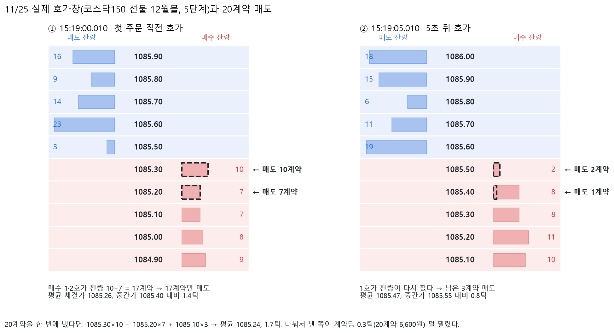
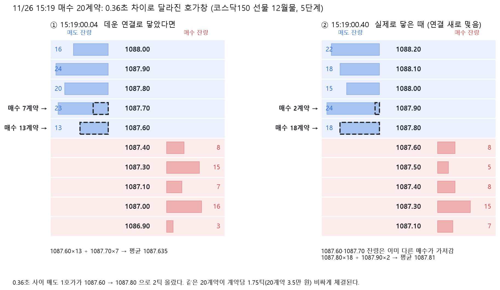
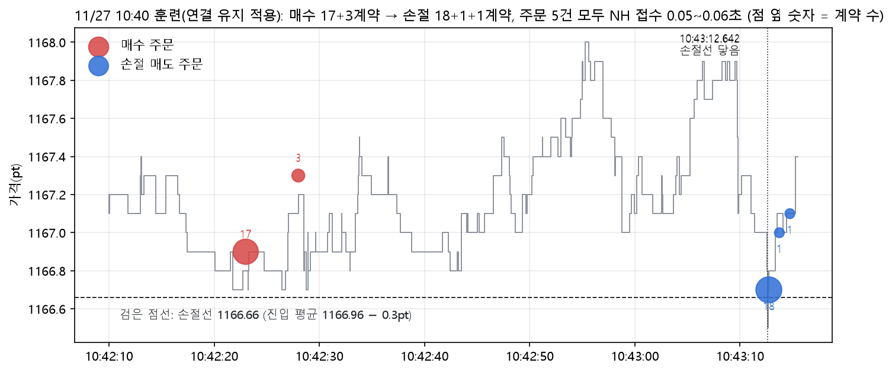
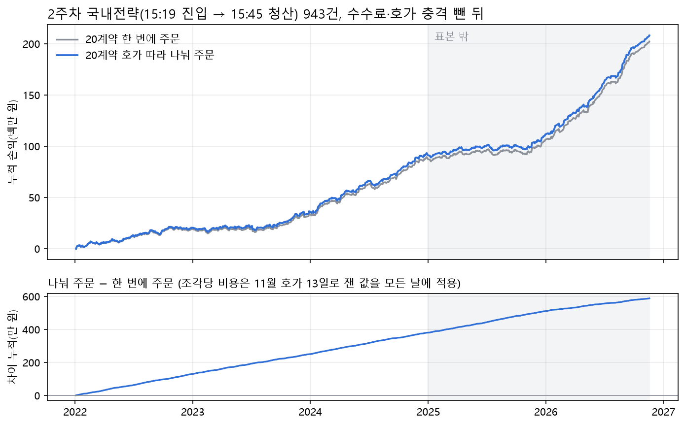
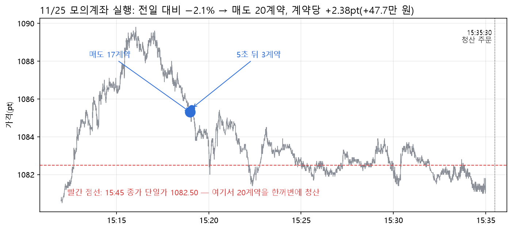
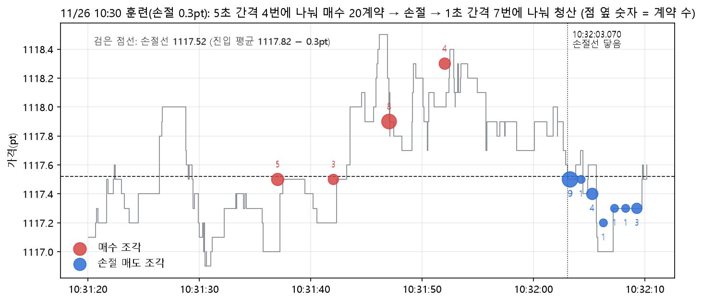
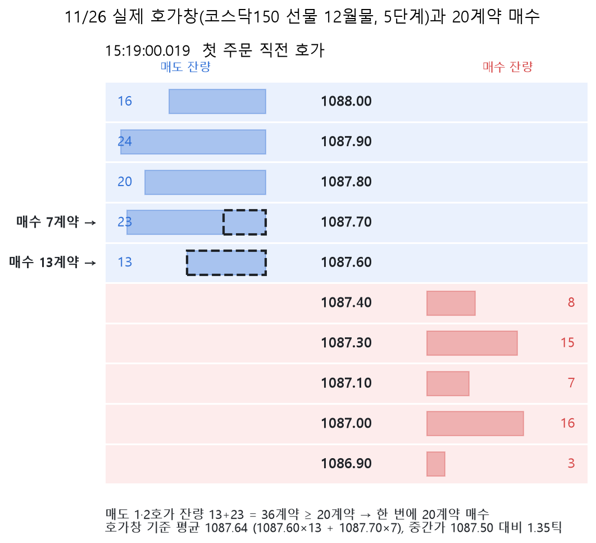
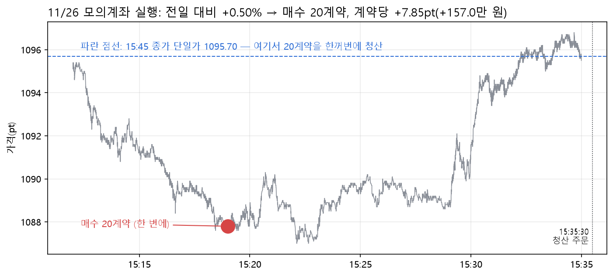

# 6주차 - 전략 + 위험관리: 2주차 국내전략을 20계약으로, 호가창을 보며 분할진입&주문 지연 완화 (코스닥150 선물)

> 실행 환경 한눈에
> - 6절 전·후 비교: [백테스트] — 2022-01~2026-11 1분봉 943건에, 11월 실제 호가 13일로 잰 호가 충격을 넣어 계산한 값입니다. 모의계좌 체결이 아닙니다.
> - 8절 작동 기록: [모의계좌 주문] 2026-11-25~27, 코스닥150 선물 근월물 20계약. 체결은 모의계좌 주문내역·잔고 기준입니다.
> - 모의서버는 시장가 주문을 실제 호가와 상관없이 그 자리에서 체결합니다. 그래서 20계약이 호가를 얼마나 밀었는지는, 주문을 낸 순간의 실제 호가창으로 계산한 **호가창 기준 체결가**로 따로 봅니다.
> - **모의계좌는 실제 시장보다 주문에 너그럽습니다. 실계좌에서는 이 보고서의 차이가 더 커질 수 있습니다(7절).**

| 항목 | 내용 |
| --- | --- |
| 전략 | 2주차 국내전략 「장 막판 모멘텀」 — 15:18:55 등락률이 0~3% 면 그 방향으로 15:19 시장가 진입, 15:45 종가 단일가 청산 |
| 대상 종목 | 코스닥150 선물 근월물(2026-12월물 `A066C000`). 1pt = 계약당 1만 원, 1틱 = 0.1pt = 1,000원 |
| 이번 주 바꾼 것 | 1계약 → 20계약. 15:19 에 가장 좋은 가격에 걸려 있는 수량은 보통 5.5계약(중앙값)이라, 20계약을 한 번에 내면 호가 여러 칸을 밀고 지나갑니다 |
| 위험관리 | ① 호가창을 보고 나눠서 진입·주문마다 감시·청산은 15:45 단일가 한 주문 ② NH 연결을 계속 유지해 주문 지연 완화 |
| 비용 | 수수료 편도 0.0098% + **호가 충격**(20계약이 호가를 밀어서 생기는 비용, 4절) |
| 모의계좌 | 예수금 1억 원, 주문가능수량 45계약(11/24 조회) |
| 작성일 | 2026-11-27 |

## 연구 배경

중간 발표(11/13) 때 팀장님께서 「호가 충격 같은 것도 고려해 보셨어요?」라고 물으셨습니다.

**호가 충격**은 내 주문 때문에 체결 가격이 불리해지는 것을 말합니다. 호가창의 각 가격에는 정해진 수량만 걸려 있습니다. 그래서 내 주문 수량이 가장 좋은 가격(1호가)에 걸린 수량보다 많으면, 남는 수량은 그다음 가격, 그다음 가격으로 넘어가며 체결됩니다. 살 때는 점점 비싸게, 팔 때는 점점 싸게 체결되는 것입니다. 1계약일 때는 거의 생기지 않지만, 주문이 커질수록 커지는 비용입니다(그림은 4-1절).

2주차 국내전략은 지금까지 1계약으로만 돌려서, 주문이 호가를 미는 일을 거의 신경 쓰지 않아도 됐습니다. 하지만 계약 수를 늘리면 이야기가 달라집니다. 그래서 이번 주에는 일부러 호가창에 걸린 수량보다 큰 20계약으로 키워, 호가 충격이 실제로 얼마나 되는지 재고 그것을 줄이는 주문 방식을 위험관리의 중심으로 삼았습니다.

## 폴더 구성

| 경로 | 내용 |
| --- | --- |
| `run_w06.py` | 이번 주 진입점 (`--mode paper-sim\|paper-order`, 훈련 `--drill now --drill-stop 0.3`) |
| `runner_w06.py` · `split_exec.py` | 나눠 주문하기: 주문마다 수량 계산, 주문마다 감시, 잔고 대사 |
| `live_w06.py` | 실시간 시세에 5단계 호가(KB)·주문 알림(O1_K) 구독을 더함 |
| `w06_record.py` | 15:45 종가 기준 손익과 실행 한 줄 기록 |
| `run.py` · `runner.py`(연결 유지 포함) · `live.py` · `strategy_core.py` · `contract.py` · `paper_fill.py` | 2주차 국내전략 실행 코드(판단·보유·단일가 청산·근월물 선택·종이 체결) |
| `strategy_w06.json` · `strategy.json` | 이번 주 설정(20계약, 나눠 내기·감시 기준) / 2주차 설정 |
| `charts.py` | 보고서 그림 |
| `nhapi/` | 팀 API 클라이언트(이 주차 시점 사본) |
| `tests/` | 단위 테스트 76개 (API 없이 동작) |
| `results/` | 모의 실행 기록(15:19 전략 `w06-*.jsonl`, 14:30 전략 `big1430-*.jsonl`, 마스킹), 같은 시간 시세(`ticks-*.jsonl`), 11/25·26 15:19 실제 호가(`book_*.jsonl`), 백테스트 거래별 손익(`backtest_trades_w06.csv`), 그림(`charts/`) |
| `screenshots/` | 그림 사본 `NN-이름.png` |

## 1. 과제 요약

| 공지 요구 | 이번 주 구현 | 근거 |
| --- | --- | --- |
| 분할 매수·매도 | 20계약을 호가창 잔량만큼씩 나눠 진입. 손절할 때도 같은 방식으로 나눠 청산 | 4-4절, `screenshots/01` |
| 손절선 | 2주차 그대로 진입가에서 10pt 불리하면 청산(5년에 3번 걸림) | 4-4절 |
| 보유 한도 | 한 번에 최대 20계약. 진입 직전에 계좌의 주문가능수량(증거금으로 낼 수 있는 계약 수, 11/25 기준 43계약)을 조회해서, 20보다 적으면 그만큼만 들어감 | `run_w06.py` |
| 실시간 모니터링 | 나눠 낸 주문 하나하나를 낼 때마다 시세가 끊기지 않았는지, 호가 간격, 밀린 정도, 실제 잔고를 확인. 이상하면 늦추거나 멈추고 경보 | 4-5절 |
| 주문 지연 | 주문 10초 전부터 2.5초마다 시세를 조회해 NH 연결을 계속 유지. 첫 주문이 NH 에 닿기까지 0.18~0.42초 → 약 0.06초 | 5절 |
| 위험관리 전·후 비교 | 같은 943건, 같은 비용으로 1계약 / 20계약 한 번에 / 20계약 나눠서. 연결 유지 전·후는 11/09~11/26 호가로 | 6절, 5-6절 |
| 실제 작동 기록 | 모의계좌 20계약 실행 로그·주문별 체결표·그림 | 8절 |

## 2. 실행 방법

이 폴더에서 실행합니다 (Python 3.11+).

```bash
pip install -r requirements.txt
python run_tests.py                     # 단위 테스트 (API 불필요)
python charts.py                        # 그림 → results/charts/, screenshots/
```

키 설정은 2주차와 같습니다. `config.example.yaml` 을 복사해 값을 채운 파일을 이 폴더 밖에 두고, 환경변수 `NHFUTURES_CONFIG` 로 경로를 지정합니다.

```bash
python run_w06.py --mode paper-sim                                               # 실시간 시세 + 종이 체결(주문 없음)
python run_w06.py --mode paper-order --confirm-orders                            # 모의계좌 본 실행(15:00 시작)
python run_w06.py --mode paper-order --confirm-orders --drill now --drill-stop 0.3   # 훈련(09:05~14:50)
```

훈련은 지금 시각을 기준으로 판단·진입·청산 시각을 옮기고 손절폭을 0.3pt로 줄여, 나눠 진입 → 손절 → 나눠 청산이 실제로 도는지 보는 실행입니다. 서버(Oracle 도쿄)의 cron 이 매일 14:55 에 본 실행을 시작합니다.

## 3. 전략

### 3-1. 15:19 전략 (2주차 국내전략, 이번 주 20계약)
- 15:18:55 에 현재가와 전 거래일 15:45 종가를 비교합니다. 등락률이 0~3% 사이면 그 방향으로 들어갑니다.
- 15:19:00 시장가 진입, 15:35:30 에 종가 단일가 청산 주문을 내서 15:45 에 체결됩니다.
- 2022~2026 1분봉 943건, 1계약 거래당 +1.19pt(비용 뒤). 다섯 해 모두 이익이었고, 11/9 부터 모의계좌 1계약으로 매일 돌리고 있습니다.
- 규칙은 2주차와 같습니다. 이번 주에 바꾼 것은 「20계약을 어떻게 사고파나」입니다.

### 3-2. 14:30 전략 (같은 기간 모의 운영, 1계약)
- 14:29 등락률이 ±3% 를 넘는 큰 날에만, 그 방향으로 14:30 시장가 진입 → 15:00 시장가 청산합니다.
- 진입가에서 10pt 불리하면 1초마다 보는 현재가로 바로 청산합니다(11/23 부터).
- 2022~2026 137건, 1계약 거래당 +2.18pt. 10pt 손절을 붙이면 +1.74pt 로 줄지만, 최대 낙폭이 −81.8pt → −57.3pt, 최악의 하루가 −26.4pt → −10.6pt 로 줄었습니다.
- 15:19 전략과 달리 청산이 연속매매 시간(15:00)이라, 계약 수를 늘리면 청산도 나눠야 합니다. 이번 주는 1계약으로만 돌립니다.


## 4. 위험관리 ①: 20계약을 나눠 사고팔기 (호가 충격 줄이기)

### 4-1. 20계약을 한 번에 내면 생기는 일


11/25 15:19:00 실제 호가창입니다. 위 파란 칸은 팔려는 주문(매도호가), 아래 빨간 칸은 사려는 주문(매수호가)입니다. **매수 1호가**는 사려는 주문 가운데 가장 높은 가격으로, 지금 시장가로 팔면 맨 먼저 체결되는 자리입니다(그림 ①의 1085.30). 그 바로 아래 1085.20 이 매수 2호가입니다. 마찬가지로 매도 1호가는 팔려는 주문 가운데 가장 낮은 가격(그림 ①의 1085.50)입니다. 숫자는 그 가격에 걸려 있는 계약 수(잔량)입니다.

이날 매수 1호가 1085.30 에는 10계약밖에 없었습니다. 20계약을 한 번에 팔면 1085.30 에 10계약, 1085.20 에 7계약, 1085.10 에 3계약이 체결되어 평균 1085.24 에 팔게 됩니다. 중간가 1085.40 보다 1.7틱 싸게 파는 셈입니다. 이것이 **호가 충격**입니다.

### 4-2. 빨리 팔면 밀리고, 늦게 팔면 놓친다 (Almgren–Chriss)
큰 주문에는 두 가지 비용이 서로 반대로 움직입니다.
- **빨리 낼수록** 호가를 많이 밀어 비싸게 사고 싸게 팝니다(충격 비용).
- **천천히 낼수록** 그사이 가격이 먼저 움직입니다. 이 전략은 15:19 직후 1분 동안 평균 2.39틱 진입 방향으로 가는데, 늦게 들어가면 그만큼을 놓칩니다. 0.2초만 늦어도 계약당 0.45틱을 잃었습니다.

Almgren·Chriss(2000)는 이 두 비용의 합이 가장 작아지는 주문 속도를 찾는 틀입니다. 이 전략의 숫자를 넣어 보았습니다.
- 1호가 잔량은 다른 참가자 주문으로 다시 찹니다. 11월 호가 13일에서 먹힌 잔량의 절반이 돌아오는 데 평균 2.78초가 걸렸습니다.
- 그래서 몇 초 간격으로 나눠 내면 다시 찬 호가를 쓸 수 있습니다. 대신 너무 오래 끌면 놓치는 몫이 커집니다.
- 나누는 방식 78가지를 호가 회복이 빠를 때·느릴 때, 가격이 빨리 갈 때·천천히 갈 때 등 12가지 상황에서 돌려, 가장 나쁜 상황에서도 손해가 가장 적은 방식을 골랐습니다.

### 4-3. 20계약 주문이 가격을 얼마나 미나 (Kyle λ 등 네 가지로 측정)
| 측정 방법 | 쉬운 설명 | 20계약 계약당 |
| --- | --- | --- |
| 호가창 쓸기 | 그 순간 호가창에서 20계약을 위에서부터 차례로 체결시켜 본 값(13일, 7,488번) | 1.89틱 (상위 10% 는 3.20틱) |
| Kyle λ | 사자 주문이 팔자보다 1계약 많을 때 가격이 평균 얼마나 움직이는지 1분 단위로 잰 값(Kyle 1985) × 20 | 0.61틱 (10초 단위로 재면 1.01틱) |
| 제곱근 법칙 | 「충격은 주문 크기의 제곱근에 비례한다」는 경험식(Almgren 외 2005, Tóth 외 2011)을 코스닥150 선물 자료로 맞춘 값 | 2.38틱 |
| 다른 참가자 주문 | 다른 참가자가 20~30계약을 한 번에 냈을 때 바로 뒤 가격 변화 | 2.43틱 |

- Kyle λ 가 작은 것은 1분 동안 다른 주문이 섞이고 민 가격 일부가 되돌아가기 때문입니다. 나머지 세 방법은 대략 2틱 안팎으로 맞습니다.
- 다른 참가자 주문 3,089건을 보면, 민 가격의 73% 가 5분 뒤에도 남았습니다. 나머지 27% 는 되돌아갑니다.
- 15:45 종가 단일가에서는 20계약이 그날 체결량의 0.19~0.44% 라서 미는 힘이 작습니다(0.5~0.7틱).

### 4-4. 규칙: 진입은 나눠서, 청산은 한 주문으로
| 순간 | 규칙 |
| --- | --- |
| 15:19:00 진입 | 그 순간 1·2호가 잔량만큼만 시장가로 냅니다. 남으면 5초 뒤 다시 호가를 보고 같은 방식으로 냅니다 |
| 두 번째 주문부터 | 앞 주문이 먹은 잔량 중 아직 안 돌아온 몫(반감기 2.78초)은 빼고 냅니다 |
| 15:19:00 직전 | 10초 전부터 NH 연결을 유지해, 첫 주문이 늦지 않게 닿게 합니다(5절) |
| 15:35:30 청산 | 20계약을 종가 단일가 주문 하나로 냅니다. 단일가는 체결량이 커서 나눌 필요가 없습니다 |
| 10pt 손절(2주차 그대로) | 걸리면 1·2호가 잔량씩 1초 간격으로 나눠 청산합니다. 5년 동안 3번 걸렸습니다 |

위 1번 그림이 실제 예입니다. 11/25 에는 1·2호가 잔량이 10+7 = 17계약이라 먼저 17계약을 팔았고, 5초 뒤 다시 찬 호가에 3계약을 팔았습니다.

### 4-5. 나눠 낸 주문마다 보는 것
| 확인 | 기준 | 넘으면 |
| --- | --- | --- |
| 시세가 살아 있나 | 마지막 체결이 5초 안 | 남은 주문을 내지 않음. 들고 있으면 REST 로 가격을 보고, 그것도 안 되면 청산 |
| 호가 간격이 넓지 않나 | 매도1호가 − 매수1호가 | 첫 주문은 6틱 이상이면 최대 1초 기다림. 다음 주문은 4틱 이상이면 최대 5초 기다리고, 그래도 넓으면 접음 |
| 얼마나 밀렸나 | 체결가 − 주문 직전 중간가 | 3틱을 넘으면 남은 주문을 작게·10초 간격으로. 5틱을 넘으면 멈추고 경보 |
| 주문이 들어갔나 | 거부·미체결 | 2번이면 멈추고 경보 |
| 실제로 몇 계약 들고 있나 | 주문마다 잔고 조회 | 예상과 다르면 더 내지 않고 경보(같은 주문을 두 번 내는 일 방지) |
| 너무 오래 끄나 | 첫 주문부터 30초 | 남은 주문을 접음 |

기준값은 15:15~15:35 매초 호가 기록에서 정했습니다. 예를 들어 6틱은 그 시간 호가 간격의 상위 1% 입니다.

### 4-6. 시험했다가 뺀 것
변동성에 맞춘 손절(2.5σ), 최근 5일 손실이 −190만 원이면 계약 수를 절반으로 줄이는 한도, 성과가 계속 기대보다 모자라면 계약 수를 줄이는 경보(CUSUM)도 시험했습니다. 변동성 손절과 경보는 표본 밖(2025~26)에서 최대 낙폭을 줄이지 못했고, 경보는 과거 두 번 울렸지만 두 번 다 잘못 울린 것이었습니다. 손실 한도는 표본 밖 최대 낙폭을 −571만 → −481만 원으로 줄였지만, 걸린 날이 적고 표본 안에서 정한 값 하나에 기대고 있어 과적합 위험이 큽니다. 그래서 셋 다 뺐습니다.

## 5. 위험관리 ②: 주문 지연 완화 (NH 연결을 계속 유지해 주문을 빠르게)

### 5-1. 무엇을 하나
이번 주 두 번째 위험관리는 **NH 와의 연결을 계속 유지해서, 주문이 정해진 시각에 최대한 빨리 NH 에 닿게 하는 것**입니다.

매매기는 Oracle 도쿄 서버에서 돌고, 주문은 인터넷(HTTPS)으로 NH 서버에 보냅니다. 주문을 보내려면 두 서버 사이에 통신 연결이 있어야 합니다. 연결을 처음 만들 때는 접속 확인(TCP)과 암호화·인증서 확인(TLS) 절차를 거치느라 도쿄와 NH 서버 사이를 여러 번 오가야 해서 시간이 걸립니다. 이미 만들어진 연결을 그대로 쓰면 이 절차 없이 주문만 보내면 되므로 빠릅니다.

매매기가 쓰는 통신 라이브러리(httpx)는 5초 동안 요청이 없으면 연결을 정리합니다(기본 설정). 15:19 전략은 15:00 에 계좌·종목 확인을 마친 뒤 약 19분 동안 NH 에 요청할 일이 없습니다(실시간 시세는 별도의 웹소켓으로 받음). 그래서 가장 중요한 15:19:00 첫 주문이 매번 연결을 처음부터 다시 만드는 데서 출발했습니다.

그래서 주문 10초 전부터 2.5초마다 현재가를 한 번씩 조회해 연결을 계속 유지합니다. 조회도 주문과 같은 연결을 쓰므로, 15:19:00 주문은 이미 만들어진 연결로 바로 나갑니다. 이 보고서에서는 이것을 **연결 유지**라고 부릅니다.

| 모의 주문 129건 (11/09~27) | 건수 | 서버 → NH 왕복 | NH 접수까지 |
| --- | --- | --- | --- |
| 5초 넘게 쉰 뒤 낸 주문 (연결을 새로 만듦) | 96 | 0.13~0.44초 (중앙값 0.22초) | 0.17~0.40초 |
| 5초 안에 이어서 낸 주문 (유지된 연결) | 33 | 약 0.10초 | 약 0.06초 |

NH 접수 시각은 주문내역의 접수 시각입니다(15:19 전략 주문만 남아 있음).

### 5-2. Oracle 도쿄 서버에서 주문하는 이유
매매기는 개인 노트북·PC 가 아니라 Oracle 클라우드 서버에서 돌아갑니다. 한국 리전은 가입이 되지 않아, 가장 가까운 도쿄 리전을 씁니다. 어디서 주문을 내느냐도 위험관리입니다. 기기가 꺼지거나 인터넷이 끊겨 주문이 아예 안 나가는 사고를 막는 것이 연결 유지보다 먼저입니다.

- 매일 같은 시각에 자동으로 돕니다. 개인 기기처럼 덮개를 닫거나 절전 모드에 들어가 멈추는 일이 없습니다.
- 서버 시계를 표준 시각에 맞춰 두어(오차 0.0001초대), 15:19:00 정각을 정확히 지킵니다.
- 정전, 가정 인터넷 끊김, 윈도우 업데이트 재시작 같은 개인 기기의 사고로 주문이 빠질 걱정이 없습니다.
- 호가·체결 기록도 같은 서버에서 매일 쌓여, 5-3·5-6절 같은 분석을 그날 바로 할 수 있습니다.

### 5-3. 늦게 닿으면 얼마나 잃나
늦게 닿으면 그사이 가격이 먼저 갑니다. 이 전략은 15:19 직후 가격이 진입 방향으로 움직이는 것을 노리므로, 늦을수록 손해입니다.



11/26 실제 호가창입니다. 같은 20계약 매수가 0.04초 뒤에 닿았다면 1087.60·1087.70 에서 평균 1087.635 에 체결됩니다. 실제로는 0.40초 뒤에 닿았는데, 그사이 다른 매수가 1087.60·1087.70 잔량을 먼저 가져가 평균 1087.81 이 됩니다. 계약당 1.75틱, **20계약이면 3.5만 원 차이입니다.**

서버에 쌓인 호가로, 15:19:00 에 낸 주문이 NH 에 늦게 닿을 때 평균 얼마나 손해인지도 재 보았습니다(9일, 진입 방향 기준).

| NH 에 닿는 때 | 진입 쪽 1호가가 불리하게 움직인 폭 | 20계약 한 번에 낸 평균가 (15:19:00 중간가 대비) |
| --- | --- | --- |
| 0.06초 뒤 (연결 유지) | 0.0틱 | 2.14틱 |
| 0.1초 뒤 | 0.1틱 | 2.22틱 |
| 0.2초 뒤 | 0.9틱 | 2.81틱 |
| 0.4초 뒤 | 0.9틱 | 2.76틱 |

- 20계약을 한 번에 낸다면, 0.2~0.4초 늦을 때 계약당 약 0.65틱, 한 번에 약 1.3만 원을 잃습니다. 이번 주처럼 나눠 낼 때는 이보다 작습니다(5-6절).
- 6절 백테스트는 15:19:00 호가로 계산했습니다. 연결 유지는 그 가정이 실제 주문에서도 지켜지게 하는 장치입니다.

15:19 전략의 지난 모의 진입 주문 8번입니다(모두 연결 유지를 넣기 전, 시장가). 1호가는 진입 쪽(매수면 매도 1호가, 매도면 매수 1호가)이고, 서버에 쌓인 그날 체결 기록으로 보았습니다.

| 날짜 | 수량 | 보낸 시각 | 쉰 시간 | 왕복 | 정각 → NH 접수 | 정각 1호가 → 접수 때 1호가 | 모의 체결가 |
| --- | --- | --- | --- | --- | --- | --- | --- |
| 11/09 매도 | 1 | 15:20:00.071 | 1,191초 | 0.37초 | 0.40초 | 1036.9 → 1036.8 (1틱 불리) | 1036.8 |
| 11/12 매도 | 1 | 15:19:00.010 | 1,139초 | 0.21초 | 0.18초 | 1153.9 → 1153.8 (1틱 불리) | 1153.7 |
| 11/13 매수 | 1 | 15:19:00.077 | 1,139초 | 0.29초 | 0.33초 | 1151.7 → 1151.9 (2틱 불리) | 1152.0 |
| 11/17 매도 | 1 | 15:19:00.085 | 1,139초 | 0.36초 | 0.41초 | 1068.2 → 1068.2 | 1068.1 |
| 11/18 매수 | 1 | 15:19:00.098 | 1,139초 | 0.34초 | 0.40초 | 1088.0 → 1088.1 (1틱 불리) | 1088.0 |
| 11/23 매도 | 1 | 15:19:00.015 | 1,139초 | 0.28초 | 0.26초 | 1046.9 → 1046.9 | 1046.9 |
| 11/25 매도 | 17 | 15:19:00.010 | 19초 | 0.22초 | 0.19초 | 1085.3 → 1085.3 | 1085.30 |
| 11/26 매수 | 20 | 15:19:00.019 | 1,139초 | 0.44초 | 0.42초 | 1087.6 → 1087.8 (2틱 불리) | 1087.80 |

- 11/09 는 진입 시각이 15:20 이던 때라 15:20:00 을 정각으로 잡았습니다.
- 「정각 → NH 접수」 0.18~0.42초는 두 가지가 합쳐진 값입니다. 보내는 시각이 0.01~0.10초 늦었고(기다리는 동안 0.2초·0.05초 간격으로 시계를 봐서), 연결을 다시 맺느라 0.17~0.40초가 더 걸렸습니다.
- 그사이 진입 쪽 1호가가 평균 0.9틱 불리하게 움직였고, 모의 체결가는 정각 1호가보다 평균 1.1틱 나빴습니다.
- 11/27 부터 둘 다 고쳤습니다. 기다리는 마지막 한 번은 남은 시간만큼만 자서 정각에 보내고, 10초 전부터 연결을 유지합니다. 기대값은 정각에 보내고 NH 접수까지 약 0.06초입니다.
- 15:19 전략은 15:18 등락이 0~3% 일 때만 들어갑니다. 11/27 은 +9.56% 라 쉬어서, 연결 유지를 넣은 뒤 15:19 진입 주문은 아직 없습니다. 연결 유지를 넣은 뒤의 첫 실제 전략 주문(14:30 전략)은 5-5절에 있습니다.

### 5-4. 규칙
| 언제 | 하는 일 |
| --- | --- |
| 주문 시각 10초 전부터 | 2.5초마다 현재가를 한 번 조회해 연결을 유지합니다 |
| 주문 시각 1초 안 | 조회하지 않습니다. 조회가 주문을 늦추지 않게 하려는 것입니다 |
| 나눠 낸 주문 사이(5초 간격) | 2.5초마다 조회합니다 |
| 보유 중(15:19~15:35) | 2.5초마다 조회합니다. 10pt 손절 주문도 바로 나가게 하려는 것입니다 |
| 조회가 실패하면 | 기록만 남기고 매매는 그대로 갑니다 |

- 시세 조회 한도(초당 10회)는 주문 한도(초당 5회)와 따로라 서로 방해하지 않습니다.
- 14:30 전략에도 같은 규칙을 넣었습니다.

### 5-5. 모의 주문으로 확인 (11/27 오전)
1계약 시장가 6건을 같은 시간대에 번갈아 냈습니다(10:39~10:40). 「기존 방식」은 8초 동안 통신 없이 있다가 바로 주문, 「연결 유지」는 6.5초 쉬고 현재가를 한 번 조회한 뒤 1.5초 뒤 주문입니다.

| 조건 | 건수 | 왕복 | NH 접수까지 |
| --- | --- | --- | --- |
| 기존 방식 | 3 (매수 2, 매도 1) | 0.21~0.22초 | 0.17~0.18초 |
| 연결 유지 | 3 (매수 1, 매도 2) | 약 0.10초 | 0.055~0.058초 |

이어서 실제 매매 코드(`run_w06.py`)로 20계약 훈련을 돌렸습니다(10:40~10:43, 손절 0.3pt, 서버 cron 과 같은 환경, 기록 `results/w06-drill-paper-order-20261127-104048.jsonl`).

| 주문 | 보낸 시각 | 수량 | 왕복 | NH 접수까지 |
| --- | --- | --- | --- | --- |
| 진입 1 | 10:42:23.000 | 17 | 0.096초 | 0.053초 |
| 진입 2 | 10:42:28.000 | 3 | 0.096초 | 0.055초 |
| 손절 1 | 10:43:12.739 | 18 | 0.096초 | 0.051초 |
| 손절 2 | 10:43:13.739 | 1 | 0.095초 | 0.051초 |
| 손절 3 | 10:43:14.739 | 1 | 0.100초 | 0.057초 |



- 첫 진입 주문이 정각(10:42:23.000)에 나갔습니다. 직전 연결 유지 조회 2.3초 뒤였습니다. 연결 유지를 넣기 전 같은 훈련(11/25·26)에서는 첫 주문이 정각보다 0.011~0.043초 늦게 나갔고, NH 접수까지 0.17초였습니다.
- 연결 유지 조회 실패는 없었고, 끝날 때 잔고 0 을 확인했습니다. 모의 체결 시각은 모두 NH 접수와 같은 순간이었습니다.
- 정리하면 연결을 유지하면 주문 한 건당 NH 접수가 약 0.12초 빨라집니다. 15:19 진입은 늦게 보내던 몫까지 합쳐 0.18~0.42초 걸리던 것이 약 0.06초가 됩니다.

**연결 유지를 넣은 뒤 첫 실제 전략 주문 (11/27 14:30 전략, 1계약)**

15:19 전략은 11/27 15:18:55 등락이 +9.56% 로 3% 를 넘어 규칙대로 쉬었습니다. 그래서 연결 유지를 넣은 뒤 처음 나간 실제 전략 주문은 14:30 전략 주문입니다.

| 주문 | 보낸 시각 | 왕복 | NH 접수 (정각부터) | 모의 체결가 |
| --- | --- | --- | --- | --- |
| 14:30 진입 매수 | 14:30:00.000 | 0.110초 | 14:30:00.068 (0.068초) | 1199.5 |
| 15:00 청산 매도 | 15:00:00.101 | 0.099초 | 15:00:00.157 (0.157초) | 1204.6 |

- 두 주문 모두 유지된 연결로 나가, 보낸 뒤 NH 접수까지 0.06초 안팎이었습니다. 이전 15:00 청산(11/16 0.21초, 11/20 0.28초 왕복)보다 빨랐습니다.
- 다만 15:00 청산은 주문 직전에 잔고를 한 번 조회하느라 0.1초 늦게 나갔습니다(15:00:00.101). 정각의 매수 1호가는 1205.1 이었는데, 15:00 정각에 주문이 몰리며 0.16초 사이 1204.7 까지 내려가, 1204.6 에 팔렸습니다(정각 대비 5틱). 연결이 유지돼 있어도 주문 앞에 다른 조회를 끼우면 늦는다는 것을 보여 준 사례입니다.
- 같은 날 고쳤습니다(11/27 16:06 서버 반영). 청산할 수량(잔고)은 14:59:59 에 미리 읽고, 15:00:00.000 에는 주문만 냅니다. 손절로 이미 잔고가 0 이면 주문을 내지 않는 것과, 청산 뒤 15:00:20 잔고 0 확인은 그대로입니다. 잔고 조회가 0.1초씩 걸리게 만든 시험에서 청산 주문이 정각 0.005초 안에 나가는 것을 확인했고, 실제 측정은 다음 14:30 전략 매매일에 나옵니다.
- 15:19 전략도 점검했습니다. 정해진 시각에 나가는 주문(15:19 진입, 나눠 낸 다음 주문, 15:35:30 종가 단일가 청산) 앞에는 네트워크 조회가 없습니다. 주문 직전에 보는 호가는 실시간으로 받아 둔 값을 메모리에서 읽습니다. 10pt 손절 주문 앞에는 이중 청산을 막는 잔고 조회(약 0.1초)가 남아 있습니다.

15:19·14:30 전략의 지난 모의 주문을 주문 종류별로 모으면 다음과 같습니다. 단일가 주문은 정해진 시각에 한꺼번에 체결되므로 지연이 체결가에 영향을 주지 않습니다.

| 주문 | 시각 | 쉰 시간 | 걸린 시간(왕복) | 체결가에 영향 |
| --- | --- | --- | --- | --- |
| 15:19 전략 진입 (8번) | 15:19:00 | 약 1,139초 | 0.21~0.44초, NH 접수 0.17~0.40초 | 있음. 1호가 평균 0.9틱 불리 |
| 15:19 전략 나눠 낸 둘째 주문부터 | 5초 간격 | 4.4~4.7초 | 약 0.10초 | 있음. 체결 뒤 잔고 조회가 있어 5초가 지나기 전에 다음 주문이 나가 빨랐음 |
| 15:19 전략 손절 (훈련 11/25·26) | 1초 간격 | 0~0.7초 | 약 0.10초 (10건 중 1건 0.21초) | 있음 |
| 15:19 전략 15:35:30 청산 (8번) | 15:35:30 | 0.2~0.9초 | 0.09~0.11초 | 없음(15:45 단일가). 단일가 동안 1초마다 REST 로 가격을 조회해서 빨랐음 |
| 14:30 전략 진입 (3번) | 14:30:00 | 약 1.6초 | 0.09~0.10초 | 있음. 직전 14:29:58 판단 조회 덕에 빨랐음 |
| 14:30 전략 15:00 청산 (3번) | 15:00:00 | 약 1,800초 | 0.21초·0.28초 (11/24 는 손절 감시 중이라 0.10초) | 있음. 15:00 전후 0.2~0.4초 사이 중간가가 평균 1.4~1.9틱 움직임(15일) |

빨랐던 주문은 모두 바로 앞에 다른 조회가 있어 우연히 연결이 유지되던 경우입니다. 연결 유지는 이것을 우연이 아니라 규칙으로 만드는 장치입니다.

### 5-6. 11/09~11/26 손익으로 다시 계산하면
11/09 부터 서버에 쌓인 호가로, 같은 날 같은 규칙을 「기존 방식」과 「연결 유지」로 두 번 돌려 보았습니다. 다른 것은 모두 같고, 첫 주문이 NH 에 닿는 때만 다릅니다.
- 기존 방식: 모의 주문이 있던 날은 그날 실제 값(0.18~0.42초), 없던 날은 실제 8번 평균 0.32초.
- 연결 유지: 0.06초.
- 체결가는 그 순간 호가창을 위에서부터 쓸어 낸 평균가입니다. 청산은 15:45 종가이고, 수수료를 뺐습니다. 10pt 손절은 9일 모두 닿지 않았습니다(가장 크게 거슬러 간 폭 1.8pt).

| 15:19 전략 20계약 (9일) | 기존 방식 | 연결 유지 | 차이 |
| --- | --- | --- | --- |
| 호가 따라 나눠 진입 (이번 주 규칙) | 935.5만 원 | 936.2만 원 | +0.7만 원 |
| 20계약 한 번에 진입 (비교용) | 935.7만 원 | 943.9만 원 | +8.2만 원 |

| 날짜 | 11/09 | 11/12 | 11/13 | 11/17 | 11/18 | 11/19 | 11/23 | 11/25 | 11/26 |
| --- | --- | --- | --- | --- | --- | --- | --- | --- | --- |
| 나눠 진입: 유지 − 기존 | +1.7만 | −3.0만 | −2.3만 | +0.3만 | +0.7만 | 0 | 0 | −0.2만 | +3.5만 |
| 한 번에: 유지 − 기존 | +1.6만 | +0.7만 | +0.2만 | +1.0만 | +0.8만 | 0 | 0 | +0.4만 | +3.5만 |

- 한 번에 낼 때는 9일 모두 연결을 유지한 쪽이 같거나 나았습니다. 평균 거래당 약 9,100원입니다.
- 나눠 낼 때는 9일 합계 차이가 +0.7만 원으로 거의 없습니다. 첫 주문은 1·2호가 잔량만큼만 내니 늦어서 손해 보는 계약 수가 적고, 남은 수량은 5초 뒤 주문으로 가기 때문입니다. 11/12·11/13 은 연결을 유지한 쪽이 더 얕은 호가를 만나 더 많은 수량이 5초 뒤 주문으로 넘어갔고, 그사이 가격이 진입 방향으로 가서 오히려 손해였습니다. 연결 유지 탓이라기보다 나눠 내는 규칙의 흔들림입니다.
- 14:30 전략(1계약, 모의 주문이 있던 3일)은 기존 방식 13.4만 원, 연결 유지 13.3만 원입니다. 15:00 청산 체결가가 11/16 하루만 1틱 달랐습니다.
- 정리하면 모의계좌와 기록된 호가로는, 나눠 내는 이번 주 규칙에서 연결 유지가 손익을 크게 바꾸지 않았습니다. 그래도 비용이 없는 조회 몇 번이고, 손절처럼 한 번에 많이 내야 하는 순간에 늦지 않게 해 주므로 규칙으로 둡니다. 9일뿐이라, 12/11 기말 발표까지 쌓이는 날로 다시 재겠습니다.
- **이 비교는 모의계좌 기준입니다. 실계좌에서는 차이가 더 커질 수 있습니다. 이유는 7절에 따로 정리했습니다.**

## 6. 위험관리 전·후 (백테스트, 같은 943건·같은 비용)


비용: 수수료 + 11월 호가 13일로 잰 호가 충격. 금액은 만 원.

| | 표본 안 2022~24 (610건)<br>합계 / 샤프 / 최대 낙폭 / 최악의 하루 | 표본 밖 2025~26 (333건)<br>합계 / 샤프 / 최대 낙폭 / 최악의 하루 |
| --- | --- | --- |
| 1계약 (2주차 그대로) | 520 / 3.60 / −24 / −14 | 614 / 5.35 / −27 / −12 |
| 20계약 한 번에 주문 | 8,753 / 3.03 / −549 / −278 | 11,469 / 5.01 / −569 / −234 |
| **20계약 호가 따라 나눠 주문 (이번 주)** | **9,133 / 3.16 / −508 / −277** | **11,677 / 5.10 / −560 / −233** |

샤프는 1년 기준 「수익 ÷ 흔들림」으로, 클수록 좋습니다.

- 20계약으로 키우면 호가 충격 때문에 1계약 × 20 보다 덜 법니다. 나눠 주문하면 그 손해를 일부 되찾아, 943건 전체에서 588만 원(거래당 약 6,200원), 표본 밖에서 208만 원 더 벌었습니다.
- 다만 이 차이는 작고 가정에 민감합니다. 15:19 직후 다른 참가자 주문이 몰려 가격이 더 빨리 움직인다고 가정하면 나눠 내는 쪽이 오히려 190만 원 덜 법니다(표본 밖). 첫 주문을 0.2초 늦게 보내면, 나눠서 얻는 이득보다 늦어서 잃는 몫이 더 큽니다. 그래서 **나누는 것보다 첫 주문이 15:19:00 에 늦지 않게 NH 에 닿는 게 더 중요합니다**. 보내는 시각은 정확했지만(지연 11/25 10ms, 11/26 19ms), 연결을 다시 맺느라 NH 접수까지 0.18초·0.40초가 더 걸렸습니다. 이것을 줄이는 규칙이 5절입니다.
- 충격을 가장 비관적으로 잡아도(단일가 청산 충격 2.21틱) 표본 밖 합계는 나눠서 10,226만 원, 한 번에 10,018만 원으로 순서가 같습니다.

## 7. 실계좌에서는 이 차이가 더 커질 수 있습니다

> **5·6절의 숫자는 모의계좌와 기록된 호가로 계산한 값입니다. 모의계좌는 실제 시장보다 주문에 너그럽습니다. 실제 계좌로 실시간 매매를 하면, 주문을 나눠 내고 연결을 계속 유지하는 것과 그렇지 않은 것의 손익 차이가 이 보고서의 숫자보다 더 커질 수 있습니다.**

| | 모의계좌 | 실제 계좌 |
| --- | --- | --- |
| 내 주문이 호가를 먹나 | 아니요. 20계약을 사도 호가창이 그대로입니다 | 예. 1호가 잔량이 실제로 줄고, 남는 수량은 다음 호가로 밀립니다 |
| 다른 참가자 | 내 주문에 반응하지 않습니다 | 잔량이 빠지는 것을 보고 같은 방향 주문이 따라붙거나, 걸어 둔 호가를 거둬 갑니다 |
| 체결되는 때 | NH 가 접수한 순간 바로 체결됩니다 | NH 에서 거래소까지 가는 시간이 더해집니다 |
| 15:35:30 종가 단일가 주문 | 15:35:30 에 바로 체결됩니다 | 15:45 단일가로 체결됩니다 |

- **호가 충격:** 모의계좌에서는 20계약을 한 번에 내도 손해가 보이지 않습니다. 실제로는 4-1절처럼 2·3호가까지 밀고 들어가고, 민 가격의 73% 가 5분 뒤에도 남습니다(4-3절). 이 보고서의 충격 값은 다른 참가자 주문에서 빌려 온 값이라, 내 주문을 본 다른 참가자의 반응까지는 다 담지 못합니다.
- **주문 지연:** 실계좌에서는 거래소까지 가는 시간이 더해져 늦게 닿는 몫이 더 커집니다. 15:19 직후는 0.2~0.4초 사이에도 진입 쪽 1호가가 평균 0.9틱 불리하게 움직이는 때라(5-3절), 연결 유지로 줄인 0.12초의 값어치가 모의계좌보다 큽니다.
- 그래서 두 규칙은 모의계좌에서 손익 차이가 작게 나오더라도, 실계좌로 가기 전에 반드시 갖춰야 할 장치로 둡니다. 실계좌로 옮길 때는 작은 계약 수로 실제 충격과 지연을 먼저 재겠습니다.

## 8. 모의계좌 실행 기록 (11/25~27)

| 날짜 | 실행 | 기록 |
| --- | --- | --- |
| 11/25 | 15:19 본 실행, 매도 20계약 | `results/w06-a20-paper-order-20261125-145502.jsonl` |
| 11/26 | 10:30 훈련(손절 0.3pt), 매수 20계약 → 손절 | `results/w06-drill-paper-order-20261126-103002.jsonl` |
| 11/26 | 15:19 본 실행, 매수 20계약 | `results/w06-a20-paper-order-20261126-145502.jsonl` |
| 11/27 | 10:40 훈련(손절 0.3pt), 연결 유지 확인. 매수 17+3계약 → 손절 18+1+1계약 | `results/w06-drill-paper-order-20261127-104048.jsonl` (5-5절)
| 11/27 | 15:19 본 실행: 15:18:55 등락 +9.56% 로 3% 를 넘어 규칙대로 쉼(주문 없음, 끝날 때 잔고 0) | `results/w06-a20-paper-order-20261127-145502.jsonl` |

### 11/25 15:19 본 실행: 매도 20계약 (전 거래일 대비 −2.12%)


| 주문 | 보낸 시각 | 지연 | 호가 간격 | 1·2호가 잔량 | 수량 | 모의계좌 체결가 | 호가창 기준 체결가 | 호가 충격 |
| --- | --- | --- | --- | --- | --- | --- | --- | --- |
| 진입 1 | 15:19:00.010 | 10ms | 2틱 | 17 | 17 | 1085.30 | 1085.26 | 1.41틱 |
| 진입 2 | 15:19:05.010 | 0ms | 1틱 | 10 | 3 | 1085.50 | 1085.47 | 0.83틱 |
| 청산 | 15:35:30.024 | — | — | — | 20 | 1081.60 | 15:45 종가 1082.50 | — |

- 진입 호가 충격은 수량 가중 1.32틱으로, 한 번에 냈을 때(1.65틱)보다 계약당 0.33틱(20계약 6,600원) 적었습니다.
- 모의서버는 15:35:30 단일가 주문을 바로 1081.60 에 체결했습니다. 실제 규칙대로라면 15:45 종가 1082.50 에 체결되므로, 손익은 15:45 종가로 다시 계산합니다(오류 제보 R03, 10절).
- 주문마다 잔고를 확인했고 어긋남·거부는 없었습니다. 끝날 때 잔고 0 을 확인했습니다.
- 15:35:04 「체결 시세 5초 없음」 경보는 연속매매가 끝나 체결이 멈춘 것입니다. 정해진 대로 REST 가격 감시로 넘어갔습니다.
- 이날은 아직 변동성 손절(15.5pt)을 쓰던 때였고, 손절선에 닿지 않았습니다. 11/26 부터 2주차의 10pt 손절로 바꿨습니다.

| 손익 | 계약당 | 20계약 |
| --- | --- | --- |
| 규칙대로(15:45 종가 청산, 호가창 기준 진입가, 수수료 뒤) | +2.58pt | +51.6만 원 |
| 모의계좌(실제 체결가, 수수료 42,471원 뒤) | +3.52pt | +70.4만 원 |

### 11/26 10:30 훈련: 나눠 매수 → 0.3pt 손절 → 나눠 청산


손절이 실제로 걸리도록 손절폭을 0.3pt 로 줄여 돌린 실행입니다(`--drill now --drill-stop 0.3`). 나눠 진입 → 손절 → 나눠 청산이 모의계좌에서 끝까지 도는지 보려는 것이라, 손익은 성과에 넣지 않습니다.

| 주문 | 보낸 시각 | 지연 | 호가 간격 | 1·2호가 잔량 | 수량 | 모의계좌 체결가 | 호가창 기준 체결가 | 호가 충격 |
| --- | --- | --- | --- | --- | --- | --- | --- | --- |
| 진입 1 | 10:31:37.043 | 43ms | 2틱 | 5 | 5 | 1117.50 | 1117.38 | 1.80틱 |
| 진입 2 | 10:31:42.043 | 0ms | 2틱 | 5 | 3 | 1117.50 | 1117.47 | 1.67틱 |
| 진입 3 | 10:31:47.043 | 0ms | 3틱 | 10 | 8 | 1117.90 | 1118.34 | 1.88틱 |
| 진입 4 | 10:31:52.044 | 0ms | 2틱 | 9 | 4 | 1118.30 | 1118.30 | 1.00틱 |
| 손절 1 | 10:32:03.283 | 213ms | 3틱 | 9 | 9 | 1117.50 | 1117.33 | 2.17틱 |
| 손절 2 | 10:32:04.283 | 0ms | 2틱 | 5 | 1 | 1117.50 | 1117.60 | 1.00틱 |
| 손절 3 | 10:32:05.284 | 0ms | 2틱 | 11 | 4 | 1117.40 | 1117.40 | 1.00틱 |
| 손절 4 | 10:32:06.284 | 0ms | 3틱 | 7 | 1 | 1117.20 | 1117.10 | 1.50틱 |
| 손절 5 | 10:32:07.284 | 0ms | 2틱 | 9 | 1 | 1117.30 | 1117.20 | 1.00틱 |
| 손절 6 | 10:32:08.284 | 0ms | 2틱 | 7 | 1 | 1117.30 | 1117.30 | 1.00틱 |
| 손절 7 | 10:32:09.286 | 2ms | 2틱 | 9 | 3 | 1117.30 | 1117.30 | 1.00틱 |

- 첫 주문 때 매도 1·2호가 잔량이 5계약뿐이라, 20계약을 5초 간격 4번(5·3·8·4계약)에 나눠 샀습니다. 진입 평균은 모의계좌 1117.82, 호가창 기준 1117.96(호가 충격 수량 가중 1.65틱)입니다.
- 10:32:03.070 현재가 1117.50 이 손절선 1117.52(진입 평균 − 0.3pt)에 닿았고, 0.21초 뒤 첫 손절 주문을 냈습니다(표의 손절 1 지연은 이 시각부터 잰 값). 이후 1초 간격으로 1·2호가 잔량만큼씩 냈습니다. 앞 주문이 먹은 잔량이 아직 돌아오지 않은 몫을 빼서, 잔량이 얕을 때는 1계약씩만 냈습니다. 7번(9·1·4·1·1·1·3계약)에 걸쳐 10:32:09 에 20계약을 모두 청산했습니다.
- 청산 평균은 모의계좌 1117.415, 호가창 기준 1117.335(호가 충격 1.55틱)입니다.
- 주문 11건 모두 주문내역에서 체결을 확인했고, 거부·어긋남 없이 끝날 때 잔고 0 을 확인했습니다.
- 손익: 모의계좌 계약당 −0.62pt(20계약 −12.5만 원, 수수료 43,810원 포함), 호가창 기준 계약당 −0.84pt(20계약 −16.9만 원).

### 11/26 15:19 본 실행: 매수 20계약 (전 거래일 대비 +0.50%)




| 주문 | 보낸 시각 | 지연 | 호가 간격 | 1·2호가 잔량 | 수량 | 모의계좌 체결가 | 호가창 기준 체결가 | 호가 충격 |
| --- | --- | --- | --- | --- | --- | --- | --- | --- |
| 진입 1 | 15:19:00.019 | 19ms | 2틱 | 36 | 20 | 1087.80 | 1087.64 | 1.35틱 |
| 청산 | 15:35:30.022 | — | — | — | 20 | 1095.60 | 15:45 종가 1095.70 | — |

- 15:18:55 현재가 1087.90 이 전 거래일 15:45 종가 1082.50 보다 +0.50% 라 매수했습니다.
- 매도 1·2호가 잔량이 13+23 = 36계약으로 20계약보다 많아, 나누지 않고 한 번에 20계약을 냈습니다. 호가창으로 계산하면 1087.60 에 13계약, 1087.70 에 7계약이 체결되어 평균 1087.64, 중간가 1087.50 대비 1.35틱입니다.
- 주문은 15:19:00.019 에 보냈지만 연결을 다시 맺느라 NH 접수는 15:19:00.419 였습니다. 그 0.40초 사이 매도 1호가가 1087.60 → 1087.80 으로 올라, 모의서버는 1087.80 에 체결했습니다. 이 일을 보고 5절 연결 유지를 넣었습니다.
- 이날부터 2주차의 10pt 손절(손절선 1077.80)을 썼습니다. 진입 뒤 가장 낮은 가격이 1087.00(15:22:07)이라 닿지 않았습니다.
- 모의서버는 15:35:30 단일가 주문을 바로 1095.60 에 체결했습니다. 손익은 실제 규칙대로 15:45 종가 1095.70 으로 다시 계산합니다.
- 주문마다 잔고를 확인했고 어긋남·거부는 없었습니다. 끝날 때 잔고 0 을 확인했습니다.
- 15:35:04 「체결 시세 5초 없음」 경보는 11/25 와 같이 연속매매가 끝나 체결이 멈춘 것입니다. 정해진 대로 REST 가격 감시로 넘어갔습니다.

| 손익 | 계약당 | 20계약 |
| --- | --- | --- |
| 규칙대로(15:45 종가 청산, 호가창 기준 진입가, 수수료 뒤) | +7.85pt | +157.0만 원 |
| 모의계좌(실제 체결가, 수수료 42,795원 뒤) | +7.59pt | +151.7만 원 |

### 14:30 전략 (1계약)
모의계좌 실행 기록(주문·주문내역 체결·잔고): `results/big1430-날짜.jsonl` (11/20·24·25·26·27).

| 날짜 | 방향 | 결과 |
| --- | --- | --- |
| 11/20 | 매도(−6.8%) | 15:00 청산, +4.89pt |
| 11/24 | 매수(+6.5%) | 15:00 청산, −0.02pt. 손절선(1099.4) 안 닿음 |
| 11/25 | — | 14:29 등락 −2.7%, 3% 미만이라 쉼 |
| 11/26 | — | 14:29 등락 +2.7%, 3% 미만이라 쉼 |
| 11/27 | 매수(+9.5%) | 15:00 청산, +4.86pt(모의 체결 1199.5 → 1204.6, 수수료 뒤). 손절선(1189.5) 안 닿음. 연결 유지를 넣은 첫날(5-5절) |

## 9. 해석과 한계
- 이번 주 위험관리는 수익을 늘리는 장치가 아니라, 20계약으로 키울 때 생기는 호가 충격을 줄이고 주문 사고를 막는 장치입니다. 백테스트상 이득은 거래당 약 6,200원으로 작습니다.
- 호가 충격은 11월 13일치 호가로만 쟀고, 그 값을 2022~2026 전체에 똑같이 썼습니다. 11월은 변동성이 5년 평균의 1.8배인 추세장이었습니다. 호가는 서버에서 매일 계속 기록하고 있으니, 12/11 기말 발표까지 쌓인 호가로 충격과 나누는 방식을 다시 재서 보고하겠습니다.
- 모의서버는 실제 호가를 움직이지 않고 접수 순간 바로 체결합니다. 그래서 이 매매기 주문의 충격과 지연 손해는 실측이 아니라, 다른 참가자 주문과 기록된 호가로 추정한 값입니다(7절).
- 나누는 방식은 78가지 중 고른 것이라, 고른 것 자체가 과적합일 수 있습니다. 그래서 「가장 나쁜 상황에서 손해가 가장 적은」 기준으로 골랐습니다.

## 10. 오류 제보 (R01~R03)

이번 주 매매기를 돌리며 찾은 NH 모의 API 오류 세 건입니다. 저장소 맨 위 [`error_reports/`](../error_reports/)에 제보문과 재현 자료를 두었습니다. 재현은 NH 서버를 부르지 않고 저장된 기록만 읽습니다: `py -3.12 -B reproduce_R번호.zip --output 결과.json`

| 번호 | 오류 | 검사 | 매매기에 준 영향 |
| --- | --- | --- | --- |
| [R01](../error_reports/R01_장전단일가_시장가거부/) | 11/24 08:30:20~08:33:57 모의 시장가 38건이 '호가접수 개시 전'으로 거부됐습니다. 실제 거래소는 08:30:00 부터 호가가 있었습니다. 신규주문 응답에는 거부가 안 보이고 주문내역에만 보입니다 | 8/8 | 주문 응답만 믿지 않고, 주문마다 주문내역과 잔고로 다시 확인합니다 |
| [R02](../error_reports/R02_실시간체결_메시지누락/) | 국내 실시간 체결(KA)에서 체결의 약 2.5% 가 메시지로 오지 않습니다(11/25 3,786건, 2.59%). 같은 연결의 누적값에는 들어 있습니다 | 10/10 | 손절선 감시는 체결 메시지 현재가를 쓰므로, 빠진 체결만큼 늦게 볼 수 있습니다(다음 체결에서 따라잡음) |
| [R03](../error_reports/R03_종가단일가_즉시체결/) | 15:35~15:45 장 마감 단일가 시간에 낸 모의 시장가 주문 8건이 15:45 를 기다리지 않고 접수 순간 체결됐습니다. 같은 시각 실제 거래소는 체결 0건, 15:45:00 에 한 번에 체결. 모의 체결가는 실제 종가와 8일 모두 달랐습니다(평균 0.34pt, 최대 0.9pt) | 5/5 | 모의 손익을 실제 규칙대로 15:45 종가로 다시 계산해 따로 적습니다(`w06_record.py`, 8절 손익 표) |
